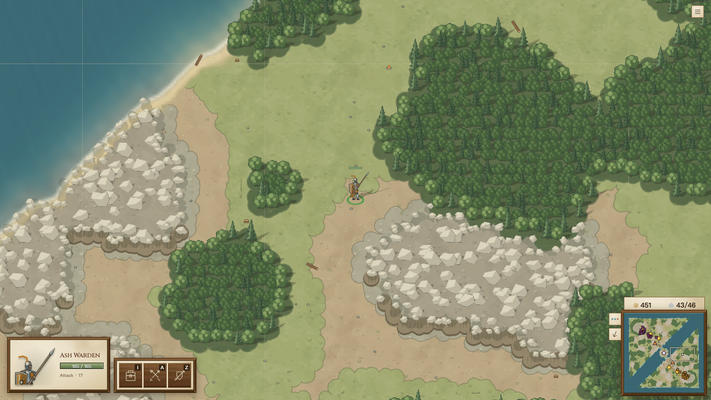
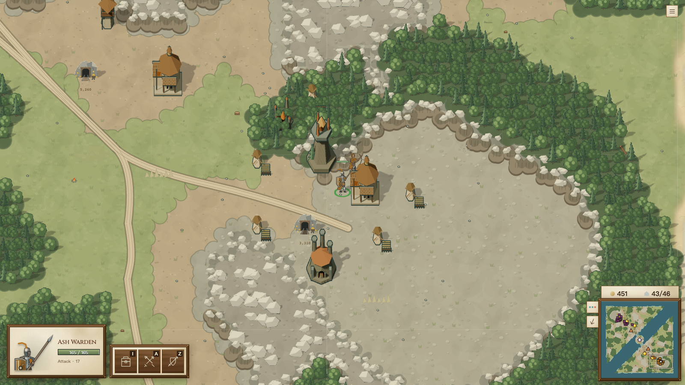

# Loot 回程振荡：flow field 的 lookahead 交接（2026-10-18）

**最终决定：#523 关闭、不合并，分支和报告保留。当前 main 的长振荡收益无法量出，两组 seed 的己方 stall 都明显增加，并有额外性能开销；本轮停止。** [不合并理由与重启条件](loot-return-steering-not-merged.md)。

PR [#523](https://github.com/shuxueshuxue/sketch-rts/pull/523)，基于 main `710986b1`。最终生产修法为 `76303b36`：只对实际返回的、可直视且跨出起始 field 的捷径，仅在首格场值不下降且进入后原 lookahead 立即朝反方向时拒绝捷径，回退到短 lookahead 或真实的第一步；单 field 与正常跨 field 捷径保留。它修复玩家和 AI 共用的移动；不改 lootRecovery 的准入、回收范围、任务重发或 AI 阈值。

## 原因和复现

历史 `41c9c208` 的 `v9_archer` 对 v9、ladder-18 ember，布局种子 `v9_archer-layout:v5-final-1:ladder-18:2`。tick **8440**，`unit-v9_archer-ashWarden-2010` 从 `(4850.353126777915,3436.36777240924)` 执行唯一的 `move(5232,5232,avoidCombat:true)` 回主厅。

`terrain.ts:walkAhead` 原来把当前 sector 出口的 field 和下一 sector 的 field 拼成最多 16 格的路径。路径先向北绕到东侧，再向南跨 sector，下一 field 又向西弯；16 格末端 `(4848,3568)` 从当前位置直线可见，但直线首先向南进入当前 field 的上坡格。越过 y=3456 后下一次 steering 又指向北方 `(4880,3376)`，于是每 tick 折返。路线图上的路径存在，连续位置执行的捷径却没有遵守 field 的交接顺序。

保留地形、资源和建筑 footprint，去掉其他初始单位、关闭 AI，不再下任何命令，main 的这个单位仍振荡。因此不是敌军挡路、目标不可达、loot 任务反复派遣或到达半径的问题。[回归快照](../../src/shared/test-fixtures/loot-return-ladder-18-8440.json)保留复现所需状态；[测试](../../src/shared/terrain-loot-return.test.ts)在 main 的原地形实现上前两项失败，修复后通过：唯一 move 自行结束；loot 任务自然释放，期间新发命令为 **0**。

从同一快照推进 2400 tick：main 在 32 范围内来回 **119.95 秒、2379 次反向**，终点 `(4863.698,3453.805)`，仍为 move；候选在 **tick 9277** 到主厅旁 `(5165.639,5230.994)` 后 idle，用时 **41.85 秒**，振荡次数 0。历史整局曾持续至 tick 43660；#520 后当前 main 的同种子整局已不再自然复现那个旧单位轨迹，不能把历史整局时长当成当前 240 局中的收益。

## 真实浏览器右键证明

在 mac1 独立副本用 `bin/sketch yatu` 加载旧快照。仅为载入快照，临时给该副本 reset 加 loader；不进入 PR。保留旧地形、建筑 footprint、资源与单位属性，将该单位改为人类 player 所有，移除其他初始单位、关闭 AI。真实鼠标左键选择，再在主厅 `(5232,5232)` **右键一次**，没有 API 下发移动。debug replay 确认只有一条 `source:browser` 的 player move（tick 8444）。

两版在 tick 10926 检查：main 仍 move，距目标 **1814.58**，末 80 tick **78 次反向**；候选 idle，距目标 **66.37**，末 80 tick **0 次反向**。目标是建筑中心，停在可走的主厅边缘符合正常到达语义。

| main：仍在山口振荡 | candidate：已回主厅 |
|---|---|
|  |  |

## 验收口径

A100 的 nproc 显示 192，后续核实容器 cgroup 实际配额为 57 核（`cpu.max=5700000/100000`），可用内存约 856 GiB。最初批次用了 80 workers；最终两组 seed 的机制重放使用 40 workers，固定在 CPU 24–63；同姿态分类 4 workers，另留 2 workers 做混合 steering 对照，保留余量。全部运行位于自己的 `/codegeex/jeffry/sketch-rts-codex-*` 目录。三种房间 AI，seed `v5-final-1`、20 图各 grove/ember；v8/v9 分开各 120 局。

临时 runner 调用原 `createSubjectGauntletInput`、`runAiGameLoop`、`createMetricTrackers`，不修改 planner 或 sim，增加只读的逐 tick 观察。base **240 局的 trade@15、trade@20、stall@60 全部逐局精确等于此前 main 等价缓存**，不是另一个赛程。普通 CLI 可重现标准指标：

```sh
npx tsx scripts/ai-room-gauntlet-benchmark.ts \
  --subjects v9_archer,v9_summoner,v9_knight --rivals v8 \
  --seeds v5-final-1 --map-count 20 --workers 40 \
  --metrics trade@15,trade@20,stall@10,stall@60 --out-dir <directory>
# --rivals 换成 v9 再跑 120 局；逗号列两个 rivals 会变成 1v2。
```

stall 使用原指标，是无战斗的 land fighters 在 move/attackMove 下停在 32 范围达 N 秒后的累计 unit-minutes；不是所有 idle 等待。独立的振荡探针要求同一 move/attackMove 目标、非战斗、在 32 范围、累计移动至少 64、至少 4 次速度反向，反向间隔不超过 2 秒；记录持续至少 10 秒的 episode，再单列至少 60 秒。单位离开、目标变更、战斗、消失即结束 episode。单位含 worker，另存 kind/paid 字段；建筑不计。它抓取的是反复折返，不包括完全不动的堵塞；也不能把每个 episode 都认定为这一个跨 field bug，拥挤分离等也可能入列。

### v5-final-1

胜/负/平按房间 AI 一方计；trade 为累计敌方损失/己方损失；stall 为每局平均 unit-minutes。

| 对阵 | main 胜/负/平 | 修复 胜/负/平 | trade@15 main→修复 | trade@20 | stall@10 己方 | stall@60 己方 |
|---|---:|---:|---:|---:|---:|---:|
| v9_archer/v8 | 30/9/1 | 30/9/1 | 1.73→1.78 | 2.00→1.98 | 0.307→0.286 | 0.028→0.028 |
| v9_archer/v9 | 25/7/8 | 25/6/9 | 1.52→1.57 | 1.65→1.68 | 1.226→1.586 | 0.166→0.307 |
| v9_summoner/v8 | 28/11/1 | 28/11/1 | 1.81→1.68 | 1.69→1.68 | 2.218→5.627 | 0.267→0.735 |
| v9_summoner/v9 | 24/14/2 | 24/15/1 | 1.45→1.43 | 1.35→1.32 | 1.475→1.283 | 0.057→0.057 |
| v9_knight/v8 | 36/3/1 | 36/3/1 | 3.07→2.97 | 2.85→2.84 | 0.434→0.444 | 0.054→0.000 |
| v9_knight/v9 | 19/11/10 | 20/10/10 | 1.30→1.30 | 1.23→1.22 | 1.233→1.486 | 0.138→0.120 |
| 合计/240局 | 162/55/23 | 163/54/23 | 1.78→1.75 | 1.74→1.73 | 1.149→1.785 | 0.118→0.208 |

逐局胜负翻转 **12**：D→L 1，D→W 4，L→D 2，L→W 1，W→D 3，W→L 1。全部翻转及未翻转局的逐局指标均在 [results.json](loot-return-steering-results.json)。

| 实际执行中的机制 | main | 修复 |
|---|---:|---:|
| 可视跨 field 首格非下降且跨入后原 lookahead 预测反向的调用 | 7500 | 0 |
| 其中首格严格上坡 | 7461 | 0 |
| 保留原首格上坡调用数（含继续向前者） | 158342 | 162775 |
| 合并连续调用后的事件 | 416 | 0 |
| 随后关联 ≥10 秒振荡 | 8 | 0 |
| 随后关联 ≥60 秒振荡 | 0 | 0 |

| 总量方向检查 | main | 修复 |
|---|---:|---:|
| stall@10 己方均值 | 1.149 | 1.785 |
| stall@10 对手均值 | 0.639 | 0.656 |
| stall@60 己方均值 | 0.118 | 0.208 |
| stall@60 对手均值 | 0.100 | 0.067 |
| ≥10 秒振荡 己方次数 | 588 | 609 |
| ≥10 秒振荡 对手次数 | 302 | 334 |
| ≥60 秒振荡 己方次数 | 18 | 18 |
| ≥60 秒振荡 对手次数 | 11 | 7 |

### v5-final-2

胜/负/平按房间 AI 一方计；trade 为累计敌方损失/己方损失；stall 为每局平均 unit-minutes。

| 对阵 | main 胜/负/平 | 修复 胜/负/平 | trade@15 main→修复 | trade@20 | stall@10 己方 | stall@60 己方 |
|---|---:|---:|---:|---:|---:|---:|
| v9_archer/v8 | 31/8/1 | 29/8/3 | 2.15→2.08 | 2.19→2.17 | 0.643→2.489 | 0.008→1.215 |
| v9_archer/v9 | 21/11/8 | 23/10/7 | 1.42→1.42 | 1.45→1.48 | 1.907→2.175 | 0.370→0.372 |
| v9_summoner/v8 | 29/4/7 | 31/4/5 | 1.93→2.07 | 1.89→2.04 | 14.312→15.802 | 2.904→2.987 |
| v9_summoner/v9 | 14/16/10 | 14/17/9 | 1.06→1.07 | 0.96→1.00 | 13.308→12.861 | 2.913→2.910 |
| v9_knight/v8 | 30/10/0 | 30/10/0 | 2.14→2.19 | 2.26→2.30 | 0.217→0.215 | 0.002→0.002 |
| v9_knight/v9 | 22/15/3 | 22/15/3 | 1.08→1.16 | 1.12→1.14 | 1.468→4.045 | 0.500→1.304 |
| 合计/240局 | 147/64/29 | 149/64/27 | 1.62→1.65 | 1.58→1.62 | 5.309→6.265 | 1.116→1.465 |

逐局胜负翻转 **14**：D→L 2，D→W 3，L→D 2，L→W 3，W→D 1，W→L 3。全部翻转及未翻转局的逐局指标均在 [results.json](loot-return-steering-results.json)。

| 实际执行中的机制 | main | 修复 |
|---|---:|---:|
| 可视跨 field 首格非下降且跨入后原 lookahead 预测反向的调用 | 7025 | 0 |
| 其中首格严格上坡 | 6933 | 0 |
| 保留原首格上坡调用数（含继续向前者） | 134098 | 124183 |
| 合并连续调用后的事件 | 240 | 0 |
| 随后关联 ≥10 秒振荡 | 1 | 0 |
| 随后关联 ≥60 秒振荡 | 0 | 0 |

| 总量方向检查 | main | 修复 |
|---|---:|---:|
| stall@10 己方均值 | 5.309 | 6.265 |
| stall@10 对手均值 | 1.060 | 1.121 |
| stall@60 己方均值 | 1.116 | 1.465 |
| stall@60 对手均值 | 0.409 | 0.437 |
| ≥10 秒振荡 己方次数 | 3012 | 3223 |
| ≥10 秒振荡 对手次数 | 368 | 383 |
| ≥60 秒振荡 己方次数 | 180 | 181 |
| ≥60 秒振荡 对手次数 | 54 | 53 |


## 为什么总 stall 改为方向检查

补做 seed `v5-final-2` 的 base/candidate 各 240 局，与第一组分别比较。修复会改变接战先后、幸存单位及拥挤位置；总 stall 混入轨迹洗牌，因此主证据改为实际 sim 中的跨 field 倒走捷径和随后振荡，并对候选所有 ≥60 秒振荡逐例做同姿态对照。

最终候选共有 **259** 次 ≥60 秒振荡（seed 1：25，seed 2：234）。每一例全军同姿态的 main/候选逐采样轨迹均完全一致；移除其他单位后的 **259×2** 个单独单位控制均能走出，没有“旧规则能走、新规则卡住”的个案。无需进一步混合规则分解，终验未发现新规则造成的长振荡卡点。

两组己方 stall@10 分别 **+55.4% / +18.0%**，stall@60 分别 **+75.7% / +31.3%**；按两组 seed 的方向检查，不能把总体回退归成单组洗牌噪声。振荡次数和 stall unit-minutes 口径不同，259 个振荡控制通过也不等于全部新增停滞都已经解释。胜场只净增 **1 / 2**，没有足以抵消这两项未通过指标的验收结论。

跨组看，未见某一房间 AI 的胜负一边倒；第一组只有 knight/v9 净 +1 胜，第二组 archer/v8 −2、archer/v9 +2、summoner/v8 +2，其余胜场相同。明显的 stall 增量分别出现在 seed 1 summoner/v8，以及 seed 2 archer/v8、knight/v9，完整六格指标和全部 26 个翻转见上述表格及[逐局结果](loot-return-steering-results.json)。这是按 AI 阵容的观察，未据此断言单兵种的胜负因果。


中间版 ladder-14 grove tick 15300 的 ashChieftain-6672 是校准：关闭 AI、保留全军推进 1200 tick，两版位置与命令逐采样完全一致，都堵在约 `(576,1280)`；只留该单位，两版约 20 tick 都到达。它是原有拥挤卡点被轨迹变化触发，不能归为新规则使路线不可达。最终候选的每一例长振荡分类见验收表及逐例数据。对 full pose 不同的情况，另外混合控制“全部旧规则 / 仅该单位用新规则 / 仅该单位用旧规则 / 全部新规则”，分清该单位的新 steering 是否直接造成卡点，还是其他单位先走出不同轨迹后触发原有拥挤。

最终机制口径明确要求“实际采用点在起始 field 的 box 外，且从当前点直线可视”；内部没有采用的 16 步路径跨界、同 field 平滑和不可视 SHORT_LOOK 的贴墙滑行，不等于一次可执行的跨 field 捷径。原粗口径也保留为 `coarse*UphillCalls`，不会把修正前后的不同计数混在一起比较。

机制探针只在 `SdkCommandFrameRuntime.tick` 的 sim 执行期间生效，排除 AI 的 route forecast；按真实单位、当前 field、实际返回的 steering 点计算首个跨入格的场值差。分别统计原 lookahead 提案和最终采用点。“首格上坡”（场值差大于 0）、“非下降且进入后方向立即反转”独立计数；等值也保留。后者用跨格后原算法返回点与原捷径方向的点积小于 0 定义，不把正常换窗口但持续向前的上坡捷径当成折返。连续同单位、同命令、间断不超过 1 秒的调用合为一次事件；“随后振荡”指与同单位事件时间重叠，或事件结束后 60 秒内开始的 ≥10/≥60 秒振荡，是时间关联，不把每个关联都冒充已证明的因果。两组当前 main 的这类事件没有关联 ≥60 秒振荡；历史旧快照的稳定长循环由单独回归与真实浏览器证明，不能把全部长 stall 都算作本机制收益。

## 两个进一步收窄的反例

`5e4b9c7e` 仍把内部 16 步路径的 `joined` 标志用于最终返回值。v5-final-1 / summoner-v8 / ladder-16 ember tick 10875，两只 lancer 的 SHORT_LOOK 还在原 field 内，却因远处未采用的路径跨 field 而失去正常拐角平滑；同姿态只改它们中一只的规则都能逃，全部应用新规则却互相顶住。`d3fdde45` 改为看实际返回点，新增的完整拥挤快照测试在 5e4 上失败。

v5-final-2 / knight-v9 / ladder-12 ember，`unit-p1-knight-8823` 的 tick 25136、31024 是同一类另一个反例：SHORT_LOOK `(944,1360)` 从连续位置 `(1010.4523,1337.4537)` 不可直视，原 steering 靠贴墙滑行通过；这不是按直线执行的捷径。把其几何首格当成实际首步，会改成朝 `(1008,1360)` 走而卡墙。`a63b5d17` 保留这类不可视短提示，`389fca24` 复用长提示已经检查过的可见性，避免重复遍历线段。该快照测试在 d3 上失败，最终版到达并 idle。

`5e4` 的真实轨迹另触发两次 mountedEscape 空候选异常：v5-final-1 / knight-v9 / ladder-52 ember tick **37447**，及 v5-final-2 / summoner-v9 / ladder-12 grove tick **32227**，调用栈从 mounted-micro.ts:131 经 caster-screen/backline 返回 planner。相同局与 seed 在 main 均正常结束（38622 胜、48000 平），d3 两局均正常跑到 48000。没有把异常当成胜负结果或在 AI 中加兜底；最终全量继续明确核对异常数。最终 960 局 main 和候选均未触发；按最终审阅决定，此项也暂缓，原始调用栈与异常快照保留。

## 最后一轮：把条件收窄到折返本身

`389fca24` 的两组完整对照虽然己方 stall 下降，仍有真实新卡点，不能因此交付：v5-final-1 / knight-v8 / ladder-44 grove，tick **24301** 的 knight-9068 与 **24329** 的 knight-15983 对顶。保留全军时 main 能走、新版不能走；冻结其他单位时仍复现差异。仅一只用新规则或仅一只用旧规则都能通过，全部用新规则才互相顶住。

局部场值上升并不必然意味着折返。这对 knight 的原捷径跨入首格后仍继续朝远目标走，只是离开当前局部窗口；强迫它们先走同一个短提示，造成额外拥挤。最终 `76303b36` 只在首格不下降、且进入后原 lookahead 的新方向与原方向点积为负时拒绝，保留那些继续向前的合法捷径。边界探针向前推进一个 cell 的 1e-7，跨过格线上的浮点误差；它只查询原算法，不推进游戏、不更新 AI 或单位。

新增的[对顶完整快照](../../src/shared/test-fixtures/lookahead-head-on-ladder-44.json)要求两只 knight 在冻结 AI、保留其他单位时都自然到达；在 389 上失败，在最终版通过。终验前对 **111** 个已抓长振荡快照做四种混合规则预检，未发现新直接卡点。按审阅明确边界，此版终验若再出现新规则卡点，就保留反例、停止继续收窄，由审阅者决定后续。

| 389 对照（非最终版） | main 胜/负/平 | 389 胜/负/平 | 己方 stall@10 总和 | 己方 stall@60 总和 |
|---|---:|---:|---:|---:|
| v5-final-1 | 162/55/23 | 165/48/27 | 275.68→227.97 | 28.37→22.75 |
| v5-final-2 | 147/64/29 | 152/64/24 | 1274.22→911.55 | 267.88→230.25 |

## 被丢弃的第一版

`40c80c15`/`8a8fa31e` 曾给所有 lookahead 捷径加“第一个跨入格沿当前 field 下降”检查。它虽能修复旧快照，却把同一 field 内的正常平滑移动也限制住了。240 局自身 stall@10 **275.68→509.78**、stall@60 **28.37→115.30**；≥60 秒振荡 **18→66**，胜/负/平 **162/55/23→161/55/24**。该版本不满足移动验收，已从最终差异中去掉这套检查，不能拿单局成功证明可合并。

这版的 preset v2 ladder duel 在 60000 tick 无胜者。按“同一单位 attack/attackMove 后 3 秒内 move，600 范围无敌单位或建筑”的严格探针，后半程有 **1957 次、72 个单位**，其中 **970 次 attackWave→skirmishPreservation**（其余 914 次 attackWave 自己、73 次 skirmishPreservation 自己覆盖）。例如 sparkArcher-1074 在 tick 30052 收到朝 `(2751.92,1970.31)` 的 attackMove，30067 被 preservation 改成向 `(1813.12,2902.17)` 的 move，最近敌方 651.69。它符合已知 v2 命令互盖，不能据此证明移动没有其他回退；第一版全场停滞增加已单独否定它。

中间版 `45adf609` 和 `5e4b9c7e` 的这个 duel 曾通过，`389fca24` 又在 60000 tick 无胜者。重新测得后半程严格指令翻转 **32 次、26 个单位**：24 次 attackWave→skirmishPreservation，7 次 expansionDenial→skirmishPreservation，1 次 mercenary→skirmishPreservation。例如 sparkArcher-4540 在 tick 30997 收到 attackWave 的 attack，31057 被 preservation 改成 avoidCombat move，最近敌方单位或建筑 **699.51**。这局 10 个长振荡的静态拥挤对照相同，冻结当前命令后两版目标单位均可走出，符合 v2 自身僵持，曾按审阅要求恢复 `it.fails`。

最终 `76303b36` 自然恢复胜者 **player / tick 21382**，没有后半程僵持或 ≥60 秒振荡。因此测试再次恢复普通 `it`，winner/战斗/CPU 断言全部保留，没有预期失败。注释保留这项 v2 胜者断言对改变轨迹敏感的背景，没有修改 v2 策略。

## 同机模拟耗时

在 A100 同一进程、固定 CPU 190，选 base 六格 index=0 的共同快照：tick 6000/18000/30000，已结束的局没有后续快照，合计 **13 个**。每次 restore 同一初态、AI 关闭、保留当前单位命令，先 warm caches；只计 200 次 `stepGame`，不计 restore、缓存预热、AI、探针。先预热两轮，再 8 轮 ABBA 交替，共每版 208 个批次、41600 tick，发生在本轮 bench 和全量移动测试启动前。

连续运行的测量与重载后的首 tick 分开列，不能混成一个“平均 tick 成本”：

| 测量 | main | 76303b36 | 平均差异 |
|---|---:|---:|---:|
| 连续 200 tick，首轮（每版 41600 tick） | 0.19271 ms/tick | 0.19689 ms/tick | +2.17% |
| 连续 200 tick，静载复测（每版 41600 tick） | 0.19113 ms/tick | 0.19172 ms/tick | +0.31% |
| 相同姿态，恢复后首 tick，未预走当前单位路线 | 1.94635 ms | 2.27068 ms | +16.66% |
| 相同姿态，先走一 tick 再恢复，保留 map/flow 缓存 | 0.71306 ms | 0.81006 ms | +13.60% |

后两项从 main 的 13 条 200-tick 轨迹每 3 tick 取一姿态，共 **871** 个共同姿态，ABBA 各测两次，每版 **1742** 个 tick；restore 和预热均不计时。`warmGameCaches` 预热粗路由，当前单位目标的 flow/动态 sim 缓存仍可能冷；保留 flow 的方法也会重建部分游戏级派生缓存，因此它测的是重载首 tick，不能改称正常稳态。保留 flow 后重置前后的初态与下一 tick checksum，在 13 初态 × 2 版本 **26** 例全部相同。

静载连续测量的混合批次中位数 main **0.18704**、candidate **0.18859 ms/tick**；相同姿态保留 flow 的中位数 **0.28574→0.30012 ms**（约 +5.0%）。首轮连续测试原始批次也完整保留，未因复测更接近而丢弃。

另在同一 A100、CPU 188 顺序跑 `large-battle-think`：main 测试主体 **35.991 秒**、candidate **38.482 秒**（+6.92%），两版均通过。CLI 总墙钟 50.234 / 51.901 秒包含启动与转译，不拿它替代测试主体耗时。

**性能不能直接记为已过。** 连续运行差异较小，但相同姿态重载首 tick 和 AI 思考都显示新增开销。完整数据交审阅决定；本轮保持实现冻结，没有为了跑分继续修改判定或缓存。


## 校验和、存档和回放边界

共享 sim 移动改变后，旧存档继续模拟、旧命令流重放的未来状态可能不同。规则版本 **4→5**，保留 checksum 算法版本 20。旧规则客户端/lockstep checkpoint、旧规则 command replay 显式拒绝跨版模拟；规则 1/2/3/4 的存档仍可加载，保留载入状态，随后按规则 5 继续。没有声称旧 replay 可在新 sim 得到旧结果。

旧快照 tick 8440 两版 checksum 均 **a63fde70**；第一步修复实际 steering 的 tick 8441 即分叉：main **00417514**，候选 **1d8062d7**。新开局 canonical checksum goldens 保持不变，包含 bareDuel **a22ffc6e** 与 ladder **e8933abb**。

最终移动测试：**196 文件、2268 项通过**，包含 steering、flow field、lookahead、全部 shared sim/naval 测试和六项 AI 恢复/运输路由文件。preset v2 duel 保持普通 `it`，无预期失败。canonical、determinism、save/replay、迁移、lockstep、room-net 与回归快照 **115 项通过**；额外 AI 路线 **42 项通过**；`tsc --noEmit` 通过。具体测试日志在证据包。


完整 runner、探针、两组 seed 的逐局结果、全部翻转、ABBA 原始批次、浏览器输入及截图、测试输出存入[证据包指针](loot-return-steering.evidence.json)，可用 `bin/sketch evidence get docs/ai/loot-return-steering.evidence.json --on a100` 取回；临时探针没有进入生产代码或测试目录。
