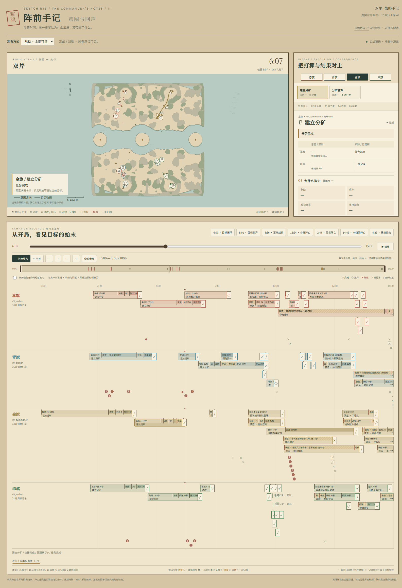
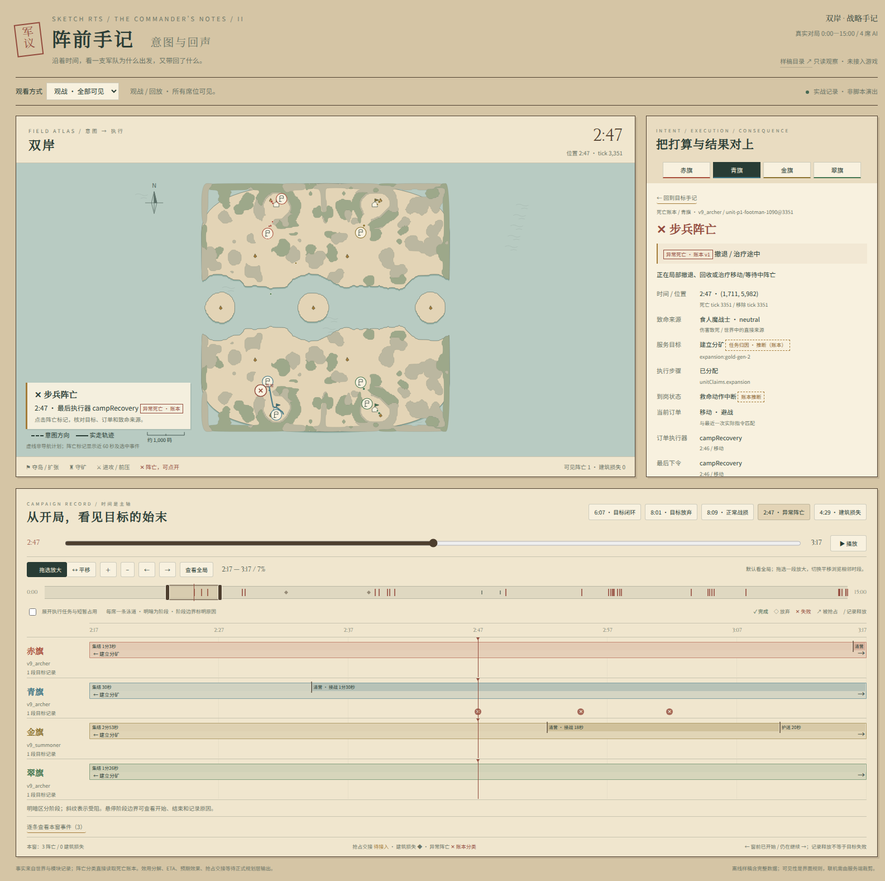
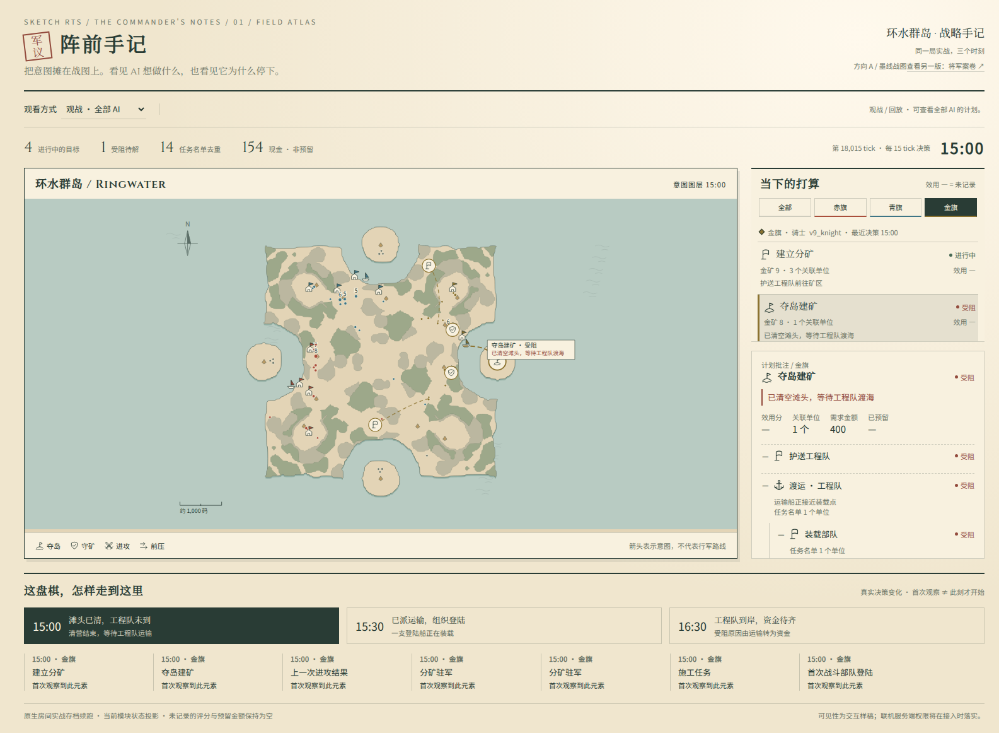
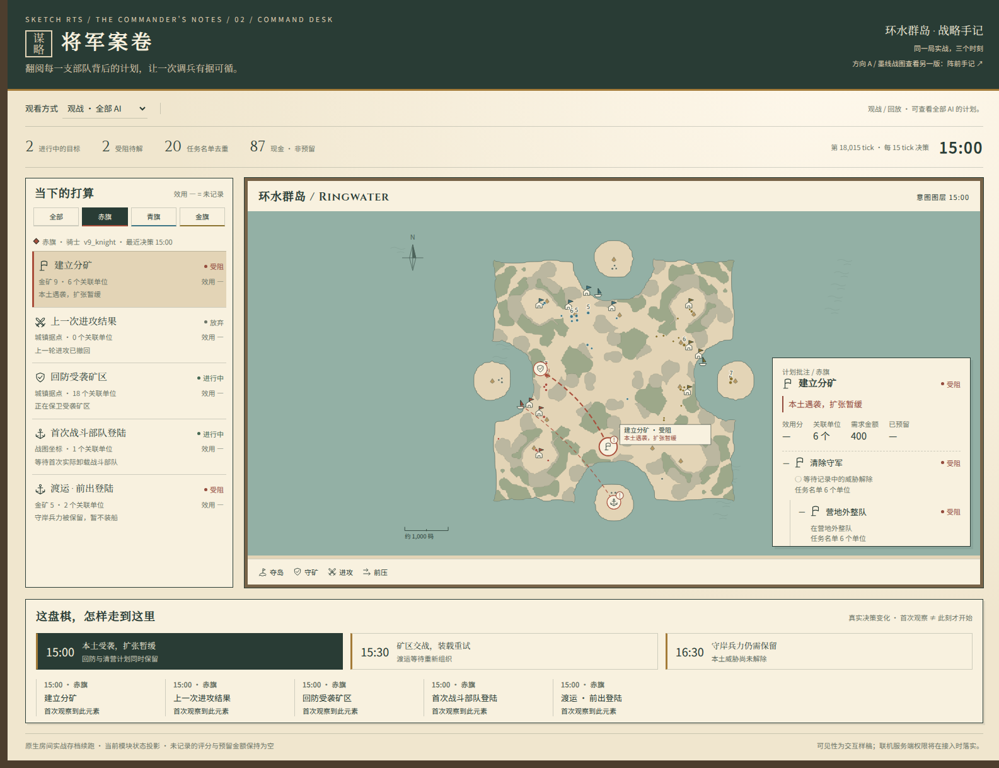

# AI 计划链：阵前手记与数据契约

现在直接打开 **[第二版：阵前手记 · 意图与回声 / timeline.html](timeline.html)**。可双击离线打开；当前为样稿，没有接入游戏。



## 第二版：沿时间轴看意图与结果

以第一轮选定的“阵前手记”为底，底部是连续 90 秒的可拖动横向时间轴，每席 AI 一条泳道。拖动滑块、拖动泳道空白、点击事件或播放，战图和面板同步到该时刻。位置按最近一个不晚于游标的世界采样、任务按该 AI 最近一次 think 显示，绝不把未来状态搬到当前战图。

每个根目标独立成带；短暂的 claim 和施工任务可通过“展开执行任务与短暂占用”一并查看。末端区分 ✓ 完成、◇ 放弃、✕ 明确战力损失导致的失败、↗ 被抢占。当前数据没有正式抢占事件，保留“待接入”；不把 claim 换人猜成抢占。斜线 `/` 仅表示模块释放记录，结果未知；同一个 claim 释放后再次出现会成为新的一段。窗前已有的完成/放弃记录画成“窗前记录”，不伪装为观察窗内的新事件。

选中目标后，右侧按 **为什么 → 怎么做 → 派了谁 → 进展 → 结果** 展开，可用五个页边按钮直达。目标目录保留每个目标的效用与状态；父子任务的单位名单取并集。面板把预计与实际并排呈现，地图虚线为记录目标的意图方向，实线为选中单位每秒采样的实际轨迹。尚无正式计划导航路线，虚线不冒充寻路结果。实走轨迹可能包含单位先前的任务，图注已说明。

到岗时间仅使用同一个 claim（单位、种类、目标、sinceTick 均一致，且 claim 目标与选中目标相同）的 `arrived` 记录；首次观察已到岗显示“≤ 时刻”。没有到岗或 ETA 记录时保持为空，不根据直线距离猜测预计到达。



真实记录里，青旗的骑射手在 **15:57 / tick 19142** 阵亡：最后交付执行器为 `mobileCare`，死亡时订单是避战移动，直接致命击打来自金旗灰烬酋长。死亡时间、位置、订单和致命来源是世界/观察接口的事实；目标与步骤归属、疑似异常分类是 **推断**。此单位没有活跃 claim 或保留任务归属，所以明确写“未找到保留的目标归属”，不把它挂到最近的进攻任务上。工人、移动/空闲订单、撤退相关执行器下的阵亡仅标记“疑似异常，需复核”；其他死亡也不自动视为正常战损。正式死亡账本尚未接入，局部兵力比、血量轨迹、伤害构成等保持“—”。

| 连续记录的时刻 | 观察到的事实 |
|---|---|
| 15:00 | 赤旗建立分矿受 `home-threat` 阻断，同时保留矿区回防。 |
| 15:30 | 金旗夺岛仍在等待工程队渡海，前出登陆船正在装载。 |
| 15:57 | 青旗骑射手在避战移动期间阵亡；可在地图或青旗泳道点开。 |
| 16:30 | 金旗夺岛变为 `saving-hall-capital`，工程队已到、资金待齐；前压记录完成。 |

这个窗口有 **1 次 AI 单位阵亡、0 次 AI 建筑损失**，没有编造建筑被拆或抢占事件。建筑损失的点与详情渲染已支持；正式抢占交接可提供 `type: preemption, owner, tick, fromGoalId, toGoalId, unitIds, gold, reason`，同一泳道会在对应目标之间画箭头和资源说明。当前样本没有这类输入。效用的收益/成本/成功概率/坚持加分、方法选择、预期效果、ETA 与预留资金也仍为“— / 待接入”。AiPlanTrace 的公共契约与决策逻辑保持原样。

可见性采用已确定的规则：观战和回放全部可见；单机可开关、默认关；联机只显示自己（金旗为样稿示例），对手必须进入赛后回放查看。切换会同时裁剪目录、目标标记、路径、时间泳道、事件与归因。快捷事件入口也按席位过滤。静态文件包含完整样本，界面隐藏不是权限边界；游戏接入时需要服务端裁剪。

### 第二版的数据与验证

沿用下述同一个原生海图存档，在 **main 3c0844e3** 上从 tick 18000 续跑到 19800。360 次 think，91 帧世界位置；没有编辑对局。`timeline-data.js` 与 `timeline-nodes.js` 是离线交互必需的紧凑数据（节点版本去重），不是原始世界快照归档。来源与计数在 [timeline-summary.json](timeline-summary.json)，命令一致性与浏览器检查在 [timeline-validation.json](timeline-validation.json)。第一轮数据继续保留。

```sh
npx tsx scripts/ai-plan-viz-timeline-capture.ts /tmp/ai-plan-viz-timeline
npx tsx scripts/ai-plan-viz-timeline-build.ts /tmp/ai-plan-viz-timeline/capture.json
# 独立关闭 trace、伤害观察与逐帧观察，再续跑同一段：
PLAN_VIZ_OBSERVE=0 npx tsx scripts/ai-plan-viz-timeline-capture.ts /tmp/ai-plan-viz-timeline-no-observer
npx vitest run src/ai/plan-trace-history.test.ts src/ai/plan-trace.test.ts src/ai/planner-context.test.ts src/sdk/package-boundaries.test.ts --maxWorkers 1 --minWorkers 1
```

开启/关闭观察的 **2182 条实际交付命令**（tick、owner、scriptId、完整 command）的 SHA256 均为 `d98d1021686535fbecf9a7fb6ceb8d45781aaa261d4573fa9a8f757cfc386774`；最终世界 JSON 的 SHA256 均为 `72e57de2538599c6ec303bbc012bb8f4a1b3e5421537a0d4f88f9ff864b9fe53`。29 项测试与 TypeScript 检查通过，覆盖时间不越界、消失不推断结局、claim 重获分段、到岗不跨任务串用、可见性和真实数据空值；第一轮逐字节命令测试仍通过。浏览器以 file:// 验证真实拖拽、三个泳道、52 段完整任务、阵亡点击、可见性切换、本地字体及两种路径。截图均逐张查看。

## 第一轮样稿与数据契约（保留作比较）

以下两版是第一轮历史方案，其中的可见性选项用于当时挑选；第二版使用上面的固定规则。

先打开 [index.html](index.html) 选风格，或直接双击：

- **[阵前手记 / ink-map.html](ink-map.html)**：浅色战图为主，目标与计划树放在右侧纸边。
- **[将军案卷 / command-desk.html](command-desk.html)**：深墨题头、左侧目标目录，战图上展开计划卷宗。

整个目录可直接复制，使用 `file://` 打开即可；不需要服务器、游戏进程、外部字体或网络。两版都有实际地形、不同目标图标、部队意图箭头、受阻标记、目标目录、可展开的计划树、三个时刻和目标变化时间线。观战/回放、单机开关、联机仅自己或仅赛后公开都可实际切换。金旗这一席用来演示“自己”。





## 数据来自哪里

沿用现有真实原生房间存档 `src/ai/bootstrap_1/fixtures/ring-beachhead-15m.json`，来源说明见 `island-conquest.scene.test.ts`。它是一个 AFK 人类、其余默认房间 AI 的环水群岛对局。使用 `883f57c5` 的普通规划器与 SDK 命令延迟，从 tick 18000 续跑至 19800，没有编辑单位、血量、资金、订单、队伍或 AI memory。

存档 SHA256：`88c94fc66697a6ba69733a62eb6b025d664768f74b503a49ed8010048a3fcc24`。

| 时刻 | 实际记录中的情况 |
|---|---|
| 15:00 / tick 18015 | 赤旗扩张被 `home-threat` 暂停，正在回防矿区；金旗已清理岛上滩头，等待工程队运输。 |
| 15:30 / tick 18600 | 赤旗继续回防，渡运遇到 `retry-delay`；金旗已有另一支前出登陆船正在装载。 |
| 16:30 / tick 19800 | 金旗夺岛的受阻原因变成 `saving-hall-capital`，工程队已到、资金未齐；青旗前压据点记录为完成。 |

三个时刻均有三名 AI 的真实 trace，而非为设计稿编造的计划。AI 分相位 think，所以每份 trace 保留自己的 `tick`；地图上的部队位置取该展示时刻，目标位置取最近一次 think。第一次观察不冒充计划刚刚开始。目标消失不推断为成功或放弃。箭头表示意图，不是计算出的导航路线。地形轮廓从原地图网格提取，仅为墨线效果圆滑边角。

`sample-data.js` 是离线样稿必需的数据；`trace-example.json` 是一份可单独读的真实输出；`capture-summary.json` 保留来源、各帧根目标和性能测量。

复现数据：

```sh
npx tsx scripts/ai-plan-viz-capture.ts /tmp/ai-plan-viz-capture
npx tsx scripts/ai-plan-viz-build.ts /tmp/ai-plan-viz-capture/capture.json
```

## 输出契约

定义在 `src/ai/plan-trace.ts`，schemaVersion 为 1。它是可 JSON 序列化的纯输出，未加入 AI memory、游戏 snapshot、存档、命令帧或网络协议；不改玩法/校验和版本。

| 字段 | 约定 |
|---|---|
| `owner / tick / plannerVersion` | 谁在何时使用哪个规划器做出的这次观察。 |
| `roots / nodes[].children` | 目标与子任务组成的树，引用稳定 node ID；任务重开用新的 sinceTick 区分。 |
| `kind / label / target` | 目标类型、人可读标题、实体 ID 和/或真实坐标；未知位置不填 0。 |
| `status` | `active / blocked / done / abandoned`。只根据保留状态判断。 |
| `selected` | 当前仍被模块保留执行的承诺；已完成或放弃为 false。未来战略层可输出未选候选。 |
| `utility` | `score / source / terms`。当前模块没有保存效用分，返回 **null / not-recorded**，不是 0，不拿脚本优先级冒充目标分数。战略层接入后可提供实际分数和各项贡献。 |
| `reasons / requirements` | 原因代码、可读文本、来源、可选记录时点，以及已满足/未满足/未知的条件。历史渡运阻塞不会覆盖新的成功状态。 |
| `resources.unitIds` | 模块明确保留的任务名单、活跃 claim 或渡运名单，剔除不存在及非己方单位。阶段和父任务可重叠；总数取并集，不能累加。部分到位的组保留实际比例。 |
| `resources.gold` | `required` 是能直接由规则确认的名义费用；`reserved` 未记录时为 **null**。全军现金只在 `bank` 列一次，不能被当成每个目标的预留预算。 |
| `previousTick / changes` | 与同一 owner 上一次 think 的新增、释放、状态、目标、兵力资源、原因条件及评分变化。实体原地移动不冒充换目标。 |
| `origin / limitations` | 明示这是 `module-state` 投影，当前没有 HTN 搜索记录、完整候选评分或分目标资金账本。 |

当前覆盖 `landExpansion`、`landAttack` 及结果、矿区回防、`expansionGarrison / mineRally / mineGuard / mineLeash / harassSquad` 等 claims、`naval.conquests / firstCombatDelivery / ferries`、`territory.objective`。子任务只展示模块实际保留的当前阶段和清营/运输子状态，不把阶段枚举伪装成已经执行过的历史或尚未生成的 HTN 分解。

## 如何获取一份 trace

本轮只提供工具入口，**未接入游戏的运行线程或 UI**。使用方以同一个 memory provider 调普通规划器的包装入口，每次 think 得到一份 trace：

```ts
const { commands, trace } = planAiOwnerCommandEntriesWithTrace(
  snapshot, request, { teams, memoryProvider }, previousTrace,
);
// commands 按原路径提交；trace 单独发送给观察者。
previousTrace = trace; // 只保存在对局观察者中，不写进 AI memory。
```

`plan-trace-planner.ts` 调原有 `planAiOwnerCommandEntries` **一次**后投影输出。默认游戏仍走原函数，关闭观察时没有 trace 构造成本。观察器每局单独持有上一次输出，不跨 owner、倒退 tick 或跨对局复用。包装器只观察原有 memory provider 的读写，不额外读取它；只读 provider 尚无 memory 时，也能拿到该次 think 的临时状态。

`buildAiPlanTrace` 只读取已有实体和模块状态；不调用寻路、效用评估、政策 helper 或任何命令生成逻辑。回调不被传回 AI，修改拿到的 trace 不会修改输入。

## 验证

```sh
npx vitest run src/ai/plan-trace.test.ts src/ai/planner-context.test.ts --maxWorkers 1 --minWorkers 1
npm run build
```

16 项测试通过，构建通过。包含冻结输入后投影、输出修改不回写、目标状态差异、部分到位组、返回岸点、过期 claim 与历史阻塞，以及 live / frozen / bootstrap 规划器的一致性。真实海图的两份独立短重放，一份开 trace、一份关闭，逐条比较每次 think 产生的原始 entries，以及实际执行的 tick、owner、scriptId 和完整 command 的 UTF-8 字节；AI memory 和最终世界 JSON 也完全一致。

样稿这段 90 秒续跑共 360 次 think、平均 12.48 个节点。一次本机测量中，规划器平均 42.43 ms，构造 trace 平均 0.48 ms，附加约 **1.14%**（含与上次比较，不含文件保存或渲染）。这是这局的数据，不作为其他地图的性能承诺；原始测量保存在 `capture-summary.json`。

实际浏览器已检查两版画面与目标展开、三个时刻、file:// 加载本地字体、单机隐藏全部计划元素、联机只看自己、赛前锁定与赛后解锁。静态文件本身包含整局样本，**可见性控件是给主人挑的交互方案，不是网络权限边界**；接入联机时必须由服务端裁剪数据。此轮没有修改游戏权限或接入游戏。

字体：随目录提供 [Noto CJK](https://github.com/notofonts/noto-cjk) 的当前样稿文字子集（Sans / Serif）及游戏已有 Cinzel；OFL 许可在 `fonts/`。没有远端字体请求。墨、纸、木框、黄铜、低饱和地形和队旗沿用 `docs/art-direction.zh.md` 的方向 A。
