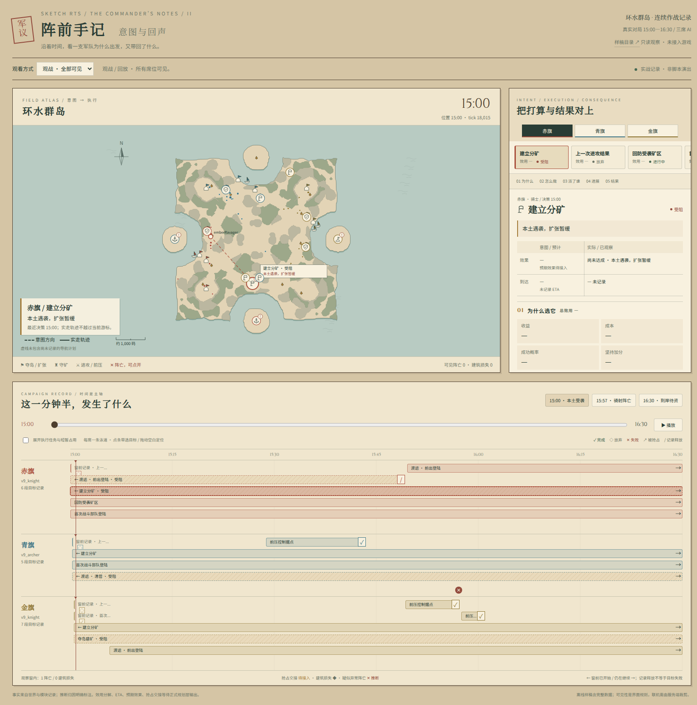
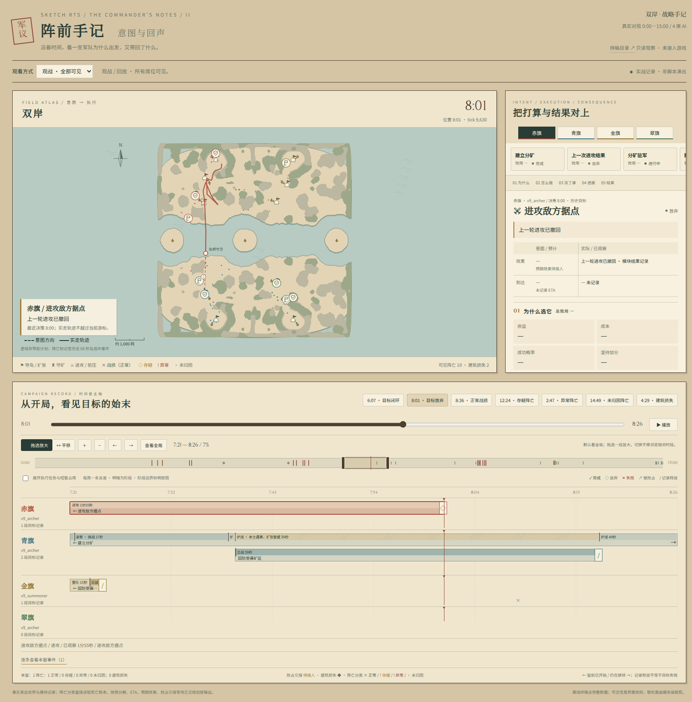
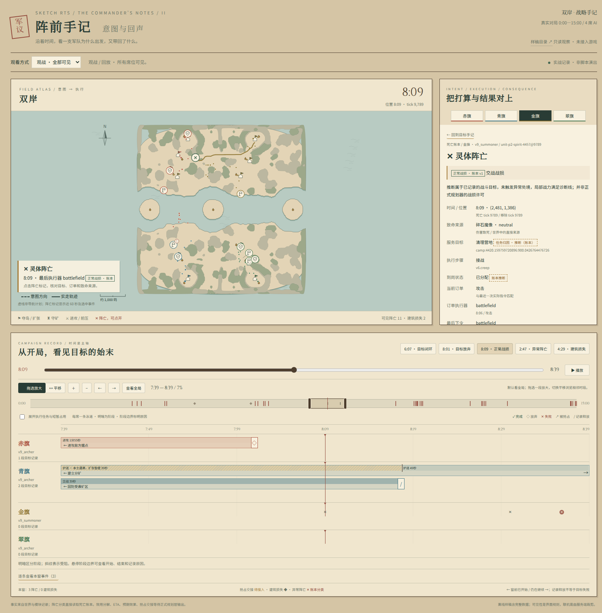
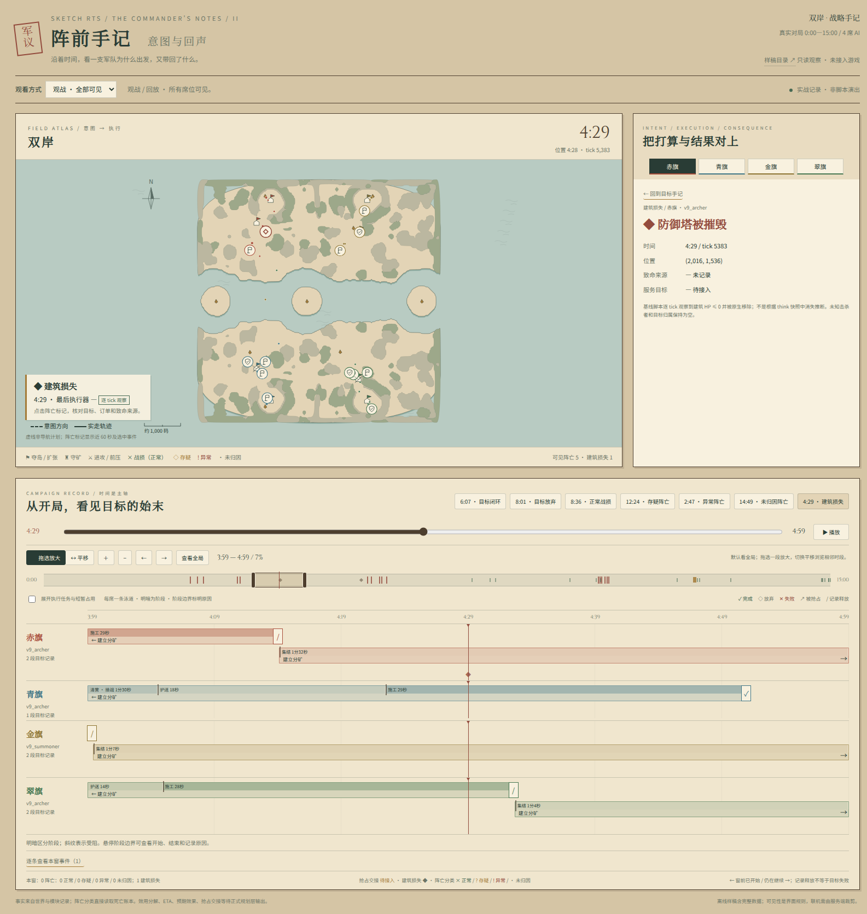

# AI 计划链：阵前手记与数据契约

直接打开 **[第二版：阵前手记 · 意图与回声 / timeline.html](timeline.html)**。双击即可离线使用，当前仍是样稿。


## 第二版：先看全局，再放大一个目标的始末

采用“阵前手记”的墨线战图。默认时间窗覆盖真实双岸对局的 **0:00–15:00**，四名 AI 各有一条泳道。拖选泳道空白可放大；“平移”、左右按钮、整局导航窗和两端手柄可移动或缩放；“查看全局”恢复完整记录。双击目标也能放大它的全过程。游标、播放、战图和面板同步，位置与决策都只取不晚于当前游标的记录。

每个目标的条带内按真实阶段分段，用不同墨色区分集结、清营、护送、施工、整队、交战、装船和航渡。受阻阶段加斜纹并直接写原因和持续时间；悬停边界显示准确起止时间与切换原因，点阶段回到该时刻。没有阶段记录就写“阶段未记录”。末端徽记区分 ✓ 完成、◇ 放弃、✕ 明确失败、↗ 被抢占；当前抢占数据尚未接入，不把 claim 换人猜成抢占。`/` 只代表模块释放，结果未知。首次观察已经结束的目标仅画“结果记录”，不伪装成观察到完整过程。



右侧按 **为什么 → 怎么做 → 派了谁 → 进展 → 结果** 展开。效用的收益、成本、成功概率、坚持加分和总分保持“—”；方法、ETA、预期效果、预留资金没有正式数据时也保持为空。父子节点的兵力名单取并集。地图虚线是记录目标的意图方向，实线是选中单位的实际采样轨迹；没有把直线当成导航计划。原始样本未记录逐单位 claim 的到岗时刻，因此本版不从位置或群组比例推断到岗和 ETA。

| 快捷示例 | 同局记录中的事实 |
|---|---|
| 3:59–6:07，金旗建立分矿 | 集结 → 清营整队与接战 → 护送 → 施工；5:46 起因 `mine-threat` 暂停 18 秒，随后恢复并完成。 |
| 8:01，赤旗放弃进攻 | `landAttackResult` 明确记录 `withdrew`，细因 `general:retreat:incoming`；不是根据目标消失猜测放弃。 |
| 8:09，金旗灵体正常战损 | 死于碎石魔像；账本诊断为清营交战战损，保留“推断”说明，不冒充规划器已批准的战损。 |
| 2:47，青旗步兵异常阵亡 | 扩张途中，`campRecovery` 交付避战移动，遭食人魔战士致命攻击；账本分类为撤退 / 治疗途中死亡。 |
| 4:29 与 6:01，防御塔损失 | 逐 tick 观察到 HP ≤ 0 且被原生移除；击杀者与任务归属未记录，保持“—”。 |








死亡标记可从战图、泳道和“逐条查看本窗事件”进入。正常战损与异常阵亡使用不同颜色；地图展示游标前 60 秒及当前选中事件，时间轴仍保留整个窗口的事件。详情显示原始账本分类、任务与步骤、到岗状态、当前订单执行器、最后下令、致命来源、局部战力、血量轨迹与伤害构成。**分类直接来自 Codex 37 的 `AiDeathLedger`，界面不再自行分类。** 账本当前的任务归因和诊断仍有 `inferred` 来源标记，界面明确写“推断（账本）”；正式 objective/method/assignment ID 为空时不补造。

当前记录有 **35 次战斗阵亡（2 正常、33 异常）和 2 次建筑损失**。另有 33 次召唤物活着到期移除，保留在账本汇总，不计作战斗阵亡。250 段根目标与执行记录中，观察到 38 次明确完成、6 次放弃或失败、109 次阶段或原因变化。执行任务与短暂 claim 默认折叠，可展开。死亡只连到同一席位、同一个已观察任务的明确账本归属；其余保留未归属，不强行摊到附近目标。

可见性使用已确定的规则：**观战和回放全部可见；单机可开关、默认关；联机只看自己，对手在赛后回放查看。** 样稿以赤旗为“自己”。切换会同时裁剪目标目录、标记、轨迹、泳道、事件、快捷入口和归因。离线文件本身包含完整数据，这只是显示规则；接入联机时仍需由服务端裁剪。

### 第二版的数据与验证

样本来自 Codex 37 的 #561 最终双岸导出，代码 **`bf9a472b02712457d2b5f4198d82ca87c8846de0`**，对照 main **`276e5d29`**。A100 原始目录：

```text
/codegeex/jeffry/sketch-rts-defense/runs/mvg8usdr-e3f0b0/death-ledger/ui-twoShores
```

原始文件也已封包到 A100 内容寻址归档 `/codegeex/jeffry/sketch-rts-evidence/sha256/8dae90fbca47850ea1608aecdd4388652400094ecc54b1673934dc809d379e1b`，含本样本、main 对照、README 和逐文件 SHA256SUMS；[来源指针](https://github.com/shuxueshuxue/sketch-rts/blob/46a08b3b181c85f96ed5713291bcd481faf00515/docs/ai/objectives/death-ledger-baseline.evidence.json)由 #561 提供。

同局 `initial.json`、`final.json`、`worlds/traces/deaths/building-losses.jsonl.gz` 与 `summary.json`，覆盖 tick 0–18000。4,804 份 trace、4,800 条原始世界采样，离线投影保留 1,531 帧（约每秒一帧，另保留任务变化时刻）。目标结果与阶段由真实 trace 推导，死亡和建筑损失取原始账本与精确观察，不改对局或决策。

`timeline-data-*.js` 是节点去重后的 gzip/base64 离线载荷，`timeline-loader.js` 用浏览器原生 `DecompressionStream` 解包，无模块请求、服务器、CDN 或网络依赖。需要浏览器支持该原生解压接口，本次使用 Chrome 验证 `file://` 打开。未压缩投影约 12.6 MB，压缩后约 0.92 MB，按文件大小限制分片。计数、哈希与示例在 [timeline-summary.json](timeline-summary.json)，验证凭据在 [timeline-validation.json](timeline-validation.json)。

```sh
# 从同一个导出目录导入，不再运行一套界面的死亡推断：
LEDGER_SAMPLE=/path/to/ui-twoShores
npx tsx scripts/ai-plan-viz-ledger-import.ts "$LEDGER_SAMPLE" /tmp/ai-plan-viz-full-match.json bf9a472b02712457d2b5f4198d82ca87c8846de0
npx tsx scripts/ai-plan-viz-timeline-build.ts /tmp/ai-plan-viz-full-match.json
npx vitest run src/ai/plan-trace-history.test.ts src/ai/plan-viz-ledger.test.ts src/ai/plan-trace.test.ts src/ai/planner-context.test.ts src/sdk/package-boundaries.test.ts --maxWorkers 1 --minWorkers 1
npx tsc --noEmit
```

原始导出的 15,792 条计划命令与实际交付数量一致。生产者已验证同局观察开启 / 关闭的计划命令、交付命令、canonical、snapshot 和 AI memory 五项哈希均与 main 对照一致；本样稿核对对应 receipt，并将五项值保留在验证文件。原生死亡损失对账通过。导入与构建脚本只读文件，不运行模拟或规划器；原有逐字节命令一致性测试仍覆盖 trace 输出入口。

本轮测试覆盖完整 15 分钟的时间不越界、真实目标闭环、阶段与受阻时长、明确结果和单纯消失的区别、缩放和平移边界、死亡账本原样导入、旧任务与未来任务不串归因、活着到期不算阵亡、历史升级种类与乘员船只引用，以及全部可见性规则。浏览器以 `file://` 验证实际拖选、平移、导航手柄、正常与异常死亡、建筑损失、目标闭环、阶段边界、播放与权限切换；最终截图逐张查看。没有改游戏线程、战斗规则或 AI 决策；游戏观战 / 回放叠加层是下一步。

## 第一轮样稿与数据契约（保留作比较）

以下两版是第一轮历史方案，其中的可见性选项用于当时挑选；第二版使用上面的固定规则。

先打开 [index.html](index.html) 选风格，或直接双击：

- **[阵前手记 / ink-map.html](ink-map.html)**：浅色战图为主，目标与计划树放在右侧纸边。
- **[将军案卷 / command-desk.html](command-desk.html)**：深墨题头、左侧目标目录，战图上展开计划卷宗。

整个目录可直接复制，使用 `file://` 打开即可；不需要服务器、游戏进程、外部字体或网络。两版都有实际地形、不同目标图标、部队意图箭头、受阻标记、目标目录、可展开的计划树、三个时刻和目标变化时间线。观战/回放、单机开关、联机仅自己或仅赛后公开都可实际切换。金旗这一席用来演示“自己”。


## 数据来自哪里

沿用现有真实原生房间存档 `src/ai/bootstrap_1/fixtures/ring-beachhead-15m.json`，来源说明见 `island-conquest.scene.test.ts`。它是一个 AFK 人类、其余默认房间 AI 的环水群岛对局。使用 `883f57c5` 的普通规划器与 SDK 命令延迟，从 tick 18000 续跑至 19800，没有编辑单位、血量、资金、订单、队伍或 AI memory。

存档 SHA256：`88c94fc66697a6ba69733a62eb6b025d664768f74b503a49ed8010048a3fcc24`。

| 时刻 | 实际记录中的情况 |
|---|---|
| 15:00 / tick 18015 | 赤旗扩张被 `home-threat` 暂停，正在回防矿区；金旗已清理岛上滩头，等待工程队运输。 |
| 15:30 / tick 18600 | 赤旗继续回防，渡运遇到 `retry-delay`；金旗已有另一支前出登陆船正在装载。 |
| 16:30 / tick 19800 | 金旗夺岛的受阻原因变成 `saving-hall-capital`，工程队已到、资金未齐；青旗前压据点记录为完成。 |

三个时刻均有三名 AI 的真实 trace，而非为设计稿编造的计划。AI 分相位 think，所以每份 trace 保留自己的 `tick`；地图上的部队位置取该展示时刻，目标位置取最近一次 think。第一次观察不冒充计划刚刚开始。目标消失不推断为成功或放弃。箭头表示意图，不是计算出的导航路线。地形轮廓从原地图网格提取，仅为墨线效果圆滑边角。

`sample-data.js` 是离线样稿必需的数据；`trace-example.json` 是一份可单独读的真实输出；`capture-summary.json` 保留来源、各帧根目标和性能测量。

复现数据：

```sh
npx tsx scripts/ai-plan-viz-capture.ts /tmp/ai-plan-viz-capture
npx tsx scripts/ai-plan-viz-build.ts /tmp/ai-plan-viz-capture/capture.json
```

## 输出契约

定义在 `src/ai/plan-trace.ts`，schemaVersion 为 1。它是可 JSON 序列化的纯输出，未加入 AI memory、游戏 snapshot、存档、命令帧或网络协议；不改玩法/校验和版本。

| 字段 | 约定 |
|---|---|
| `owner / tick / plannerVersion` | 谁在何时使用哪个规划器做出的这次观察。 |
| `roots / nodes[].children` | 目标与子任务组成的树，引用稳定 node ID；任务重开用新的 sinceTick 区分。 |
| `kind / label / target` | 目标类型、人可读标题、实体 ID 和/或真实坐标；未知位置不填 0。 |
| `status` | `active / blocked / done / abandoned`。只根据保留状态判断。 |
| `selected` | 当前仍被模块保留执行的承诺；已完成或放弃为 false。未来战略层可输出未选候选。 |
| `utility` | `score / source / terms`。当前模块没有保存效用分，返回 **null / not-recorded**，不是 0，不拿脚本优先级冒充目标分数。战略层接入后可提供实际分数和各项贡献。 |
| `reasons / requirements` | 原因代码、可读文本、来源、可选记录时点，以及已满足/未满足/未知的条件。历史渡运阻塞不会覆盖新的成功状态。 |
| `resources.unitIds` | 模块明确保留的任务名单、活跃 claim 或渡运名单，剔除不存在及非己方单位。阶段和父任务可重叠；总数取并集，不能累加。部分到位的组保留实际比例。 |
| `resources.gold` | `required` 是能直接由规则确认的名义费用；`reserved` 未记录时为 **null**。全军现金只在 `bank` 列一次，不能被当成每个目标的预留预算。 |
| `previousTick / changes` | 与同一 owner 上一次 think 的新增、释放、状态、目标、兵力资源、原因条件及评分变化。实体原地移动不冒充换目标。 |
| `origin / limitations` | 明示这是 `module-state` 投影，当前没有 HTN 搜索记录、完整候选评分或分目标资金账本。 |

当前覆盖 `landExpansion`、`landAttack` 及结果、矿区回防、`expansionGarrison / mineRally / mineGuard / mineLeash / harassSquad` 等 claims、`naval.conquests / firstCombatDelivery / ferries`、`territory.objective`。子任务只展示模块实际保留的当前阶段和清营/运输子状态，不把阶段枚举伪装成已经执行过的历史或尚未生成的 HTN 分解。

## 如何获取一份 trace

本轮只提供工具入口，**未接入游戏的运行线程或 UI**。使用方以同一个 memory provider 调普通规划器的包装入口，每次 think 得到一份 trace：

```ts
const { commands, trace } = planAiOwnerCommandEntriesWithTrace(
  snapshot, request, { teams, memoryProvider }, previousTrace,
);
// commands 按原路径提交；trace 单独发送给观察者。
previousTrace = trace; // 只保存在对局观察者中，不写进 AI memory。
```

`plan-trace-planner.ts` 调原有 `planAiOwnerCommandEntries` **一次**后投影输出。默认游戏仍走原函数，关闭观察时没有 trace 构造成本。观察器每局单独持有上一次输出，不跨 owner、倒退 tick 或跨对局复用。包装器只观察原有 memory provider 的读写，不额外读取它；只读 provider 尚无 memory 时，也能拿到该次 think 的临时状态。

`buildAiPlanTrace` 只读取已有实体和模块状态；不调用寻路、效用评估、政策 helper 或任何命令生成逻辑。回调不被传回 AI，修改拿到的 trace 不会修改输入。

## 验证

```sh
npx vitest run src/ai/plan-trace.test.ts src/ai/planner-context.test.ts --maxWorkers 1 --minWorkers 1
npm run build
```

16 项测试通过，构建通过。包含冻结输入后投影、输出修改不回写、目标状态差异、部分到位组、返回岸点、过期 claim 与历史阻塞，以及 live / frozen / bootstrap 规划器的一致性。真实海图的两份独立短重放，一份开 trace、一份关闭，逐条比较每次 think 产生的原始 entries，以及实际执行的 tick、owner、scriptId 和完整 command 的 UTF-8 字节；AI memory 和最终世界 JSON 也完全一致。

样稿这段 90 秒续跑共 360 次 think、平均 12.48 个节点。一次本机测量中，规划器平均 42.43 ms，构造 trace 平均 0.48 ms，附加约 **1.14%**（含与上次比较，不含文件保存或渲染）。这是这局的数据，不作为其他地图的性能承诺；原始测量保存在 `capture-summary.json`。

实际浏览器已检查两版画面与目标展开、三个时刻、file:// 加载本地字体、单机隐藏全部计划元素、联机只看自己、赛前锁定与赛后解锁。静态文件本身包含整局样本，**可见性控件是给主人挑的交互方案，不是网络权限边界**；接入联机时必须由服务端裁剪数据。此轮没有修改游戏权限或接入游戏。

字体：随目录提供 [Noto CJK](https://github.com/notofonts/noto-cjk) 的当前样稿文字子集（Sans / Serif）及游戏已有 Cinzel；OFL 许可在 `fonts/`。没有远端字体请求。墨、纸、木框、黄铜、低饱和地形和队旗沿用 `docs/art-direction.zh.md` 的方向 A。
