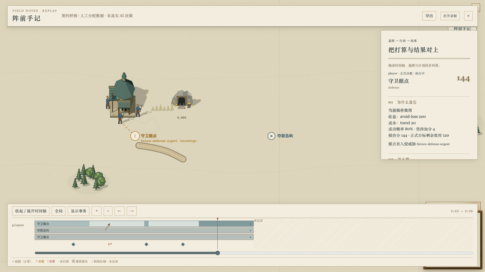
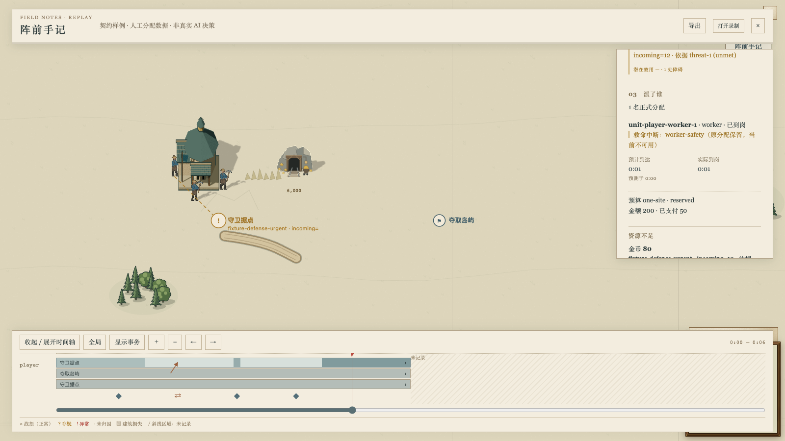
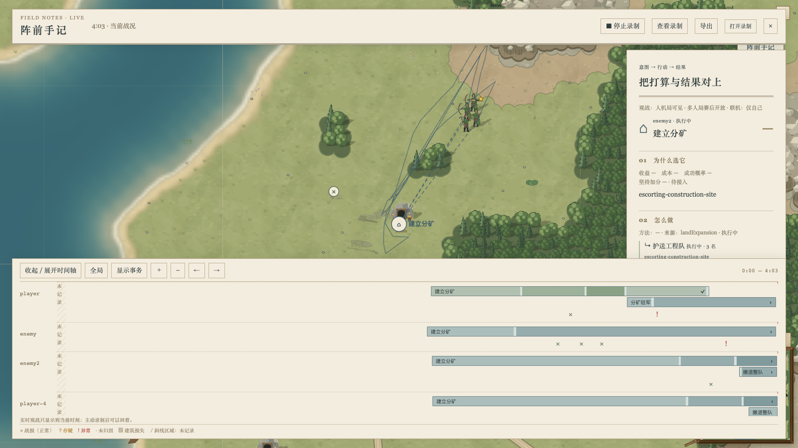
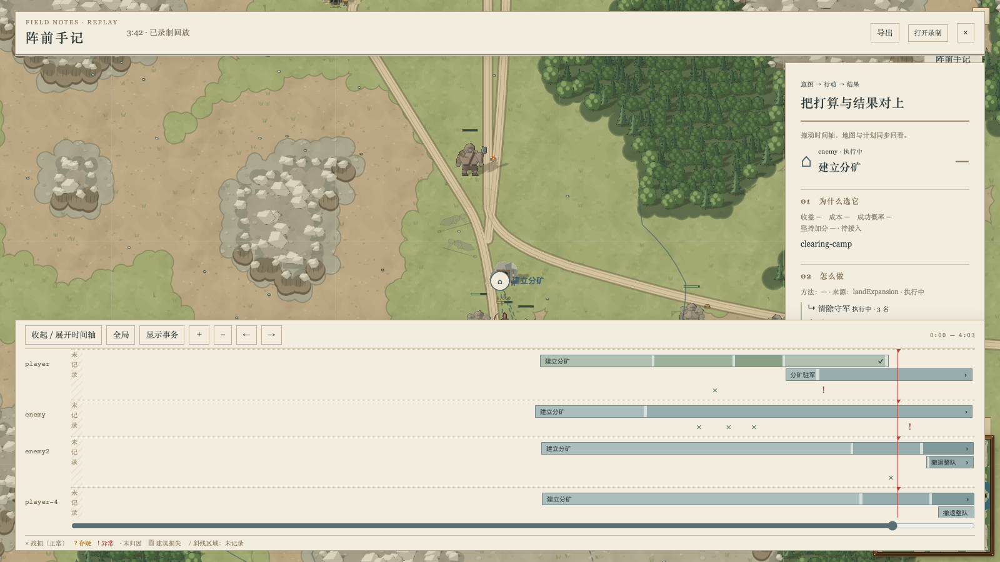

# 正式分配接线

2026-10-21：#576 的展示方向已按 #584 改为[目标依赖图](goal-dependency.zh.md)，[正式类型消费端](goal-consumer.zh.md)已接线。本页保留上一轮分配通路和验证的来源；当前界面沿目标、条件、动作、执行和结果展开，人工样例不作为真实决策证据。

本切片把 `AiPlanTrace.strategy.allocation` 接到游戏中已有的阵前手记，只做消费端和位置采样。当前基于 main `0552ff21` 上的分配器类型提交 `0d4edde4`（#575，与原接口 `3bbeb2ae` 等价）。统一规划入口、runtime/worker 的生产端和防守/夺岛执行器由对应切片提供；这里不生成或更改任何分配。

## 读什么，怎样显示

- 目标列表同时保留正式目标、观察报价和尚未迁移的模块任务。观察到的旧任务不算正式派兵，未知分数不会变成零。
- 正式目标连接方法、行动及行动代次，显示当前报价的收益、成本、成功概率和坚持加分，并将正式目标的剩余效用单列。候选报价不是已经取得的收益。
- 兵力只取正式 assignments，显示角色、到岗状态、救命中断、绝对 tick 的 ETA 和预测时刻。实际到岗来自同一 assignment、同一 action generation 的到岗事件；没有精确事件时只写“已到岗，时刻未记录”。
- `unmet` 是初始资源需求不足，`vacancies` 是救命中断留下的替补空缺，`blocked` 是安全中断的父行动报价，三者分别展示。地图上同时标出受阻前置；不把受阻行动冒充整个目标失败。
- 抢占和原子交接在时间轴上有独立标记；两条目标带都存在时画出交接箭头。详情保留具体资源、收益/损失/切换成本、交接状态和原因的 code、values、factIds。未知报价仍为“—”。
- 同一个目标 ID 在结束后以新的 sinceTick 再次出现，会开始一段新条带。消失仍只表示结果未记录，不推断完成或失败。阵亡按账本的 objectiveId 关联，保留原归因标识。

## 增量和录制边界

首包保留完整基线，后续 `strategyDelta` 对有稳定 ID 的行做递归增量，支持行增删、顺序变化和可选字段删除。目标分配用 objectiveId，行动用 token.actionId，其他正式表和事件用 id；行动 generation 本身随数据传递。补丁比整值更大时直接发送整值。旧录制中 `header.strategy` 的整份策略仍可读取。

客户端只读复制，不修改先前帧。缺少匹配 owner/tick/session 的基线时不应用增量，重新观察使用新基线。权限仍由现有服务端 all / owner / none 过滤，不引入新旁路。

事件按 owner + event.id 去重，同时保存首次观察的 tick。只纳入本次记录区间内且已经发生的事件；业务 memory 保留的旧日志不会补画进“未记录”区间。回放倒拖到首次观察之前，面板不会提前显示这些事件。事件点击定位到首次可观察到它的记录帧，标签保留实际发生时刻。

视图和录制都关着时仍不构造策略补丁、trace、归因上下文或死亡账本。所有新表、补丁和 UI 派生结果均在诊断通路，不进入 Game、命令帧或 canonical；本切片不升级规则或校验和版本。

## 验证范围

相关测试覆盖正式/观察权威的区分、到岗代次、三个资源缺口、效用和抢占展示、HTML 转义、阶段变化、结束后重用 ID、事件去重、倒拖、未记录区间、网络及录制往返、旧格式读取，以及关闭时零构造和命令/逐 tick 哈希不变。

重放到 main `6685a6ca` 和 #575 新类型头后，消费端原有九笔提交的补丁内容均未变化。另将陆地场景夹具的可写视图限制在 Situation，保留 PlanningContext 原类型和函数签名，避免分配类型扩展后对完整上下文递归比较超限；仅改测试类型，转译后的 JavaScript 与基线逐字节相同（SHA256 `4163bbb555d358a99d6940548a7bf830fcf05f4c20d7244dcc38bc7ddfd661ef`）。下文的全量与 mac1 证据保留原测量版本，不将旧报告冒充新 head 的全量或正式控制验证。

当前源码的根/CLI tsc 均通过；上述六文件、真实线程和 SDK 边界共八文件 40 项通过，陆地决策场景的 22 项也全部通过。夹具修正保留所有数值、解释字节和 memory golden 的原断言。

随后换底到 main `0552ff21` / #575 `0d4edde4`，新增内容只有 #582 的校准文档。与已测 `dab615f0` 相比，`src` 和 `tools` 的 git tree ID 分别仍为 `bfa4176b61828445397f2a46211f84577d9fc338`、`2b6f3458388a790037940b375979ff02087f3669`，依赖清单和编译配置也无差异，因此沿用同一源码的类型检查与 62 项结果；没有把这次换底写成重新跑过全量。

`ai-plan-allocation-contract` 是真实 mac1 Metal 浏览器中的**人工契约样例**，不是实际分配器行为证据。截图顶端明确标注“人工分配数据，非真实 AI 决策”。它验证正常导入 debug replay 后的展示、回放定位和未记录区间。真实执行器切片跑起来后，才用真实分配事件精修样式和复测完整战略负载。

```sh
npx vitest run src/client/ai-plan-strategy.test.ts src/client/ai-plan-history.test.ts src/ai/plan-output-delta.test.ts src/ai/plan-observer.test.ts src/server/ai-plan-net.test.ts src/ai/plan-observation-gap.test.ts --maxWorkers 2 --minWorkers 1
npx tsc --noEmit -p .
SKETCH_MACHINES=~/.config/sketch/machines-camps.json bin/sketch yatu ai-plan-allocation-contract --ref HEAD --on mac1 --locale zh-CN --json
SKETCH_MACHINES=~/.config/sketch/machines-camps.json bin/sketch yatu ai-plan-overlay --ref HEAD --on mac1 --locale zh-CN --json
```

根 tsc 通过；通路、历史与展示的 27 项测试，以及 SDK 边界 7 项通过。A100 在 `fe15e971` 上用 6 workers 跑完整 src：8030 通过，1 项 worker 启动失败。单独复测显示 Node 22.23.3 加载 `.ts` worker 时未应用 tsx 的扩展名解析，报 `ERR_MODULE_NOT_FOUND`，然后触发 30 秒期限；关闭原生 strip-types 后变成 `ERR_UNKNOWN_FILE_EXTENSION`。相同测试在未修改的 `3bbeb2ae` 基线上同样失败。本机 Node 24.22.0 的该文件 6 项全部通过，包含真实线程与观察开关的命令/校验和对照。没有为此改动 AI 或放宽测试。

全量之后的改动仅为地图受阻标记、同位置正式标记的绘制/命中优先级与浏览器样例标注，已补根 tsc、相关测试与实际鼠标点击验证。原报告、基线失败与复测日志保留在 `/codegeex/jeffry/sketch-rts-camps/plan-allocation-fe15e971/`。

## mac1 截图与 trace

本 PR 保持 draft。#564/#562 的只读层已合入；等待 #575 与真实控制实现合入后，本 PR 再 rebase 到 main，并在 mac1 至少一局真实海图观战中，用实际分配数据重新验证和截图。以下人工样例不作为正式控制切片的合并证据。

下面两图是 `f5c25a34` 的人工契约样例，在真实浏览器内绘制“人工样例 / 非真实 AI 决策”水印后重截，已逐张检查。点击同位置目标会命中正式分配，不被候选报价覆盖。




以下是 `607e5973` 上真实双岸四 AI 对局的既有模块回退通路；此时 runtime 尚未接入正式分配生产端，因此保留“— / 待接入”。观战 tick 4860，真实鼠标拖动回放至 tick 4443，两张图均已检查。正式负载不拿这组图冒充。




同一 Metal GPU、同一场景和相同镜头，分别在接口基线 `3bbeb2ae` 和分支运行关/开/关/开四轮 Chrome trace；每轮 6 秒，不看 FPS。均先关闭录制。

| 版本 | 两轮开启的帧 CPU 中位数 | 两轮开启的帧 CPU p95 | 接收增量的 p95 | 两轮关闭的计划计时事件 |
| --- | --- | --- | --- | --- |
| 基线 | 5.060 / 4.670 ms | 8.723 / 7.448 ms | 0.201 / 0.200 ms | 0 / 0 |
| 分支 | 5.245 / 4.099 ms | 9.268 / 7.472 ms | 0.201 / 0.200 ms | 0 / 0 |

绘制计时的中位数都为 0.1 ms。分支有墙钟尖峰：p95 为 4.199 / 27.4 ms，最大 50.3 ms；该最大样本所在帧墙钟为 55.421 ms、线程 CPU 为 4.328 ms，包含大量非 CPU 时间，尚未细分等待或调度原因。保留原始值，不把墙钟尖峰隐藏掉。这组样本只检验既有模块回退通路，不能据此承诺正式战略表接通后的完整负载成本。

[原始计量和逐图 SHA256](allocation-wiring-mac1.json)包含两组 trace 的 SHA256、完整指标及归档位置；原 PNG、Chrome trace 和场景结果存于 camps 范围的 `browser-evidence/{base,ref,contract,contract-watermarked}`。
