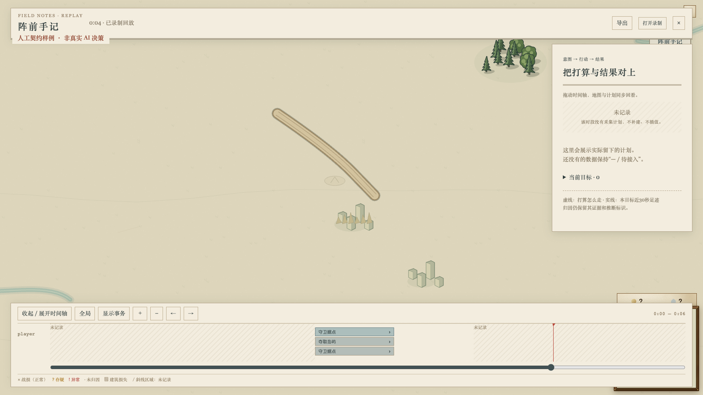

# 目标依赖图消费端

#576 保持 draft。入口是 `AiPlanTrace.goalPlanner?: GoalPlannerOutput`；本切片只读取共享输出，不调用规划器、事实读取器或动作 provider，不产生命令和资源租用。正式生产端尚未启用，因此本页的游戏内截图全部标注“人工契约样例 · 非真实 AI 决策”。

共同契约固定在 `feat/strategy-goal-planner` 的 `8afe8a35b3474855ac4352752cd1ffe0b6c999c9`（含 `GoalAlternative.declaration` 和精确 cargo/cohort 引用）。#576 以该分支为 base；后续接口增量和真实生产端接通后继续复核，尚未申请合并。

独立的五层版式见 [目标依赖图样稿](goal-dependency.html)。它使用版式专用假数据；这里的游戏内样例则直接使用 shared 类型约束的 `GoalPlan`，经过正常计划增量、debug 录制与回放界面。

## 从目标到结果

- 主图展示目标、世界事实和动作。箭头方向与 `requires` / `establishes` / `resource-before` 原记录一致；目标效果直接关联事实。节点可滚动查看，布局最多展开 200 个事实和动作，超出部分明确计数。
- 点击事实，查看未成立原因、`pending` 的稳定 requestId、可用时刻及满足它的候选方案。未来才成立的条件明确写“当前尚不可用”，不冒充当前就绪。原生证据、精确 cohort/cargo 引用、收入来源和绝对时间区间保留在可展开的结构化字段中。
- 候选方案优先读取自身完整动作声明，再查已选 actions；旧录制两处都没有时写“动作声明未记录”，不从 ID 猜测动作类型。落选方案的前置、执行器、成本和落选原因仍可核对。
- 点击动作，查看前置事实、前置动作、计划执行器、未来产物和预计时间。未来 output 引用不变成当前实体；计划就绪和命令接纳都不代表已经执行。
- 实际执行、兵力和预算只关联相同 objective、method、action 和 generation 的正式记录。计划资源需求、规划余额与实际已支付金额分开；同名动作的旧代次不算本次执行。
- 结果只读目标状态和世界效果观测；没有实际完成时刻就显示“—”。未知估值保持“—”，不会继承旧报价或替换成零。

底部泳道与原有回放进度联动。目标完成后又变为未成立时开始新的观察条带；缺少记录的时段仍显示“未记录”，不补建、不插值。旧模块和分配记录仍可读，未提供 `goalPlanner` 时明确说明未记录规划器输出。

## 通路与权限

首包带完整基线，后续 `goalPlannerDelta` 按稳定键更新事实、动作、候选和 cache.entries；缓存条目使用 goalKey。补丁更大时回退整值，旧的完整 header 录制仍可读取。缺少基线、owner 不匹配或可选字段删除冲突时不应用补丁，历史帧保持不变。

沿用现有 all / owner / none 服务端过滤和 debug 入口，没有新增可自选观众的通路。关闭视图且未录制时仍不观察、不构造 trace；客户端关闭时不构造依赖图 DOM。没有修改模拟、规则或校验和格式版本。

## 验证范围

```sh
npx tsc --noEmit -p .
npx tsc --noEmit -p tools/cli/tsconfig.json
npx vitest run src/client/ai-goal-plan.test.ts src/client/ai-plan-strategy.test.ts src/client/ai-plan-history.test.ts src/ai/plan-output-delta.test.ts src/ai/plan-observer.test.ts src/server/ai-plan-net.test.ts src/ai/plan-observation-gap.test.ts src/ai/think-worker/think-worker.test.ts src/sdk/package-boundaries.test.ts --maxWorkers 2 --minWorkers 1
SKETCH_MACHINES=~/.config/sketch/machines-camps.json bin/sketch yatu ai-goal-plan-contract --ref HEAD --on mac1 --locale zh-CN --json
```

定向测试覆盖不可变消费、未知值、未来可用、同代次关联、私有过滤、JSON 录制、增量、cache 单行变更和未记录空窗。沿用的运行时回归检查关闭时零构造，以及观察开关前后的逐命令和逐 tick 哈希一致。生产端尚未运行新规划器，这些回归不能代替新规划器的行为和性能验收；本轮没有跑胜率 benchmark。

在消费端代码 `dca0b4c4776b36f22623de0398118627c19ac229` 上，根和 CLI tsc 均退出 0；9 文件 48 项测试通过。后续本轮提交只补说明、原始截图及校验元数据。

mac1 场景使用真实 Metal 浏览器，导入人工契约录制，实际点击条件、动作和 pending 请求，并拖动回放检查增量帧及未记录空窗。截图只证明类型消费和游戏内展示，不证明真实 AI 选择或执行了这些动作。

实际鼠标分别拖到 tick 68 与 95，检查增量帧保留依赖图、空窗不显示计划。契约样例特意在落选原因中包含转义检查文本，页面只显示文字，没有创建图像节点；版式选择请看独立 HTML 样稿。

截图来源、逐文件 SHA256 和验证结果见 `goal-consumer-capture.json`。



