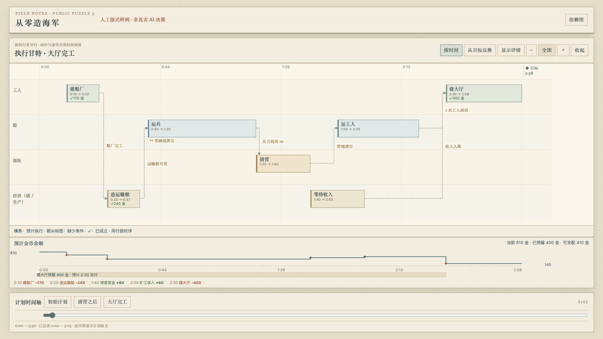
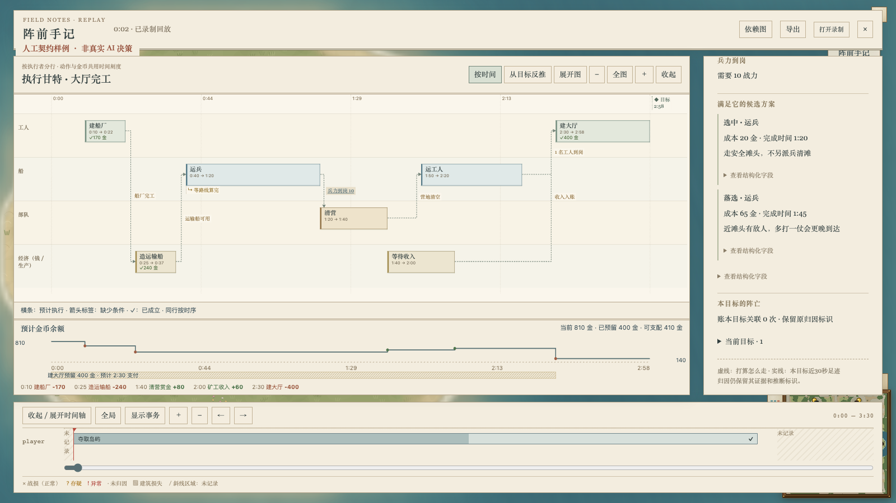
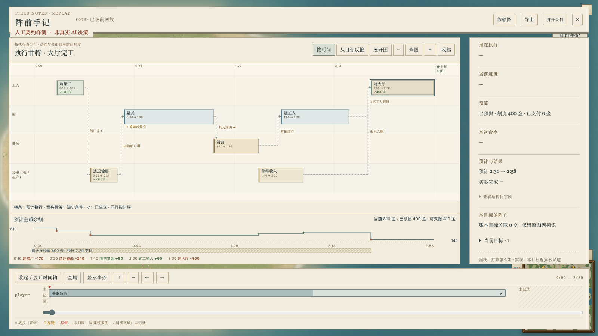

# 目标依赖图消费端

#576 保持 draft，已在 main `d36d0543` 上接入共享规划器前置 `8ada3fbe`（`feat/strategy-goal-planner`）。入口是 `AiPlanTrace.goalPlanner?: GoalPlannerOutput`；不调用规划器、事实源或动作 provider，不生成命令、兵力或预算。

当前样稿：[从零造海军，双击打开](goal-navy.html)。它与游戏叠加层使用相同的渲染函数，由 `scripts/export-goal-plan-mockup.ts` 导出，单文件、无需联网。默认是带依赖箭头的执行甘特图，点击动作条或条件标签打开侧栏，支持缩放、查看原始字段和切换时间；也可切换“从目标反推”。

## 公开第 3 题的人工展示

这是公开题“从零造海军”的**版式样例**，不是规划器解题结果。所有页面和截图始终标记人工数据。

- 船厂 170、运输船 240、大厅 400，直接读取游戏 catalog；初始 810 金。
- 展示建船厂 → 造运输船 → 运兵 → 清营 → 运工人 → 建大厅。运兵和运工人共用船，造船同时依赖船厂与金币；大厅需要工人、清空的营地和建造费。
- 资源带先支付 170 和 240，余额保留 400；随后示意赏金 +80、矿工收入 +60，最后支付大厅 400，剩 140。80 和 60 是明确的人工演示金额。
- 当前大厅预留 400 来自样例里显式的正式 budget。图上斜线段延伸到预计付款时间，属于展示投影；不会因此生成或复制一笔世界资源。付款后显示已预留 0、可支配 140；没有预算记录时显示“—”。
- 三帧分别是 tick 50、2100、3600。清营前后和大厅完工由时间轴切换；50 以前及 3700 以后明确显示“未记录”，帧间保持已记录帧。

## 阅读顺序与原始记录

默认按工人、船、部队、经济（钱 / 生产）分行。动作横条从预计开始延伸到预计完成，两端与金币收支共用时间坐标；缩放和横向滚动保持同步。同类同时执行的动作在这一类内分轨，保留各自起止时间。行名按原子动作声明分类，不把计划中的执行者冒充已经派出的真实单位。

时间视图不再画独立条件方块：缺的条件写在跨行直角依赖箭头上，例如“兵力到岗 10”；没有已记录生产动作的条件直接标在动作条旁，例如“等路线算完”。已经成立的条件贴在横条上，例如“✓400 金”。同行依赖按时间顺序读，不另画箭头；间接依赖经已有路径可达时省略重复连线，原始前置与边全部保留在侧栏和结构化记录中。完整原始记录仍可逐项核对。

缺动作时间时列在“时间未记录”，不拿零点或 deadline 补 ETA。条件和目标的预计生效时刻保留 availableTick 与 start / finish / offset 语义；多个贡献者缺任意一个 ETA 时保持未知。

“从目标反推”视图保留目标 → 条件 → 动作 → 前置的方块图，循环用前向引用叶子保留。三个样例时刻（50 / 2100 / 3600）的反推 HTML 与调整前逐字节一致。两种模式都只投影视图，不改原始边、ID、方向或计划数据；时间视图最多展示 200 个动作，反推视图最多 200 个事实与动作。

节点和侧栏用中文说明条件、动作、当前进度、预算及结果。pending 路线显示“等路线算完”；缺少执行者、时刻或数值时显示“—”。内部 ID、requestId、执行器代码、原生证据及完整声明收进结构化详情。候选方案仍保留选中/落选、成本、完成时间和原因。

实际执行、分配和预算只关联同一 objective、method、action、generation。当前现金与预留来自 trace；余额曲线直接读取 resourceTimeline 的 before/delta/after，不重新计入收入或赏金。旧代次不能冒充当前执行；未来 output 引用不会变成真实单位。

## 增量、权限与关闭开销

首包完整基线，后续 goalPlannerDelta 按稳定键更新，cache.entries 使用 goalKey；补丁更大时退回整值。旧完整 header 录制仍可读取，历史帧保持不变。目标完成后再次出现会重新起条带；未记录时段不补建。

沿用 all / owner / none 的服务端可见性和现有 debug 入口。关闭视图且未录制时不观察、不构造 trace；关闭时不构造图 DOM。未修改模拟、规则或校验和格式版本。没有新规划器的真实决策、执行或负载证明，后续仍等共同候选和生产端。

## 验证

本次变基代码头 `e5939e9f1139287b4799fc1c11da0946832c62d9`：根/CLI tsc 均退出 0，10 文件 56 项复验通过，生成页一致性检查通过。消费端、场景及生成 HTML 与变基前逐字节一致，没有修改版式。下面的截图继续保留其真实来源 `45f00a38` 和当时契约 `8afe8a35`；本次没有重拍人工图，也不把旧图标成新版本实战。待真实规划器输出稳定后再换实战截图。

代码源 `45f00a38c3fba73521fcabfe30c7a4a91753e258`：根/CLI tsc 均退出 0，10 文件 56 项通过。新增检查包括执行者分行、动作起止点与金币事件共用坐标、同行无箭头、重复间接连线省略、并行动作不重叠、未知 ETA 不补值、start / finish / offset 生效时刻、反推切换、原生记录不可变及 400 金保护。现有通路回归仍检查零构造、私有过滤、不可变回放、worker、观察开关前后逐命令和逐 tick 哈希一致。

```sh
npx tsc --noEmit -p .
npx tsc --noEmit -p tools/cli/tsconfig.json
npx tsx scripts/export-goal-plan-mockup.ts --check
npx vitest run src/client/ai-goal-plan.test.ts src/client/ai-goal-navy.test.ts src/client/ai-plan-strategy.test.ts src/client/ai-plan-history.test.ts src/ai/plan-output-delta.test.ts src/ai/plan-observer.test.ts src/server/ai-plan-net.test.ts src/ai/plan-observation-gap.test.ts src/ai/think-worker/think-worker.test.ts src/sdk/package-boundaries.test.ts --maxWorkers 2 --minWorkers 1
SKETCH_MACHINES=~/.config/sketch/machines-camps.json bin/sketch yatu ai-goal-plan-contract --ref HEAD --on mac1 --locale zh-CN --json
SKETCH_MACHINES=~/.config/sketch/machines-camps.json bin/sketch yatu ai-goal-navy-mockup --ref HEAD --on mac1 --locale zh-CN --json
```

mac1 使用真实 Metal GPU。游戏场景实际点击候选和预算、鼠标拖到清营后/完工/未记录时段；独立 HTML 从 file 打开并重开。两处均测量 0:10 / 0:25 / 2:30 三次支出的横条起点，以及 1:40 赏金 / 2:00 收入的横条终点与金币标记，覆盖默认、视图切换、放大并横向滚动 190px，最大误差小于 0.04 CSS px；候选、预算、结果及未记录处理保持原样。一次鼠标拖动未命中完工区间，同一源单独复测后 tick 2160 / 3650 / 4000 均准确落位；失败尝试也保留指针。8 张最终原图逐张查看；SHA256、实际拖动 tick 和来源见 [goal-consumer-capture.json](goal-consumer-capture.json)。本轮不跑胜率 benchmark；未把人工场景当作真实 AI 或性能验收，也未新增完整 src 测试。

CLI 增量复制会漏带 docs 文件，因此独立页面用该源的 git archive 放入 mac1 的独立目录 `runs/camps-navy-preview-45f00a38`；没有覆盖版本缓存。完整副本可直接运行常规命令。





[清营之后](goal-contract-progress.png) · [大厅完工](goal-contract-result.png) · [未记录空窗](goal-contract-unrecorded.png) · [游戏内全图](goal-contract-overview.png)
