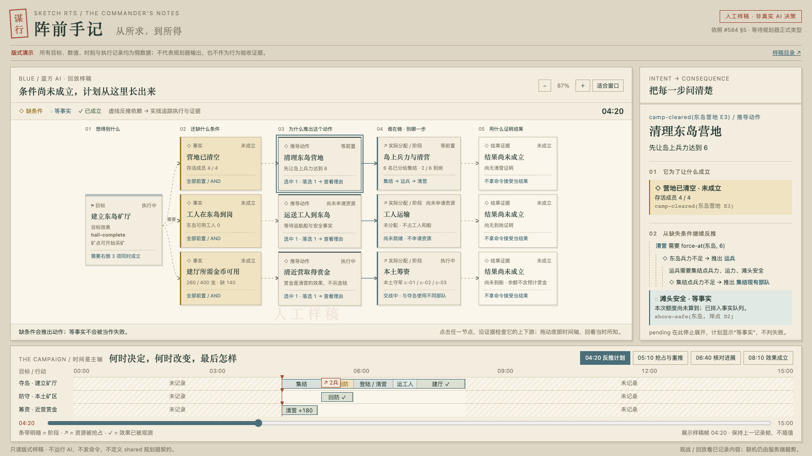
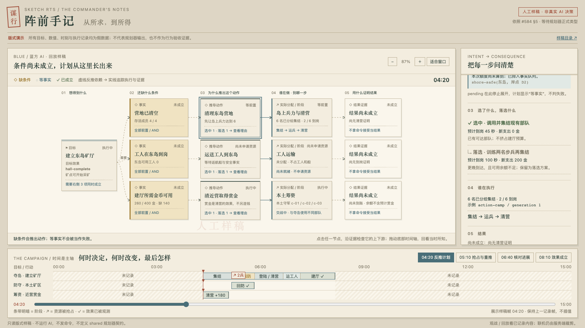
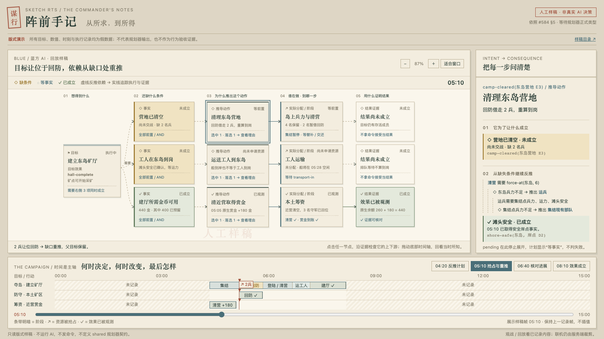
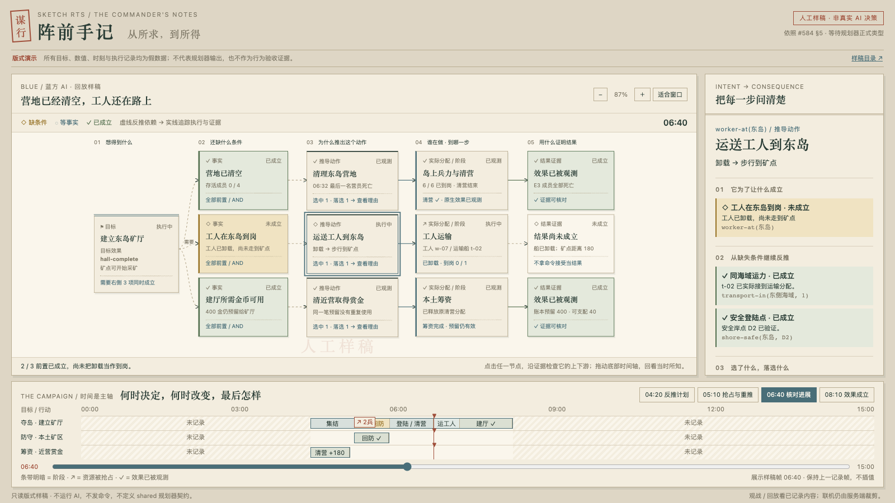
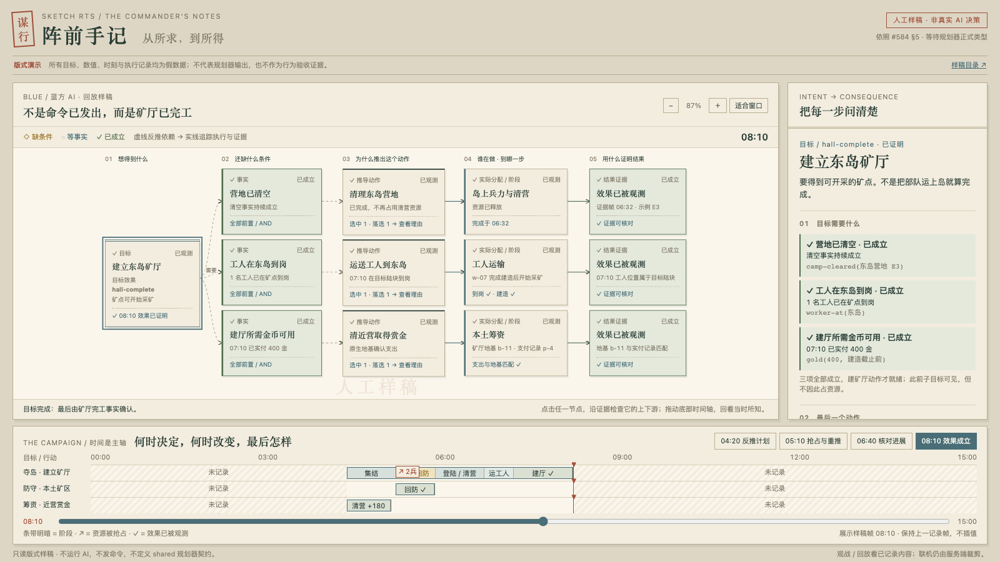

# 第一版目标依赖图（历史样稿）

当前样稿已换成[从零造海军](goal-navy.html)，分叉、汇合、按时间推进与金币对齐见[当前说明](goal-consumer.zh.md)。

以下保留第一版来源。[打开历史样稿](goal-dependency.html)。HTML、CSS、JS 随目录提供，无联网、服务端或游戏依赖；正文采用系统中文字体。

依据 #584 的 `docs/ai/objectives/goal-planner.zh.md` §5（main `d4ca2668`）：目标 → 未成立的条件 → 推导动作与落选方案 → 执行者与进度 → 结果。

本页全部使用**人工假数据**，页面和截图始终保留标记。时间、金额、实体 ID、执行阶段及原因仅演示版式，不是规划器输出、残局题或真实行为证据。

## 怎样读

- 主图从左向右读：目标需要哪些事实；哪些动作能满足这些事实；谁实际执行；哪些效果已经有证据。虚线表示反推依赖，实线表示执行与观测。
- 点击节点，右侧显示更深的前置，例如清营需要岛上战力，岛上战力又需要运兵和集结；同一条件的落选方案连同时间、成本和原因保留。
- 事实区分已成立、未成立和 `pending` 等事实。未就绪的动作显示“尚未申请资源”；计划中的执行器和实际分配不同。卸载不等于工人到岗，命令接受也不等于效果完成。
- 底部保留整局 0–15 分钟的横轴。四个关键时刻分别展示反推计划、两名兵让位回防、清营完成但工人未到岗、矿厅完工。阶段条带与图、面板同步。
- 样稿只提供 04:20–08:10 的四帧；拖动到前后区间明确显示“未记录”。帧间保持上一帧，不插值、不补建。可缩放依赖图，并滚动查看节点。

## 类型接入

32 已提供 `fa9fff25` 的 `GoalPlan`、事实、动作、边、候选、数量时间账本和分配关联类型。版式脚本中的演示对象只属于本地样稿，不导出为 shared 契约。

正式类型的[游戏内消费端](goal-consumer.zh.md)已在共同基础设施栈上接线：事实 `pending` 保留稳定 requestId；动作就绪与实际执行分开；执行只关联同一 objective/method/action/generation 的真实分配与回执；结果只读世界效果观测，未来产物保留 output 引用。正式入口是 `AiPlanTrace.goalPlanner?: GoalPlannerOutput`，没有复制或伪造公共事实队列。生产尚未运行规划器时，缺少字段就表示未记录输出；人工契约样例不作为真实对局证据。

`#576` 继续保持 draft。已有分配接线和验证记录见 [allocation-wiring.zh.md](allocation-wiring.zh.md)；它们是上一轮的基础设施，新的展示主线由这张依赖图取代。

## 浏览器检查

```sh
SKETCH_MACHINES=~/.config/sketch/machines-camps.json bin/sketch yatu ai-goal-dependency-mockup --ref HEAD --on mac1 --locale zh-CN --json
```

场景从本地文件打开样稿，检查依赖、落选原因、等待事实、抢占后父目标保留、卸载与到岗区分、真实鼠标跳到未记录时段、最终效果证据和重新打开文件。该检查只证明样稿显示及交互，不证明规划正确或 AI 执行。

本次 mac1 检查发现 CLI 增量副本漏带新 docs 页面。截图使用版本 `d22bff3e` 的三个静态文件，经 `git archive` 传到独立运行目录 `camps-goal-preview-d22bff3e`，将场景的文件路径指向该目录后运行；没有覆盖缓存副本。源文件和截图的 SHA256 见 `goal-dependency-capture.json`。常规命令从完整副本运行即可。

五张 mac1 原始截图已逐张检查，浏览器检查通过、无页面错误。CLI tsc 和 SDK 边界检查通过。






