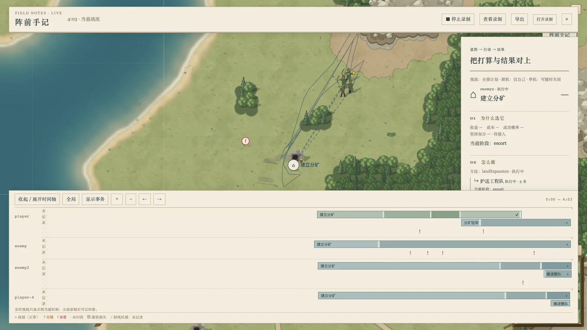
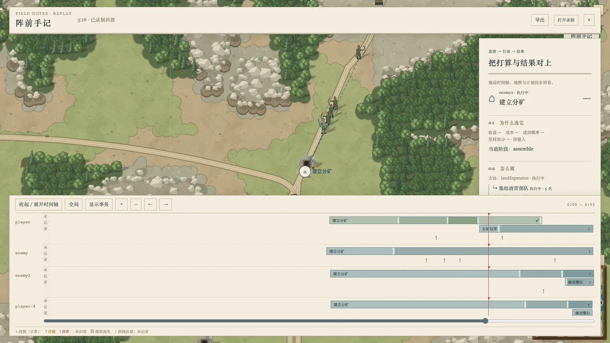

# 游戏里的阵前手记

游戏中点右上角「阵前手记」，直接在当前战场看目标、意图箭头和阵亡位置。底部是各 AI 的阶段泳道，右侧把选择理由、执行步骤、单位与资源、进展和结果放在一起。选中目标才展开它的行军线；虚线表示意图，实线表示该目标近 30 秒记录到的足迹。任务切换、缺采样和未记录区间处断线。



「录制」是独立开关，关闭视图后可以继续录制。停止后可查看或导出当前片段，也可从主页「打开调试录制」载入 JSON。重新开始录制会建立新片段，上一份可先导出。回放使用已有 debug replay 的命令帧和检查点，在 match worker 中定位；拖动滑块同时更新实际游戏世界、目标、面板和游标。



## 采集边界

- 从打开视图或主动录制开始采集。两者都关闭时，不构造 trace、归因上下文、死亡账本或实体索引；客户端的历史容器也在首次打开时创建。关闭后的每次 think 仍走原来的规划入口。
- 不补建过去的计划，不默认录整局。时间轴的斜线区写「未记录」。视图断开后重新打开，只取当前基线；即便服务器仍在录制，也不把客户端漏收的时段连接成连续阶段。完整的已录片段通过「查看录制」读取。
- 命令先从 AI 线程发出，之后构造独立的诊断回复。诊断失败不会丢弃已完成的命令帧。旧观察代次的晚到回复被丢弃；读出或停止录制前会收取已经到达的回复，不消费命令队列、不推进游戏。
- AI 记忆留在思考线程。跨线程只传模块投影和必要的归属事实，含已观察单位、任务、清营目标 ID、一般部队状态及应急标识；闭包不跨线程。伤害、击杀、订单和移除仍由模拟线程上的原生观察器记录。

## 通路与可见性

`AiRuntime / think-worker → AiPlanObserver + AiDeathLedger → AiPlanDelta → RoomNetHub / match-worker → AiPlanHistory → 游戏 Canvas + DOM 面板`。

每位 AI 首次观察有一份基线，之后传变更的 header 字段、节点 upsert/remove 和已分配单位的 think 位置采样。死亡记录与精确建筑损失分别追加事件。录制把相同输出附在已有 `DebugReplayTrace.aiPlans` 中；不放进 Game、AI 记忆、命令帧、存档快照或校验和。`RULES_VERSION` 和 `CHECKSUM_VERSION` 不变。

服务器按房间已有的 join 身份裁剪：观战看全部，正在对战的席位看自己。订阅消息不能指定其他 owner。读取录制计划使用服务器在该订阅上签发的随机访问标识，绑定房间与席位；任意 `viewer` 查询参数不能改变权限。标识随断线或重新 join 失效。对局结束后，回放可以读取所有**确实录制过**的计划。单机数据直接来自本地 match worker，视图默认关闭。

节点状态、效用项、资源预留、方法和时间信息均取记录；没有的仍为「— / 待接入」。到岗标识不会冒充精确到达时刻。完成条带在首次记录到完成时结束；模块不再保留的目标单列「不再保留（结果未记录）」，不推断为失败。

死亡主分类直接使用账本的正常、存疑、异常和未归因，活着到期不计作阵亡。详情保留主分类、全部子标签、任务步骤与致命来源，并标明「推断（账本）」。目标只关联同一席位、同一任务身份及本次目标时段内的记录，不用当前单位名单或地理接近猜测归属。建筑损失要求原对象 HP ≤ 0 且已被原生移除，普通消失不算损失。

## 验证

固定交付时刻下，观察开关前后的命令逐字节一致、逐 tick 校验和一致。覆盖 inline planner、复制消息的 AI 线程、房间帧与 debug 录制；原有真实 Node worker 等价测试继续通过。另有关闭时零构造、故障不吞命令、命令先于诊断出队、角色裁剪、访问标识、重连缺口、阶段终点、同时阵亡分行和录制回放恢复测试。

```sh
npx vitest run src/ai/plan-observer.test.ts src/ai/plan-observation-gap.test.ts src/ai/think-worker/observation.test.ts src/ai/think-worker/think-worker.test.ts src/server/ai-plan-net.test.ts src/client/ai-plan-history.test.ts src/client/match-worker/match-thread.test.ts
npx vitest run --dir src --maxWorkers 2 --minWorkers 1
npm run build
SKETCH_MACHINES=~/.config/sketch/machines-camps.json bin/sketch yatu ai-plan-overlay --ref HEAD --on mac1 --locale zh-CN --json
```

## mac1 真 GPU 证据

[原始计量摘要](runtime-mac1.json)记录采样提交 `b2368423`、场景与各压缩 trace 的 SHA256。GPU 为 **Apple M3 Ultra / ANGLE Metal**，场景运行一局真实双岸四 AI 对局。观战拍摄于 tick 4860；回放使用真实鼠标拖动到 tick 3922。两张截图均逐张检查，浏览器没有页面或控制台错误。

性能测量先关闭录制，再交替关闭/打开视图，各采 6 秒 Chrome trace，每轮实际推进 115 tick。同一局、同一镜头；表中是 `FireAnimationFrame` 的线程时间，不用 FPS 判断。游戏在测量中继续运行，因此各轮局势有小幅变化。

| 轮次 | 视图 | 帧 JS 中位数 | 帧 JS p95 | 帧 JS 最大值 |
| --- | --- | ---: | ---: | ---: |
| 1 | 关 | 4.218 ms | 6.097 ms | 8.474 ms |
| 2 | 开 | 4.456 ms | 8.989 ms | 10.709 ms |
| 3 | 关 | 4.731 ms | 7.293 ms | 8.300 ms |
| 4 | 开 | 4.593 ms | 8.086 ms | 12.265 ms |

计划层绘制中位数均为 **0.1 ms**，包含每秒面板/时间轴更新的 p95 为 **3.5 / 3.901 ms**，最大 **5.4 ms**；接收增量的 p95 为 **0.101 / 0.199 ms**。关闭两项开关的两轮均为 **0 个计划层计时事件**。该样本的帧 JS 峰值保持在 16.7 ms 内；这些数字只说明此局此镜头的 CPU 成本。

整次操作收到 1,354 个计划包，共 1,325,081 字节，含重复开关的基线；记录片段为 tick 60–4860，保留 1,289 个增量/事件/覆盖区间包及 8 次阵亡。分类来自采样时 main 的账本代码，后续清营分类修正不能当作 AI 行为改变。

未改动的原始 PNG、四份 Chrome trace、摘要及逐文件校验表存于 A100 的 camps 范围，见 [来源与归档指针](runtime-capture-source.json)。
