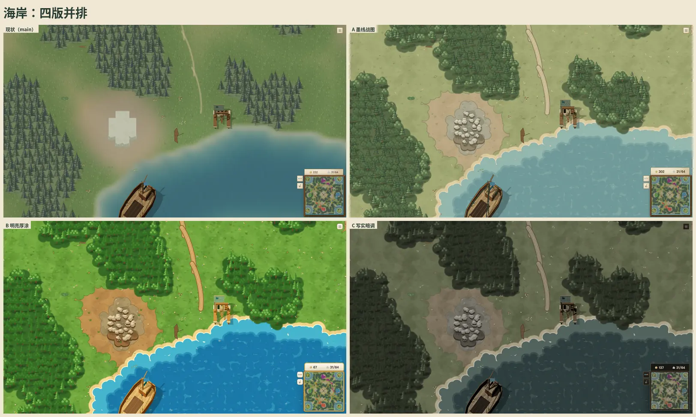
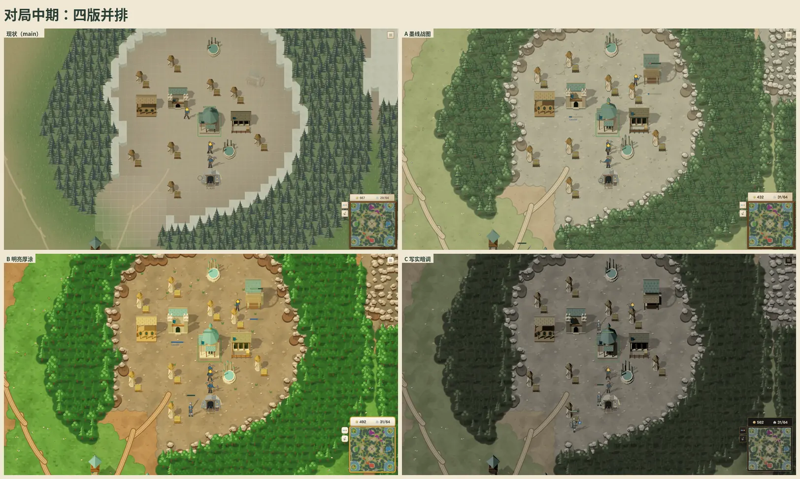
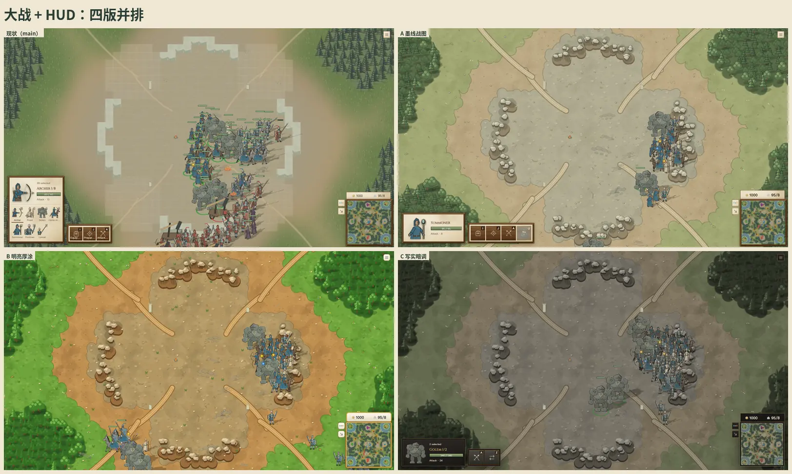
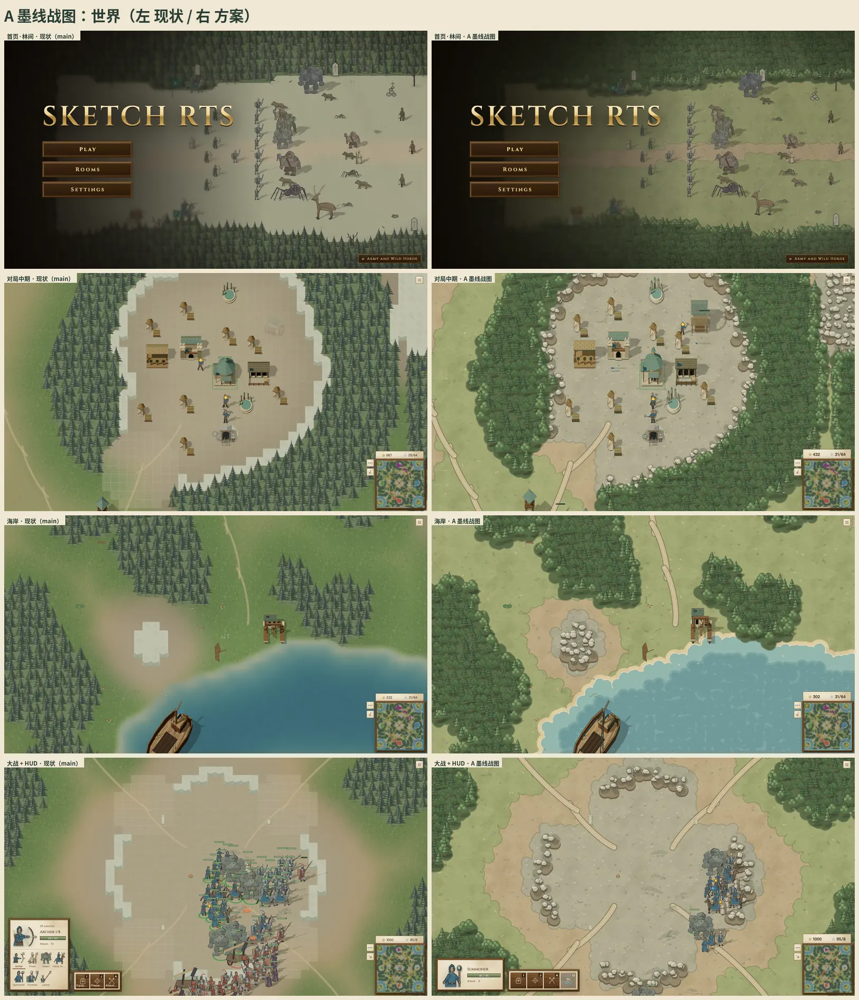
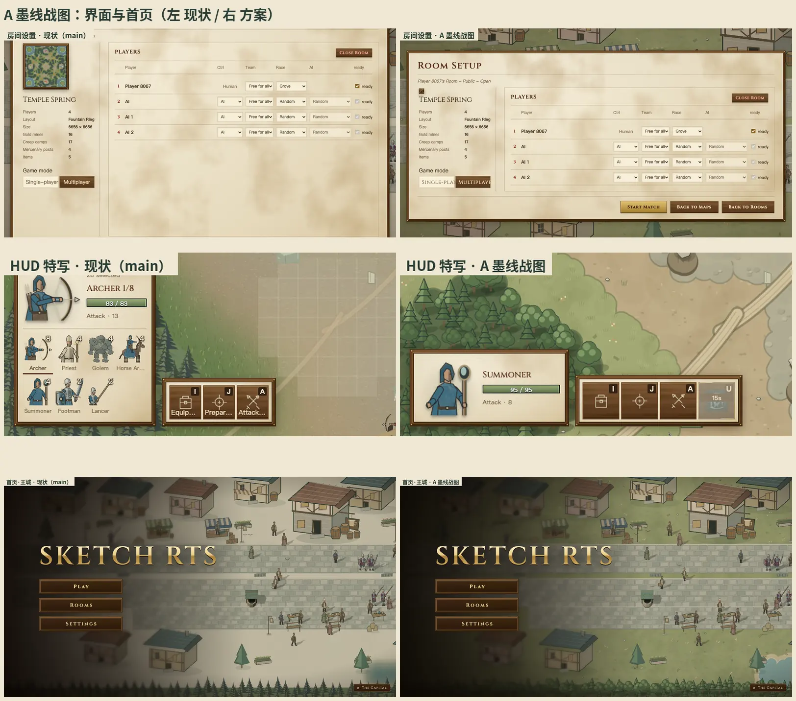
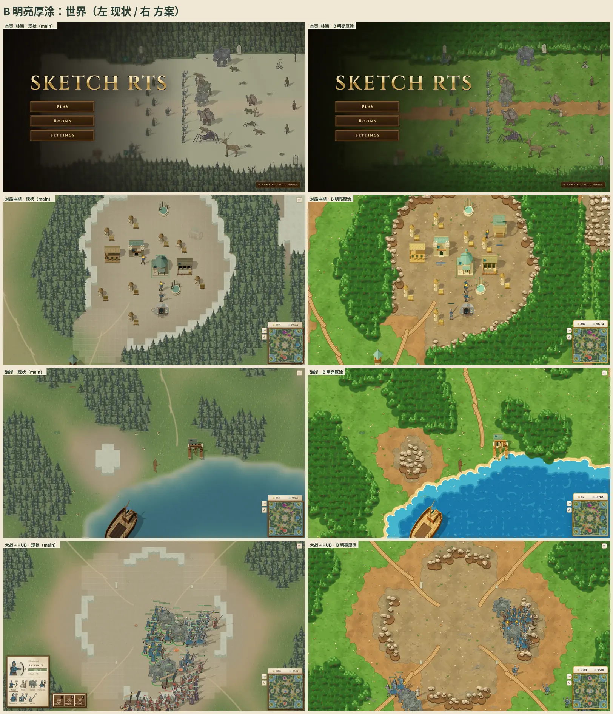
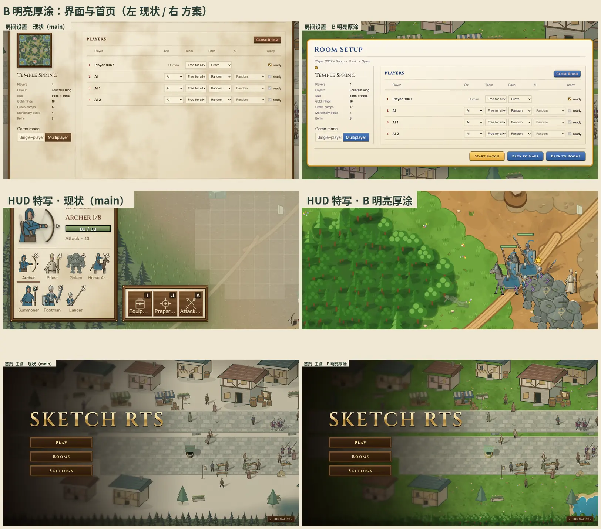
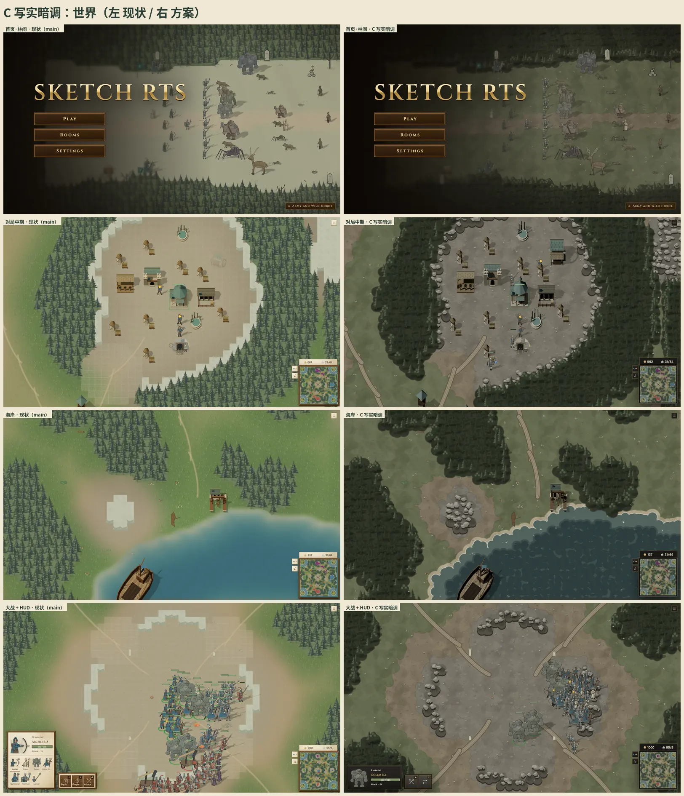
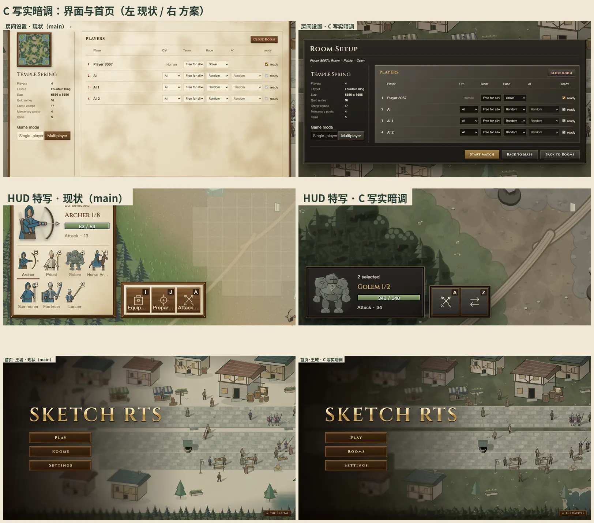

# 美术方向：三版效果图

[返回美术方向](art-direction.zh.md)

owner 从下面三版里挑一个方向，挑定后再写进 [美术方向](art-direction.zh.md) 当标准。三版用同一套地形结构（第一节的规则），区别在调色、线条、明暗和界面材质。

## 这些图是怎么来的

- 都是真实游戏画面：main `13d0a870` 加一个临时补丁，在 mac1 上用 Playwright 截图，分辨率 1600×900。
  - 补丁只用来出图，不进任何 PR。
  - 补丁内容：
    - 一个新的地形画法（按第一节的规则写）。
    - 建筑和船的模型着色：A 加墨线和三阶着色；B 调高饱和度；C 保持原样。
    - 每版自己的灯光和曝光。
    - 一份界面样式覆盖。
- 同一画面的四张图来自同一局：同一张地图（神泉殿 Temple Spring），由 AI 托管九分钟。
  - 截图时服务器停止自动推进；切换方案靠重载页面，载入期间客户端还会走几帧，所以人物位置略有出入。地形和建筑完全一致。
- 三版里建筑都加高了 1.55 倍，占地不变。
- **没改的东西：**
  - 人物卡片在三版里都是现在的墨线画法，B 和 C 落地时都要重画人物，见各版工作量。
  - 界面只改了样式，没改布局。A 里「单人/多人」切换按钮的文字被截断，是临时样式的问题，不是方案本身。

## 一、地形：HoMM3 借鉴分析 → 我们的地形规则

owner 的判断：地形要改的最多，也最难设计，标杆是《英雄无敌 3》（HoMM3）的冒险地图。下面只借原则和规则，不用它的任何素材。参考图都用外链，仓库里只放我们自己游戏的截图。

### HoMM3 的地形是怎么做出来的

事实来自开源引擎 VCMI 的源码和数据，以及 HoMM3 社区 wiki：

- **格子和图层**：地形是 32×32 的格子。每格存三层：地表、河流、道路，各自有类型、帧号和两个镜像位。帧号在编辑器里选定后存进地图文件，只镜像不旋转（[TerrainTile.h](https://github.com/vcmi/vcmi/blob/develop/lib/mapping/TerrainTile.h)、[地图格式](https://github.com/vcmi/vcmi/blob/develop/docs/modders/Map_Object_Format.md)）。
- **地表之间不直接相接**：草地、雪地、沼泽、粗砺地、熔岩之间，以及它们和泥地之间，都画一圈**泥土边**；对沙地、水和岩石则画一圈**沙边**。泥地只对沙、水、岩石画边，沙地从不画边。所以两种鲜艳的地表中间总隔着泥或沙，岸线和沙滩是自动长出来的；美术成本随地表种类线性增长，不随组合数增长（[terrainViewPatterns.json](https://github.com/vcmi/vcmi/blob/develop/config/terrainViewPatterns.json)、[CMapOperation.cpp](https://github.com/vcmi/vcmi/blob/develop/lib/mapping/CMapOperation.cpp)）。
- **选边规则**：每种边是一个 3×3 模板，八个邻格各写一个条件（同类、泥边、沙边、泥或沙但全模板一致、任意……）。按文件顺序、在四种镜像下逐个匹配，第一个匹配的模板胜出，再在它的帧范围里随机取一帧。
- **最小特征 2×2**：每格都必须落在一个同类地表的 2×2 方块里，编辑器会把违反的格子改掉，所以没有单格孤岛和单格细颈。
- **安静的底纹 + 配额细节**：每种地表有 8 块素格、16 块带装饰的格；随机地图生成器只用 15% 的装饰格，源码注释写的是「为了地图更好读」（[RmgMap.cpp](https://github.com/vcmi/vcmi/blob/develop/lib/rmg/RmgMap.cpp)）。
- **阻挡来自物体，不来自地面**：树林、山、湖都是放在地上的障碍物，每个物体带一张格子遮罩（阻挡 / 可走 / 可访问），高的美术可以盖住后面可走的格子。障碍物按区域成套（这里是山 + 树，那里是湖 *或* 陨坑，再配小植物和石头）。
- **高度靠画出来**：没有高度图，悬崖和岩壁是带阴影的边缘贴图；岩石边是少数**不镜像**的贴图，因为镜像会把亮面翻到背光的一侧。
- **道路和河流按连通性选形**：看八个邻格有没有路，选直、弯、T、十字、尽头；道路贴图向下错半格，正好盖住格缝。道路分泥路、碎石路、石板路，移动消耗依次为 75%、65%、50%（[Road](https://heroes.thelazy.net/index.php/Road)、[CDrawRoadsOperation.cpp](https://github.com/vcmi/vcmi/blob/develop/lib/mapping/CDrawRoadsOperation.cpp)）。
- **只有水在动**：只有水、熔岩和河流循环几个调色板颜色，地面是静的。
- **统一方向的接触阴影**：VCMI 仿 HoMM3 给每个物体一个半透明的柔和投影，方向固定（[SDL_Extensions.cpp](https://github.com/vcmi/vcmi/blob/develop/clientsdl2/render/SDL_Extensions.cpp)）。

参考画面（外链）：[HoMM3 地图编辑器](https://heroes.thelazy.net/index.php/Map_Editor)、[编辑器界面标注图](https://heroes.thelazy.net/index.php/File:H3hotamaped_explained.png)、[地表一览](https://heroes.thelazy.net/index.php/Terrain)、[VCMI 编辑器截图](https://vcmi.eu/img/screenshots/main_page/Editor.webp)、[VCMI 地形格式文档](https://vcmi.eu/modders/Entities_Format/Terrain_Format/)。

### 拆成我们的规则，并对照现状

我们是即时战略，地形是规则的一部分（格子 32 世界单位，有可走、不可走、浅水、高地、坡道），不能照搬回合制的贴图拼接。下面每条写成我们自己的规则，最后一列是现在 main 的样子。

| # | 规则 | 来自 HoMM3 的哪一条 | 现在 main |
| --- | --- | --- | --- |
| 1 | **泥土是底，其它地表盖在上面**：草地、沙地、碎石按环境场选出主地表，以有机的块盖在泥土上，每块带一圈手绘边（比本色深一阶的描边带）。两种饱和的地表之间必隔泥或沙 | 地表不直接相接，经泥或沙过渡 | 四种地表按连续权重**混合**：一格 1 像素的颜色图放大后模糊过渡，边界是糊的，没有边 |
| 2 | **水岸一律经沙滩**：陆地 → 沙滩带 → 浪花白边 → 浅水 → 深水，层次分明 | 水只取沙边，岸线自动成沙滩 | 几十像素宽的模糊渐变，没有岸线 |
| 3 | **最小特征 2×2**：小于 2×2 的地表块并入周围 | 2×2 最小特征 | 没有约束（效果图里还没做） |
| 4 | **底纹安静，细节按配额**：每种地表一张低对比的大斑块底纹 + 一层中频笔触（草叶、碎石、沙纹）；可走地面上的小装饰（花、草丛、小石）不超过格子的 16%，而且都是矮的 | 8 素格 + 16 装饰格，只用 15% | 草地是均匀细噪点；装饰物刻意画得很淡 |
| 5 | **不可走 = 有体积的东西**：森林是树的团块，岩区是成堆的岩块；地面颜色本身不表达阻挡 | 阻挡来自障碍物 | 森林是同一棵松树等距铺满；岩区是浅色方块 |
| 6 | **林缘**：林缘的树更大更亮，林内更暗；两三种树形混合（松树 + 阔叶） | 障碍物成套、成区域 | 单一树形，林缘直接截断 |
| 7 | **高度画出来**：岩区和高地的边缘，朝南的一侧画崖面（暗面带 + 竖向岩纹），朝北一侧不画；岩块有亮顶和暗侧；崖面贴图不镜像 | 悬崖是带阴影的边缘贴图，岩边不镜像 | 按格子画的直角台阶，浅色石块像体素 |
| 8 | **路要清楚**：路有边、有路基、有两道车辙，宽度不小于一个步兵 | 道路是独立图层，按连通性画 | 很淡的半透明曲线 |
| 9 | **统一接触阴影**：树、岩块、建筑都有半透明的接触阴影，方向和人物一致（右下） | 固定方向的柔和投影 | 树有，岩块没有 |
| 10 | **地面静止，只有水动**；**同一种东西在世界、小地图、头像里同一个颜色** | 只有水和熔岩动；小地图颜色编码地表 | 水在世界里和小地图上颜色不同 |
| 11 | **不出现格子痕迹**：地面上没有方格、分块接缝、调试网格 | — | 高地上有浅色方格（原因见下），512px 分块有细缝 |

方格的原因已经查到：高地每格画一个半透明矩形，并且向四周各多画 1px（`terrain-art.ts` 里 `fillRect(col * size - 1, row * size - 1, size + 2, size + 2)`），相邻格的重叠处透明度叠了两次，就成了网格。改成整块高地一次填充就没有了。效果图里三版都已经这样处理。

效果图实现了第 1、2、4、5、6、7、8、9、11 条；第 3 条（2×2）和第 10 条（小地图同色）留到正式实现。

## 二、三个方案

先看同一画面四版并排，再看每版自己的左右对比。

### 方案 A：墨线战图

一张用墨笔画过的战争地图。暖灰纸色，低饱和；所有东西一支笔描边（深绿墨线 `#293c35`），三阶平涂。界面保留胡桃木框和羊皮纸，只统一字体、字号和面板尺寸，HUD 按钮放大、名字收进提示框。

- **优点**
  - 和现有人物、首页街景是同一种画法，人物几乎不用动。
  - 墨线让单位、建筑、岩块、树在任何底色上都读得清，大战里也不糊。
  - 地形按上面的规则做出来后，最像「一张地图」。
- **缺点**
  - 色彩最克制，第一眼没有 B 热闹。
  - 墨线密度高的地方（森林）容易显得满，林内的树需要减线。
- **工作量**
  - 地形：大。新的地形画法，加上 2×2 规则和小地图同色。
  - 建筑和船：中。world3d 加屏幕等宽墨线和三阶着色；效果图里的墨线是固定宽度的反向外壳，正式版要按屏幕定宽，并处理桅杆这类细件。
  - 界面：中。
  - 人物：小。

### 方案 B：明亮厚涂

最接近 HoMM3 的那种饱和、暖、热闹：亮绿的草地、橙黄的泥路、湛蓝的海，白色浪花沙滩，金边蓝底的纹章式界面。不描墨线，用同色相的深色收边。

- **优点**
  - 第一眼最「像游戏」，海岸和林缘的观感最接近 HoMM3。
- **缺点**
  - 队色要和饱和的地面抢眼，需要专门调。
  - 人物现在是低饱和、有墨线的画法，放在 B 的地面上明显发灰、发硬（效果图里能看到）。要统一，人物和建筑都得按 B 重画配色、去掉墨线。
  - 饱和度高的画面，大战时单位和地面的对比会被压缩，需要更强的人物轮廓或阴影。
- **工作量**
  - 地形：大（和 A 同一套结构，换色板和笔触）。
  - 人物：大。所有单位卡片重新配色、改收边。
  - 建筑：中。
  - 界面：中。整套新的界面材质。

### 方案 C：写实暗调

低饱和、高对比、偏冷的写实战场：深色森林、灰色岩地、暗青的海，界面是深色皮革和铁框、黄铜字。不描线，靠明暗和材质。

- **优点**
  - 船和建筑的写实模型在这里最协调；气氛严肃，适合「物理战争」的定位。
  - 深色界面压得住各种地面，HUD 在战场上最不抢眼。
- **缺点**
  - 程序生成的平涂地表一压暗就显得空，写实需要真正有细节的地表贴图，靠程序笔触撑不住。
  - 平涂墨线的人物卡片和写实环境冲突最大；暗色下队色和单位的辨识度最差（效果图里大战的蓝军已经和地面贴得很近）。
- **工作量**
  - 地形：很大。需要绘制或生成成套的写实地表贴图。
  - 人物：很大。卡片画法要整体改写。
  - 建筑：小（保持 PBR）。
  - 界面：中。

## 三、我的建议

选 **A**，并从 B 借两样东西：海岸的层次（沙滩、浪花、深浅水），以及草地和泥路的暖度（饱和度在 A 的基础上提一点，不到 B 那么高）。

理由：

- A 是唯一一个人物不用重画的方向。
- 地形规则在 A 下最完整地落地，而地形是这次要改的最多的部分。
- 墨线保证了大战时的可读性。

B 和 C 的观感优势都要以重画全部人物为代价。

## 四、选定之后

1. 把选定的方向和第一节的地形规则合并进 [美术方向](art-direction.zh.md)，删掉落选的方案。
2. 按地形 → 建筑 → 界面 → 人物 → 船的顺序分批提 PR。地形升为第一批，每批带改动前后截图。
