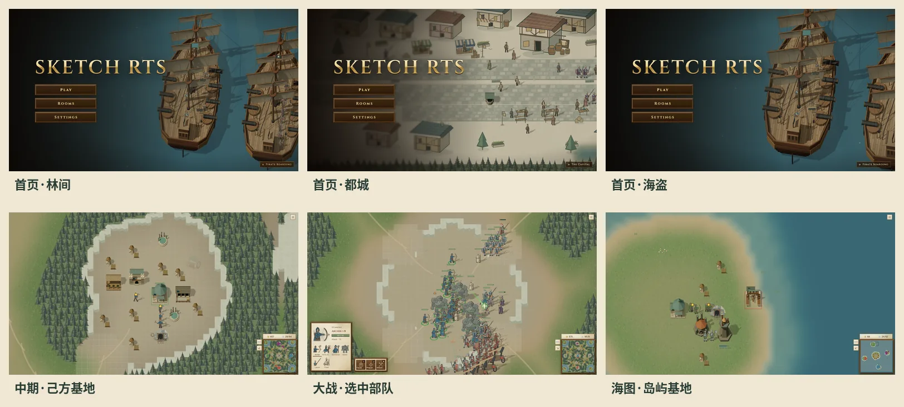
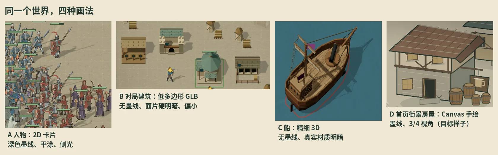
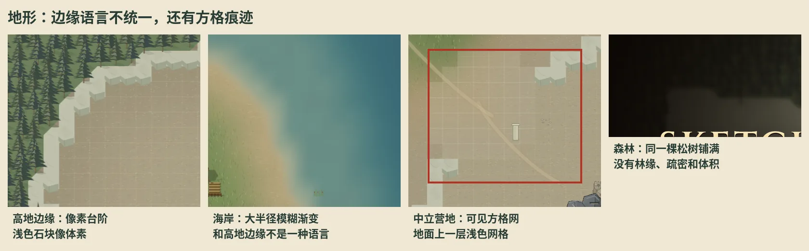
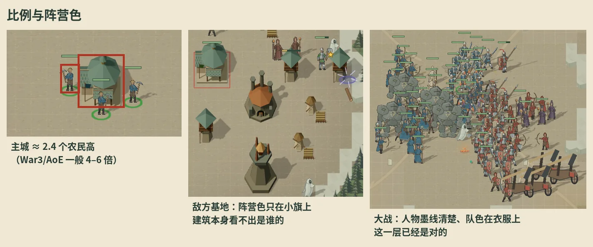
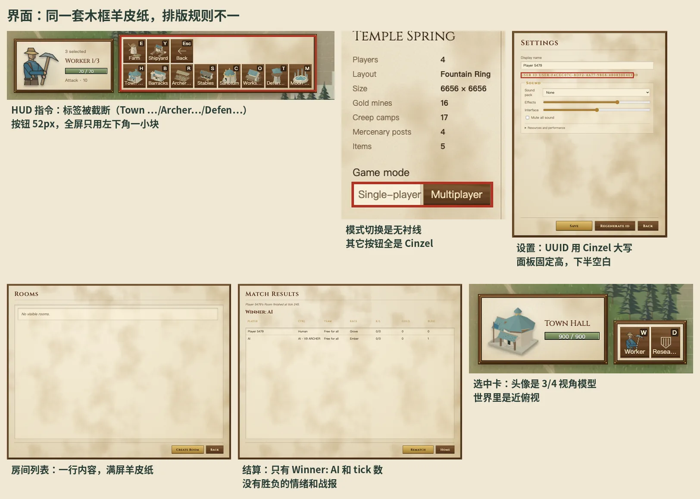
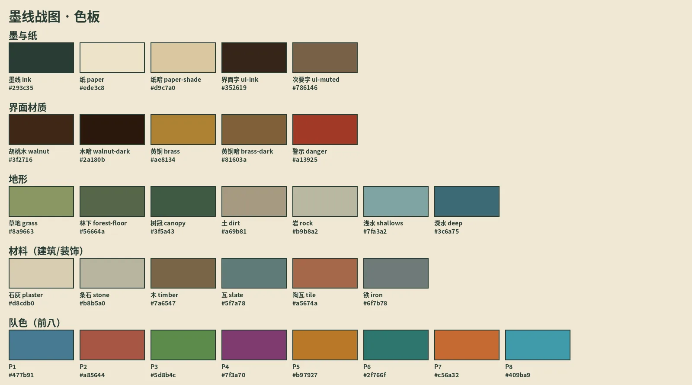

# 美术方向：墨线战图

[返回项目介绍](../README.md) · [世界渲染](rendering/world3d.zh.md) · [林野战记（第一版美术）](woodland-atlas.md)

这份文档是以后所有画面改动的标准：界面、建筑、人物和兵种、船、装饰物和地形，都按这里的规则画。改动和这里冲突时，先改这份文档，再改代码。

## 一句话

**一张有人用墨笔画过的战争地图。** 所有东西都在同一张纸上，用同一支笔描边，在同一束光下着色；界面是摆在这张地图旁边的木框和羊皮纸。

现有画面里，人物和首页街景已经是这个样子（深绿墨线、平涂、暖灰纸色）。这次翻新以它们为基准，把建筑、船、地形和界面拉到同一条线上，而不是另起一种风格。

## 审计：现在哪里不统一

截图来自 2026-10-17 的 main（`13d0a870`），在 mac1 上用 Playwright 驱动真实页面：首页三个场景、设置、房间列表、选图、房间设置、四人图开局、全 AI 托管九分钟后的中期、80 人对战、海图、结算。

### 1. 同一个世界，四种画法

| | 人物（2D 卡片） | 对局建筑（GLB） | 船（GLB） | 首页街景房屋（Canvas） |
| --- | --- | --- | --- | --- |
| 轮廓 | 深绿墨线 `#293c35`，约 1.1–1.4px | 没有 | 没有 | 墨线 1.0–1.1px |
| 明暗 | 平涂 + 一层暗面 | 每个面一个硬色块，八边形屋顶像宝石切面 | 连续材质明暗、木纹贴图 | 平涂亮面/暗面两阶 |
| 视角 | 正面立像 | 近俯视 | 近俯视 | 3/4 |
| 细节密度 | 中 | 低 | 很高 | 中 |

人物和街景房屋是同一种画法；对局建筑和船各是一种。玩家在战场上同时看到三种，最显眼的是建筑没有墨线、颜色偏冷（主城是青灰色的八面锥顶），和站在旁边的人物不像一个世界。

### 2. 地形：三种边缘语言，加上方格痕迹

- **高地边缘**是按地形格子画的直角台阶，浅色石块带立面，像体素游戏。
- **海岸**是几十像素宽的模糊渐变，没有岸线。
- **林缘**是树冠剪影直接截断。三种边界相邻出现，互相不搭。
- 高地和营地空地上能看到一层**浅色方格网**；开阔地面和海面上还有细缝，间距 512px，和地形分块的大小一致。
- **森林**是同一棵松树等距铺满，没有林缘大树、疏密和明暗变化；首页林间场景大半屏都是这种纹理。
- **水**有三个颜色：地形代码里的浅水 `#91b5b7`、世界里实际画出的深青 `#3c6a75`、小地图上的灰青 `#678487`。

### 3. 比例与阵营色

- 主城大约只有 2.4 个农民高，兵营、靶场和人物差不多大，建筑读不出分量。农场是一个小风车加一个木架，所有农场一模一样。
- 建筑的阵营色只在一面小旗上。敌我基地并排时，靠选框颜色才分得清。
- 人物的队色在衣服上，大战里两军分得很清楚。这一层是对的。

### 4. 界面：同一套木框羊皮纸，排版规则不一

- **材质**本身统一：胡桃木框、羊皮纸底、黄铜主按钮，菜单和 HUD 都用这一套。问题在排版。
- **字体**：标题和按钮是 Cinzel；正文是无衬线；设置里的用户 ID 也用了 Cinzel 大写，一串 UUID 变成金色碑文；房间设置的「单人/多人」切换用无衬线，同一排其它按钮都是 Cinzel。
- **数量**：10 个 CSS 文件里有 213 个不同的十六进制颜色、27 种字号（8px 到 104px）。`styles.css`、`game-materials.css`、`game-ui.css` 各定义一遍颜色变量，后加载的覆盖前面的。
- **面板尺寸**：房间列表、设置、结算都是固定的满屏羊皮纸，内容只占顶上一两行，下面是大片空白。
- **HUD**：指令按钮 52×55px，名字放在按钮里被截断（Town …、Archer…、Defen…、Moon …）；整个 HUD 只占屏幕左下角一小块，资源和人口挤在小地图上方 12px 的一行里。
- **结算**：只有一行 `Winner: AI` 和 `finished at tick 245`，没有胜利或失败的画面，背景是上次首页选中的场景。

## 规则

下面每一条都写成能检查的形式。新画的东西逐条对一遍。

### 光

- 一束主光，从左上（西北）来；投影落向右下。人物卡片、建筑和船的投影方向现在已经一致，保持。
- 着色分三阶：**亮面、本色、暗面**，阶与阶之间是硬边，不做连续渐变。亮面 = 本色混 35% 白，暗面 = 本色混 30% 黑（就是 `art/kit.ts` 的 `lighter` / `darker`）。
- 模型材质不做金属感和高光。木纹、石缝这类贴图细节可以保留，但亮度变化不超过一阶。

### 线

- 世界里每个实体都有外轮廓墨线，颜色只用墨线色 `#293c35`。
- 线宽按屏幕算，缩放为 1 时：人物和小物件 1.25px，建筑和船 1.5px，内部结构线（门窗、木筋、船舷）0.75px。镜头拉近拉远，线宽不跟着变粗变细。
- 地形块（高地、水岸、林缘）用淡墨：墨线色 35% 不透明度，1px。
- 只有特效（法术、火焰、光环）可以不描线。

### 色

- 大地色为底，偏暖、低饱和；地形和建筑材料的饱和度不超过队色的一半，这样队色永远是画面里最鲜的东西。
- 队色只放在**布料**上：人物衣服、旗、帐篷、屋顶饰带、船帆的条纹。每座建筑正面至少有一块看得见的队色（屋檐饰带或门帘），面积不少于正面的 15%。
- 界面和世界共用墨与纸两组颜色；界面另有胡桃木、黄铜两组材质色。所有颜色写成 CSS 变量或 TS 常量，组件里不出现裸的十六进制值。
- 同一样东西在世界、小地图、头像里用同一个颜色（水只能有深浅两个色，不是三个）。

### 比例

占地大小是规则的一部分，不动；改的是看起来的高度和体量。

| 东西 | 可视高度（以农民为 1） |
| --- | --- |
| 农民、步兵 | 1 |
| 骑兵、魔像、精英 | 1.3–1.8 |
| 小建筑（农场、箭塔） | 1.5–2 |
| 生产建筑（兵营、靶场、马厩） | 2.5–3 |
| 主城、主城升级 | 3.5–4 |
| 船 | 按甲板上船员的比例，不另算 |

农场这类会大量重复的建筑，至少要有两三个变体（屋顶朝向、田垄、草垛），由位置决定，不随机闪动。

### 地形

- 所有地形边界用同一种语言：**不规则的柔边**（8–16 世界单位），再压一道淡墨轮廓。高地边缘不再是格子台阶，海岸不再是几十像素的模糊带。
- 高地边缘有立面：朝南、朝东的边画一条暗面带，朝北、朝西的边画一条亮边，和光的方向一致。
- 森林分三层：林缘是更大、更亮的树；林内更密更暗；中间穿插两三种树形。不允许同一个树冠等距铺满。
- 地面上不出现任何方格、分块接缝或调试网格。

### 界面

**材质**（已有，保持）：容器是胡桃木框（`--frame-walnut`），内容是羊皮纸（`--game-paper`），主操作是黄铜按钮（`--primary`），次操作是木按钮（`--game-button`）。

**字体**只有两种用途，各一种字：

| 用途 | 字体 | 用在哪 |
| --- | --- | --- |
| 题字 | Cinzel（中文用宋体回落） | 页面标题、面板标题、按钮文字、单位名 |
| 正文 | 界面无衬线（`--game-text`） | 说明、表格、数值、输入框、ID、提示 |

一个控件里不混用两种字；ID、数字、时间永远用正文字体，并且用等宽数字。

**字号**只用七级：11 / 13 / 15 / 18 / 24 / 32 / 56px。

**面板**按内容定高，最高不超过视口减 64px，超出再滚动。不出现大面积空白的羊皮纸。

**HUD**：

- 指令按钮至少 56px 见方；按钮里只放图标和快捷键，名字和说明放在提示框里，不在按钮里截断文字。
- 资源和人口是独立的一块，字号至少 15px，和小地图同一块木框。
- 选中卡、指令栏、小地图是同一条底边对齐的木框，不是三个散落的小框。

**结算**：先是一张胜利或失败的题字页（队色、地图名、时长），再是战报表格。背景用这局的战场，不用首页场景。

### 首页场景

首页场景的逻辑和数据归房间车道；这里只管画风：场景里的地形、树、建筑、人物都按上面的规则画；场景和对局用同一套建筑与地形画法，不单独维护一套更好看的画。

## 怎么落地

分五批，每批一个 PR，带改动前后的截图（改动前截完全渲染好的旧画面，改动后截稳定下来的新画面）。每批只动这一层，不顺手改别的。

1. **界面**：合并三份颜色变量为一份；字体两种用途、字号七级；面板按内容定高；HUD 按钮放大、名字进提示框、资源块并入小地图框；结算页。
2. **建筑**：在 `world3d` 给模型加屏幕等宽的墨线和三阶着色（建筑和船一起受益）；按比例表调可视高度；屋檐饰带上队色；农场变体。
3. **人物和兵种**：现在已经最接近目标，只对齐线宽、亮暗两阶的算法和队色位置；头像和世界里用同一个视角。
4. **地形与装饰物**：统一边缘语言，去掉方格和接缝，水统一为两色，森林分层，装饰物（石头、遗迹、营地）补墨线。
5. **船**：第 2 批的墨线和着色之后，单独校一遍船帆、队色条纹和水面颜色。

## 维护

- 改了规则，先改这份文档，再改代码；PR 正文里写明对应的是哪一条。
- 每批 PR 合并后，在下面的记录里补一行，并替换掉已经过时的审计截图说明。

| 批次 | PR | 状态 |
| --- | --- | --- |
| 方向与审计 | 本文档 | 待确认 |
