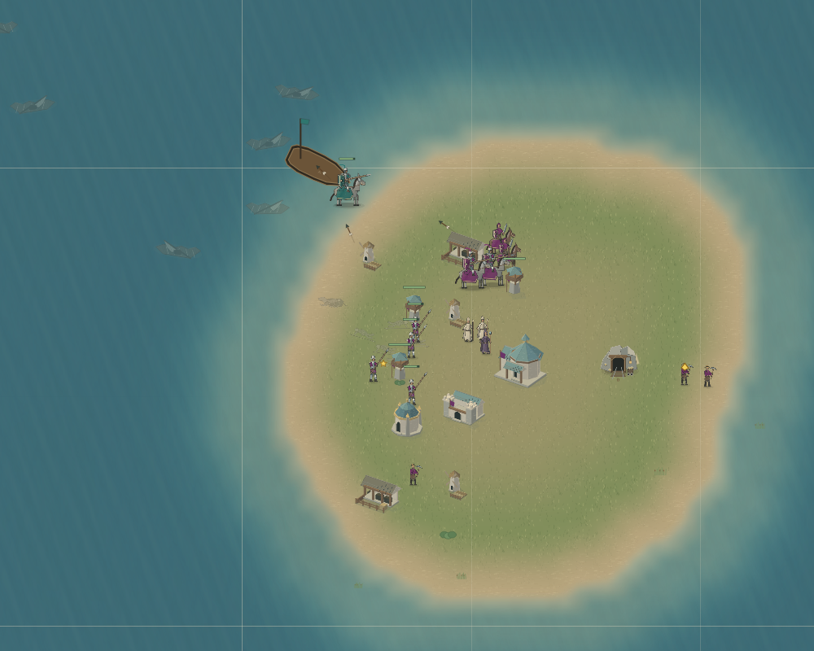
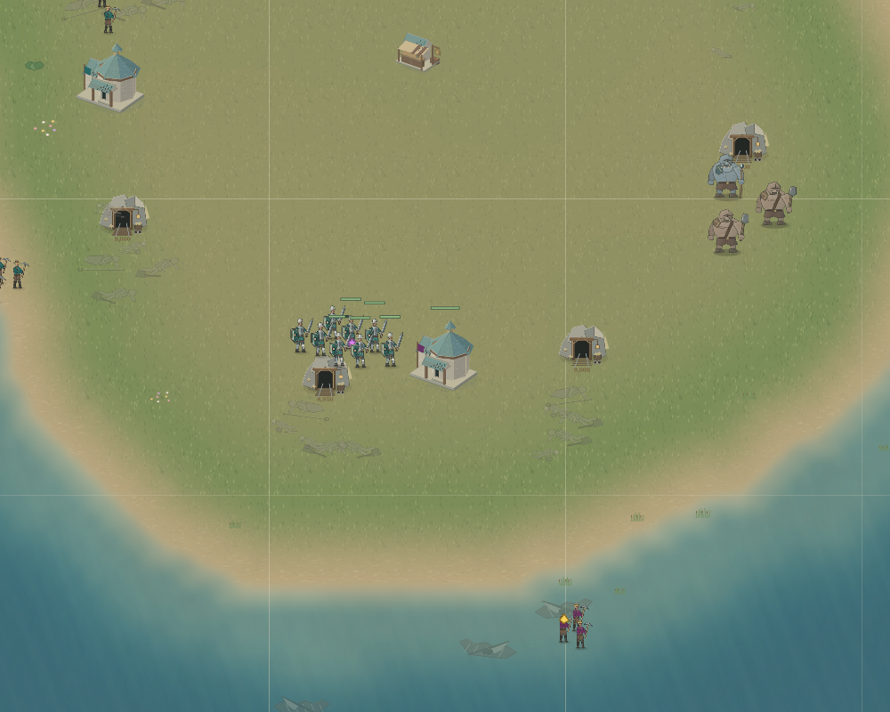
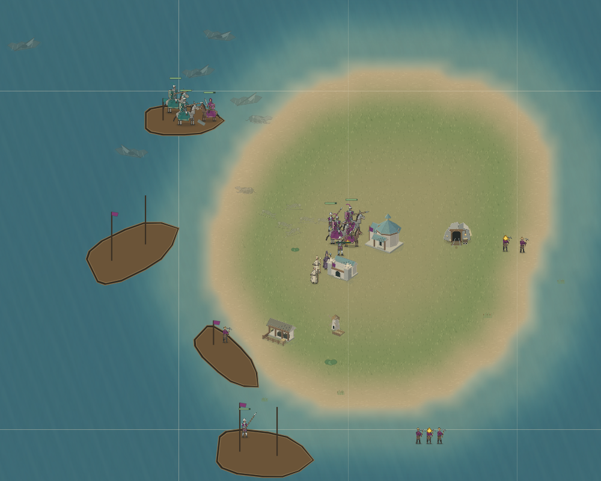

# bootstrap_1 committed colony capital — 2026-10-18

This round continues cf7df3fabacd094a094ae72f74d933ddc45c38b8 and retains runtime822ba36ae5a3898b5ae62f64c1dd1fd4f0075da1 and all four preceding full-match results. The preceding verified bundle remains `/workspace/bootstrap-1-shore-final-20261018.bundle`, SHA256 c9272c4bb33486ac5bf749f2d4b4a2dfbce4d804635691667ed8cc045a22c8a1, prerequisite4238aefe6151c3276b3c9b02c48fa35299be0d5c. No remote upload attempted; authentication remains pending. No old workspace, branch, or unrecognized scratch file was removed.

## Causal observation

The former normal knight loss uses generated brokenSea, seed `bootstrap_1-shore-holdout-20261018-fd7535517e18452149b447f286a18f8a`, grove side0 against frozenv7+v8. This is now a known regression seed, not unseen. At30525 an actual enemy knight landed within537.354 of the home hall. The existing naval budget legitimately released its reserve. Two190-gold knight purchases spent380 of453.43, leaving73.43 after all home mining had exhausted. This was not a carrier purchase or an absence of all reserve logic.

The initial broad diagnostic retained400 whenever there was no active mining base, filtering purchase commands after planning. It resumed the original full30000 checkpoint (snapshot,nextId,three memories). It issued a hall at31830, founded building-p0-townHall-8027 at31948, first sampled complete32520. Its founders were subsequently evacuated. Enemy footmen from the same mainland first hit the900HP hall at33241 and destroyed it at33407:50hits of18damage. The original target had no immediate defenders; this does not imply the whole mainland was uncontested. Native renderer views at30525 and33240 were inspected. Net treasury change excluding recorded spending through36000 was29.28, which includes upkeep and is not gross mining income. The hall died and income again stopped. This failed diagnostic is preserved in reserve-probe.tar.gz; it is neither a normal start nor a victory.

## Candidate

f8b6fc8241247c4d0b566d6828e21aa31aabe90f changes only bootstrap_1's economy. When all mining bases are exhausted, an existing sailing settlement with live founders retains400 foundation capital. It validates the actual hull, actual deck passengers, live unclaimed target and mining prospect; loading/returning/abandoned missions do not qualify. Existing construction or resumed income releases the additional reserve. Pending boarding crewIds are not an embarked passenger list: the actual30525 memory had emptycrewIds with two workers physically aboard each outbound boat. Normal naval purchasing exceptions remain intact. No enemy behavior, resource, population, terrain, engine, art, or performance source changed.

Formal replay30000→36000 issued exactly the broad diagnostic's commands and matched its terminal snapshot andnextId. Its p0v6goalAges unit:raider/since differs(24405 versus30555) because filtering after planning and declining a purchase within planning affect goal bookkeeping differently; opponent memories match. Therefore it is not advertised as full replay-memory equivalence. All source hashes stayed unchanged during the replay. The formal replay also loses the isolated new colony. The code corrects funding of an existing voyage; it does not establish defensible, sustainable colonization.

## Verification and limits

42 relevant tests passed, including actual-input spending, three-family reserve release boundaries, existing naval capital scenarios, frozen planner andrules2 checks. TypeScript noEmit passed. One initial Vitest worker-pool configuration failed before tests ran; the corrected single-worker invocation passed. Frozen manifest retains184entries andrulesVersion2, byte-identical tocf7df3fa. SHA2560490e7d43d109e70be3b141f76d1276a778a3402f3ea19f51a8cd37fee941774.

Normal-start validation and its final result are recorded separately in normal-summary.json. Initial snapshot,nextId,all memories and match configuration exactly match the prior822 normal-start loss. Every normal simulation uses ordinary500gold,three workers,3/8population,zero upgrades,15-tick thinking and120000cap. No expensive matrix was repeated. Capability across three routes, official maps and unseen maps remains unaccepted. In particular the earlier knight known-seed victory and eight saved shore soldiers do not offset the archer cap, summoner loss or knight failure.

The first4756 normal-start commands match822 exactly. The first difference is omission of the30525 knight purchase; ordinary home-defense movement still executes. The normal30000 checkpoint matches snapshot,nextId andall3memories exactly, independently connecting the focused replay to the new normal run.

Next causal boundary: frozenp2 issued its firsteight-footman attackMove toward the new mine at32880, after the first sampled hall completion32520 and361ticks before the first hit33241. At33000 the founders already had evacuation board orders. Funding alone cannot defend this mainland foothold. Investigate actual escort arrival or a sustainable alternative landing, preserving the existing no-unnecessary-escort rule for truly uncontested colonies; do not change the frozen opponent or treat waiting forever for soldiers as a fix.

## Native views

Original home landing at30525:

Broad reserve probe colony at33240, immediately before first hit; enemy footmen have arrived and founders are at the coast:

Candidate normal start at43800, home still standing with coastal embarkation in progress:

Formal replay and candidate normal start also match all snapshot,nextId andthree-memory fields at36000. The external broad reserve probe remains distinct because its goal-age memory differed.

## Final normal result

The f8b6fc82 candidate naturally lost at72654 (winnerp1). Subject permanent deaths39, four own survivors, plus carrier unit-p0-carrier-7155 captured and surviving underp2. Native unitsLost also records39; no death was omitted by the terminal observation hook. Initial3 +41births =39deaths +4own survivors +1captured survivor. Original822 lost at45045 with45deaths andzero survivors, initial3 +42births. The candidate produced one fewer permanent unit, so aggregate death reduction is not an equal-army survival comparison and does not satisfy victory acceptance. Original home hall fell at40839; candidate home at61654. Candidate second original hall fell at72200. All original and new failure records remain preserved.

The candidate normal start ran for1104915.889ms without restart, starting0 with resume=null, and reached a natural terminal before the registered120000cap. sourceChangedDuringRun is empty. The formal30000 replay also completed normally at its declared diagnostic36000 cutoff. No simulations remain active. This candidate is an isolated funding correction with a failed full-game acceptance result, not a production/AI acceptance milestone.

Archives have per-file SHA256 manifests and were reopened to verify every member:

- reserve-probe.tar.gz: 413files; SHA2566d5cf679ae2d76e4a80d215e51a44656b3f1a4e020ab4f85e3e89466352b710f.
- formal-replay.tar.gz: 410files; SHA256d8a9cce05c3ad33a413b360a9df0555725f72bd473114758230d08fb1d631052.
- normal-complete.tar.gz: 139files; SHA2566f2db4cb64728c030bed6d161a37b0e776a9202dd75a0d581cdbb0fa0a9efe28.
- checks.tar.gz: 6files; SHA25667e5d34cb6be75f65f20f8f94af158cea3f99bb8f50e8fcac4511d0ca602c37c.

The prior four822 matches and their verified bundle remain unchanged. No new implementation session, other lane edits, credential changes, purchases or remote push occurred. The old owner's missing uncommitted candidates have not been represented as recovered by this new implementation.
