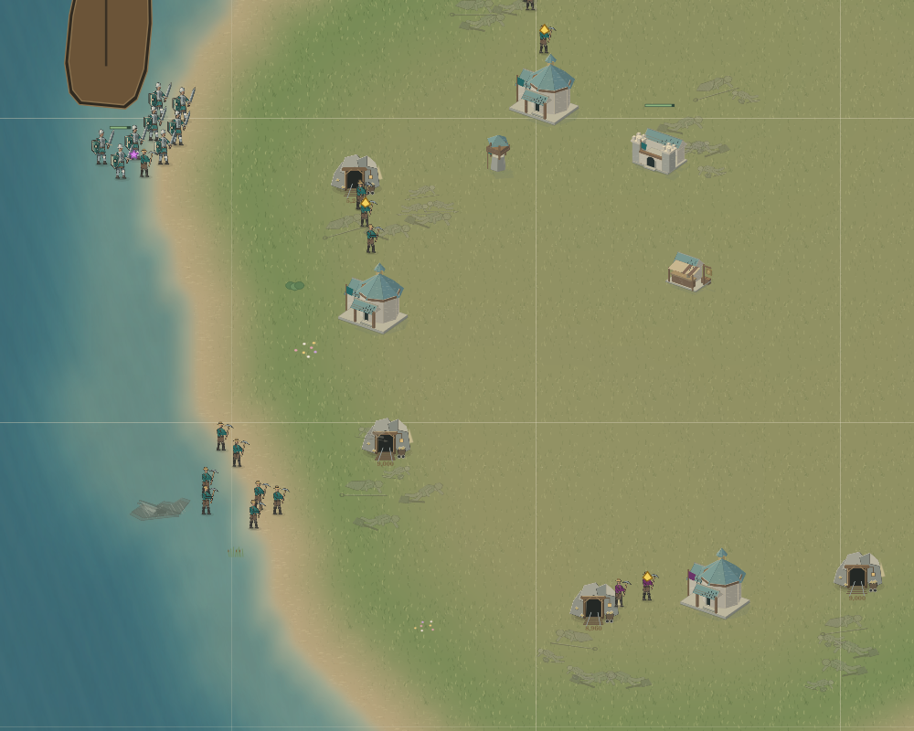
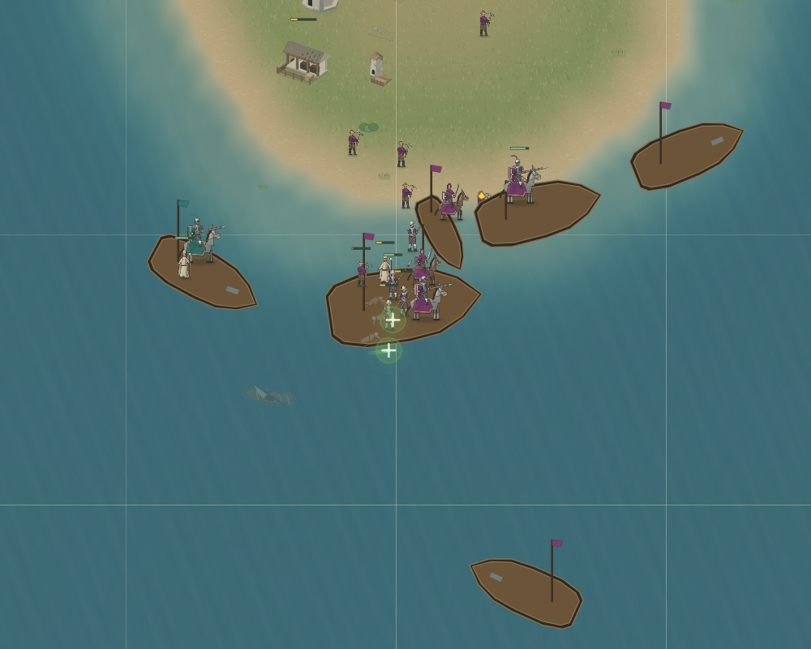

# bootstrap_1 colony escort experiment — 2026-10-18

**Outcome: candidate rejected and runtime reverted; no new accepted capability improvement.** The normal candidate lost naturally at66929 with no new colony.

This round retains f8b6fc8241247c4d0b566d6828e21aa31aabe90f, evidence3205eedb3539f275ce5edd70bd3defa1d125f28d and its natural72654 loss. `/workspace/bootstrap-1-capital-final-20261018.bundle` remains unchanged, SHA256 b8fe9d952e3a3d7fb493348110aaec5ec099222e6b0d246cc62462f789ac6c39. The preceding four822 full matches and earlier bundles also remain intact.

## Actual landing and construction sequence

Additional inspection corrects an incomplete earlier description: the eight enemy footmen were not continuously walking on the mainland during construction. At31830 seven had boarded enemy carrier5722 and the eighth was approaching it. At32520 all eight were aboard. At32865 the frozen opponent issued unload back toward2992,3888; by32880 all eight were actually ashore, and the ordinary opponent issued attackMove towardgold-mainland-3. The new hall had already completed at the first sampled32520. First hit33241; destroyed33407. No friendly local fighters accompanied the two founders. This is visible in the preserved snapshot timeline, commands and native renderer; no enemy orders were altered.

## Candidate727cfc9501ec7b639f848f4324da960d33ef1741

The candidate estimates armed opponent land responders that can reach the target by a native ground route within the hall's28-second construction time. It excludes deck passengers, allies, inaccessible ground, workers and temporary troops expiring before arrival. It feeds that lower-bound threat into the existing1.4x landing strength check, both during assembly and sailing, and suppresses the two-worker clear-mine shortcut only when responders exist. It does not invent future sailing or landing times. Native400-range guards and tower checks remain intact.

Implementation adds an optional settlementResponse hook to shared naval policy, supplied only by bootstrap_1. Ordinary callers use zero; frozenv5/v7/v8 still execute the same archived sources. The184-entry manifest and rulesVersion2 are unchanged. No population, income, map, spawn, opponent ability, art or engine change was made. The three families retain their doctrines.

Forty-eight distinct relevant tests passed:47 in the final batch, then6 colony-response tests with five repeats and one added native-ferry integration case. Typecheck passed. The original clear-colony cases still release two engineers for all three families. One early test incorrectly assumed the29400 perimeter was empty; the real snapshot had three nearby footmen. That failed test and original fixture are retained; the corrected empty-perimeter test uses the actual30000 snapshot. This does not constitute match acceptance.

## Focused replay and normal-start evidence

The candidate replay29400→36000 starts from the previous f8 normal game's full state, not from the candidate normal trajectory. It ends without a new hall, gold57.43, native unitsLost15 and no source changes. The new threat check cancels the existing voyage; leaving the sailing state also removes f8's committed-voyage reserve, and home recruitment spends380. This probe is a negative interaction result, not a success or a normal start.

The normal run uses exactly the preceding f8 match, generated brokenSea seed `bootstrap_1-shore-holdout-20261018-fd7535517e18452149b447f286a18f8a`, grove side0 versus frozenv7+v8, normal500gold/three workers/3-of-8population/zero upgrades, think15, registered120000cap. The initial snapshot,nextId,all memories and match configuration match exactly. This seed is known, not unseen. First1207 command entries match. The first actual difference is omission of p0's18105 unload; the next indexed row is an unchanged p2 command, not a modified frozen policy.

Normal observation distinguishes board commands from actual carriage. At30000 carrier2915 held cargo power9.5764 against reachable enemy response10.7911, before the existing1.4 multiplier. This diagnostic reports cargo alone, not the entire native support computation. At34800 two workers and multiple lancers, priests, witch, raider andknight were aboard, but the mission had returned. No new town hall had been founded. At35475 two190-gold knights were purchased. No new town hall resulted from spending the remaining capital.

At40000–41700 enemy warship7948 killed multiple deck occupants individually, then sank carrier2915 at41670. This is a separate failure from the original eight-footman colony raid. Native observation shows the packed near-shore assembly/return, enemy warship and injured deck crew. It does not by itself prove why every retreat route was unavailable.

The full normal outcome is recorded in normal-summary.json. A longer survival time or a different death count cannot substitute for sustainable colonization or victory. No matrix was repeated. No remote push or credential operation was attempted; remote authentication remains pending. Original untracked scratch files remain untouched. No old workspace or branch was deleted; only the existing recovery branch received this work.

## Final result and restoration

Candidate727cfc95 naturally lost at66929, winnerp1:35permanent deaths, six own survivors, one original transport1067 captured byp2 and surviving. Initial3 +39births =35deaths +6own survivors +1captured survivor. No original unit died under a different owner. The old f8 run remains72654loss,39deaths,4own survivors andcaptured carrier7155. The candidate produced two fewer permanent units and lost earlier; lower raw deaths are not a demonstrated survival improvement. It never founded another town hall; the only hall birth was the same opening natural at10269. Original capital fell59496 and second hall66375. sourceChangedDuringRun is empty; startTick0, resume=null; elapsed971997.027ms. No simulation remains active.

The runtime candidate has been reverted, while its commit and all evidence remain in history. See restoration.json for the full revertSHA. `git diff --exit-code f8b6fc8241247c4d0b566d6828e21aa31aabe90f HEAD -- src scripts` passes: the active implementation is byte-identical to f8 across source, scripts and tracked fixtures. This does not promote f8 to acceptance; its original failure remains recorded.

The reusable finding is that detecting a responding army is insufficient without an affordable, safe assembly plan. The next smallest diagnostic should inspect the18105–21600 army/production budget and actual loaded strength together, preserving the400foundation and measuring whether enough escort can be recruited and embarked before income expires. Repeatedly increasing a wait/abort condition alone is not supported. Separately, loaded near-shore retreat needs physical escape analysis before attributing losses to command replacement.

Archive files were reopened and every member SHA256 checked:

- replay-complete.tar.gz:450files, SHA2561222ecd49ace1259ff9b2d78f2b5888cde888ca303dc47d71c245408c36a915e.
- normal-complete.tar.gz:131files, SHA256746e3508d2aba80211f869c668d7d21c536adbd87e7e51ba7b6b346d1128e844.
- original-landing.tar.gz:4files, SHA2562195d5ad3cea97e95fde89f24c0a478be652be99c58d01fa7dc016836dc49e0b.
- checks.tar.gz:8files, SHA256695a96d7ef08f6de90e14827af28a43161f55a80334d60634764ed82a1cd44e9.

No new implementation session was created. The earlier old-owner uncommitted work has not been claimed as recovered by this experiment. Wider three-family capability, sustained colonization, unseen-map performance and victory acceptance remain incomplete.
