# 首页王城：镜头游览整条街

真实浏览器（mac1 无头 Chromium，生产构建），首页场景“王城”。改动前为 `main@c107026b`，改动后为 `feel/capital-tour@893eee7a`。每组截 5、30、55、80 秒四帧。

## 桌面 1440×900

| | 5 秒 | 30 秒 | 55 秒 | 80 秒 |
|---|---|---|---|---|
| main | 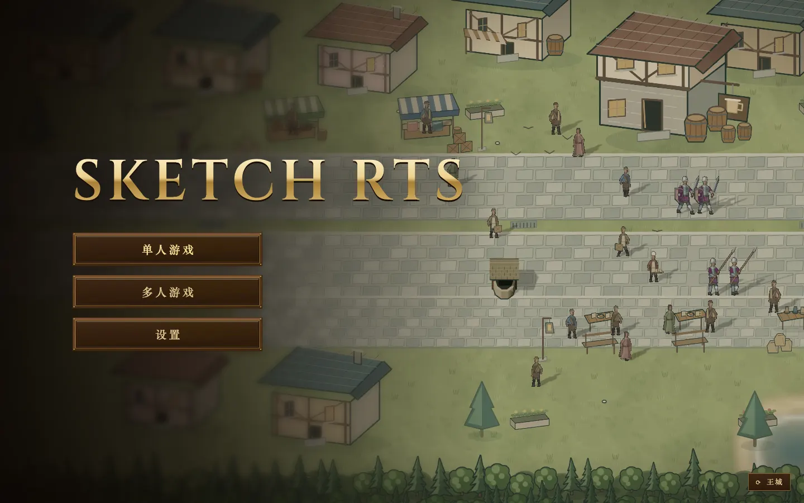 | 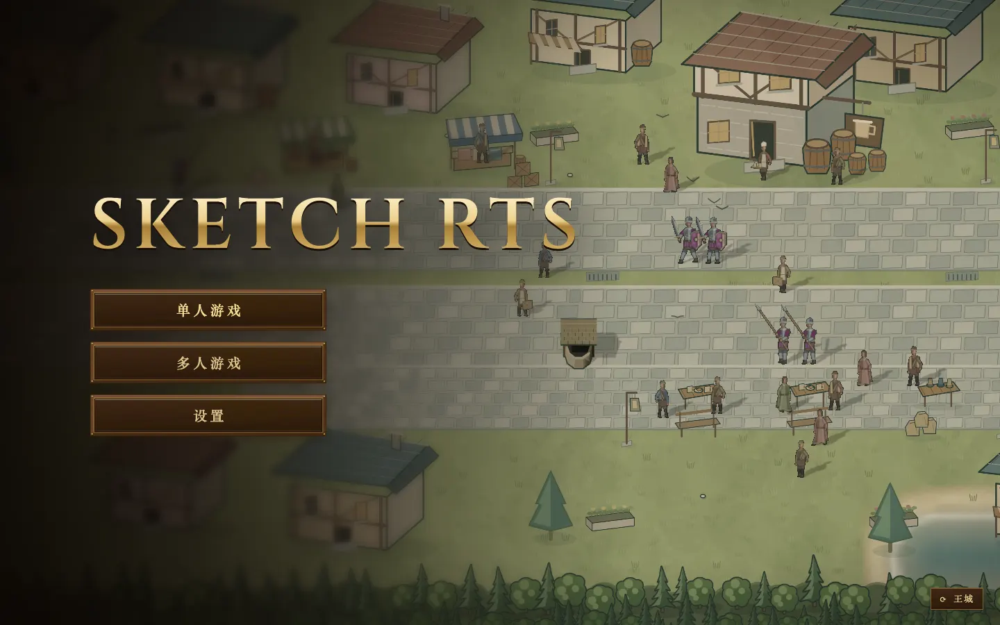 | 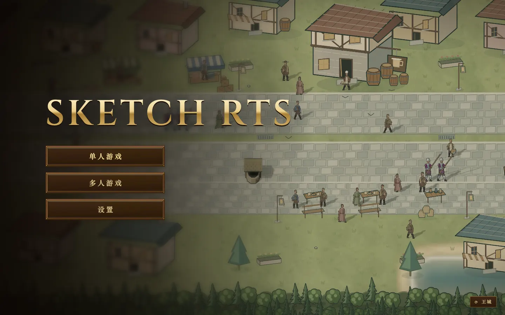 | 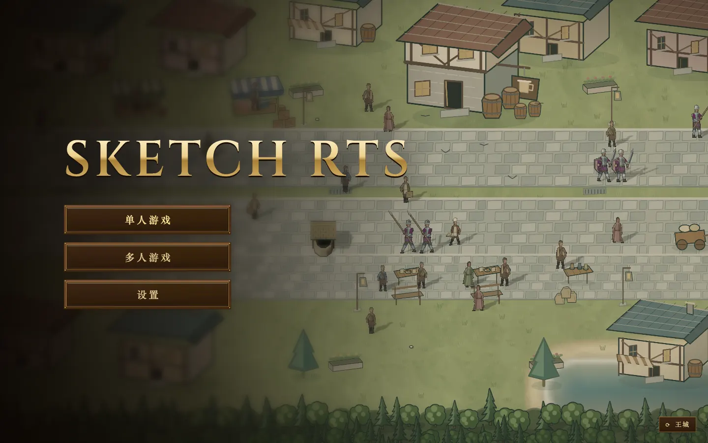 |
| 游览 | 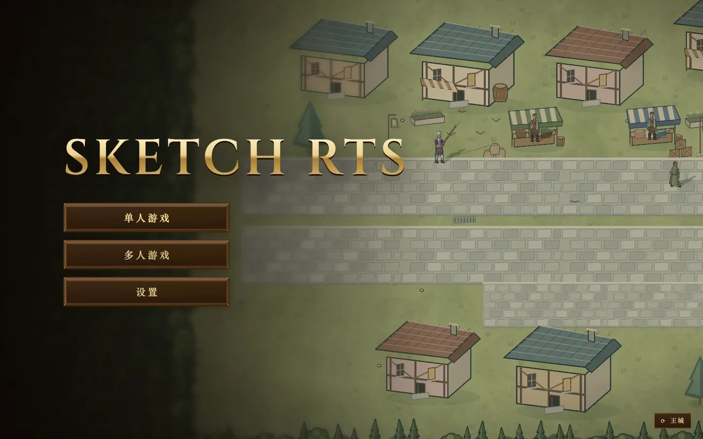 | 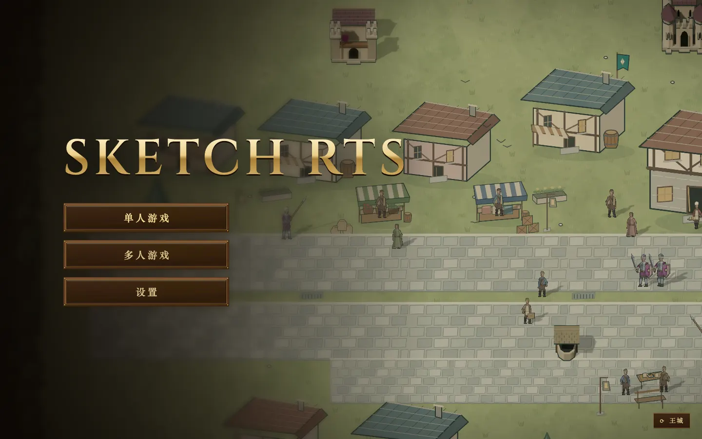 | 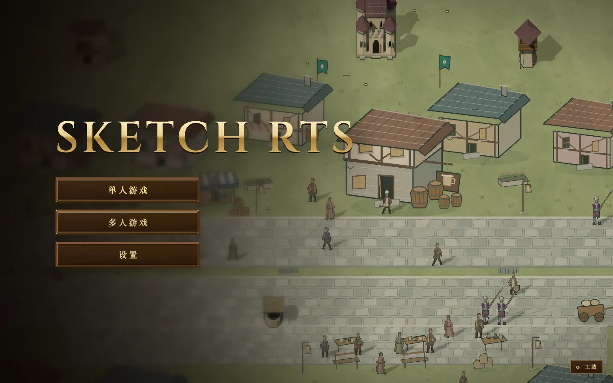 | 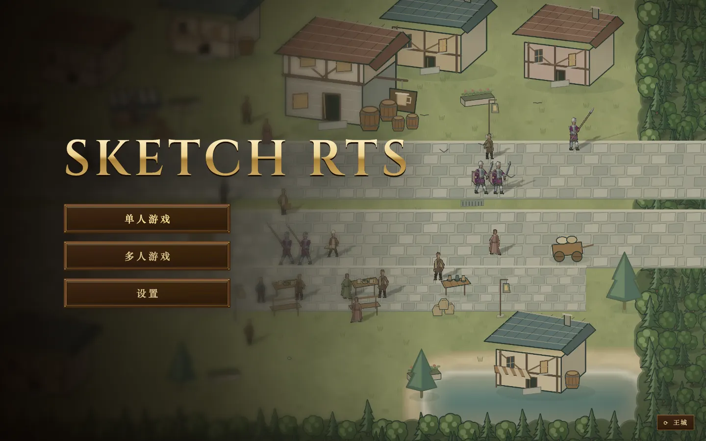 |

## 手机 390×844

| | 5 秒 | 30 秒 | 55 秒 | 80 秒 |
|---|---|---|---|---|
| main | 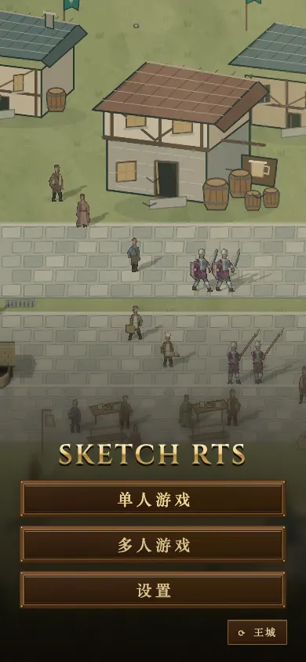 | 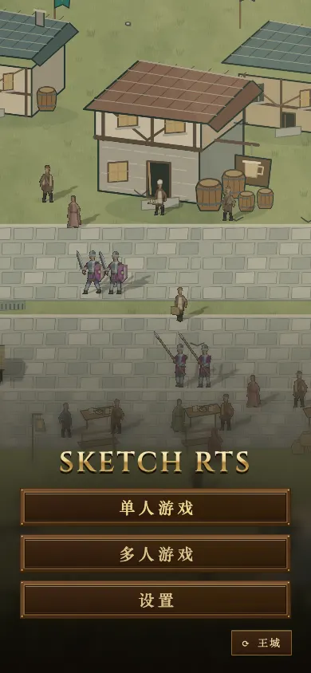 | 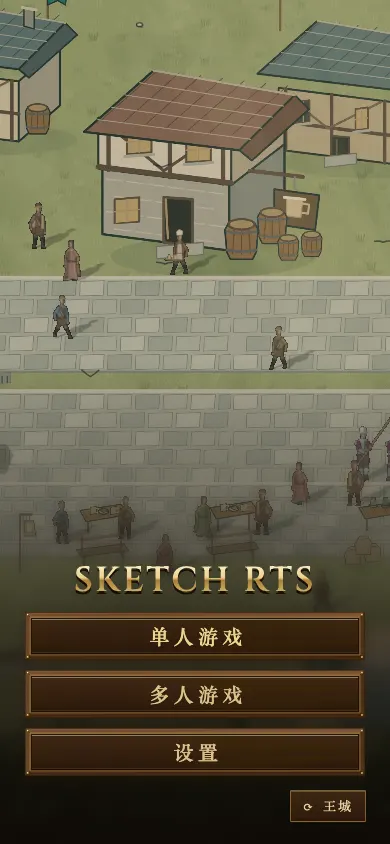 | 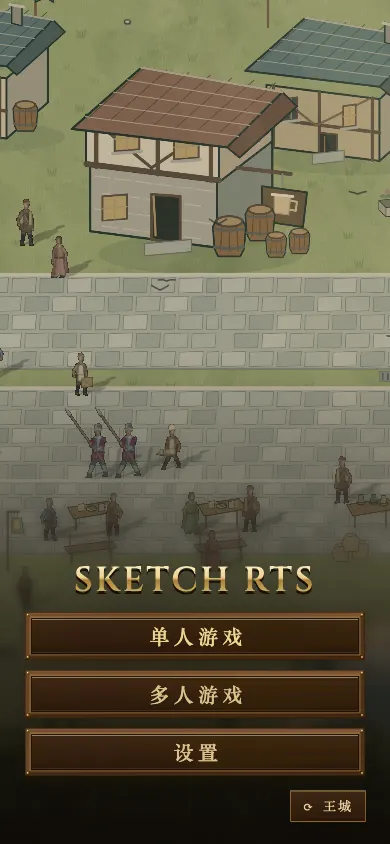 |
| 游览 | 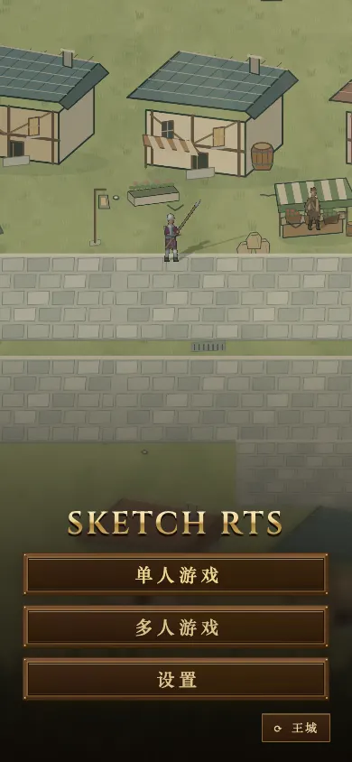 | 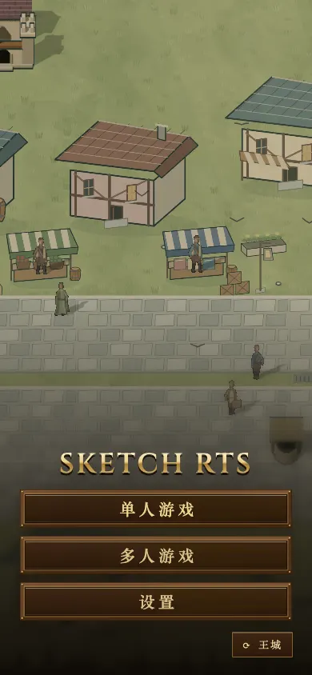 | 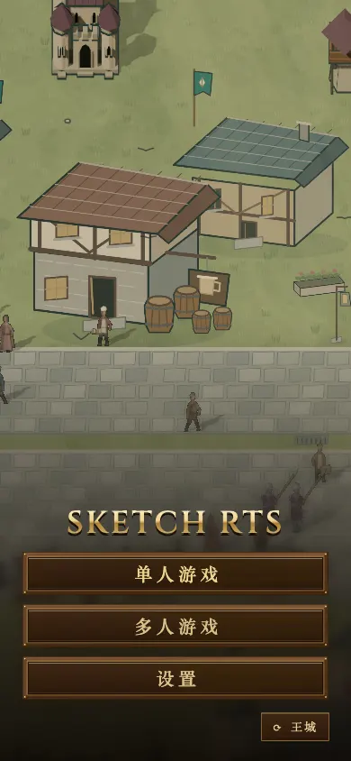 | 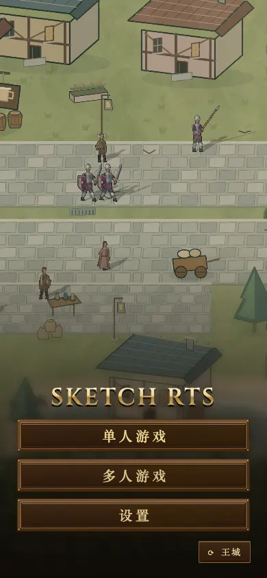 |

## 看到的

- **地图外的空地或树林：** 没有拍到。桌面 5 秒那一帧左边那条暗带，是菜单自己的暗角，盖在西边的树林上，main 上同一位置也有。80 秒到了东头，右边是街尽头的树林和湖，那是布景，不是空地。
- **被菜单挡住的内容：**
  - 桌面上菜单盖住画面左侧约三分之一，和 main 一样。55 秒王城大厅出现在标题右上方，没被挡住。街上的人和摊位都在菜单右边。
  - 手机上，街道和房子在上半屏，菜单按钮占下半屏，没有重要内容落在按钮后面。
- **速度：**
  - 桌面上大约每 25 秒走过三分之一屏，看得清行人和摊位，不晕。
  - 手机上走得更明显：5 秒在西边集市，80 秒到东边，中间经过兵营和王城大厅。
- **一点观察：** 5 秒在西头集市时，街上人少；人群大多在中段，镜头走到 30 秒后画面才热闹。如果想一开场就热闹，可以把出发点往东挪一点，或者在集市那段多放几个行人。我没有改路径。
