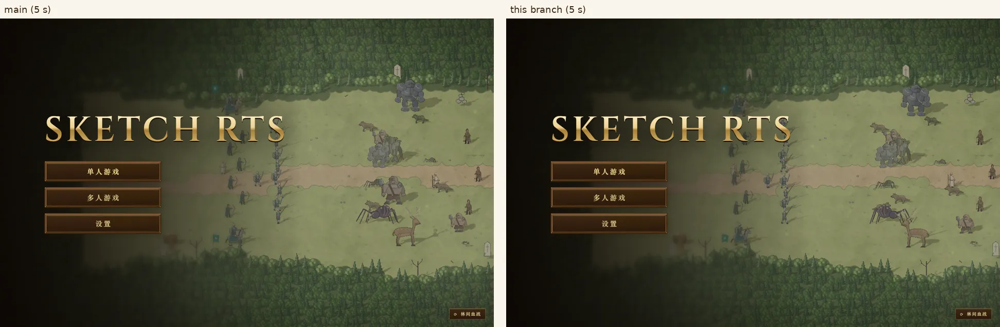
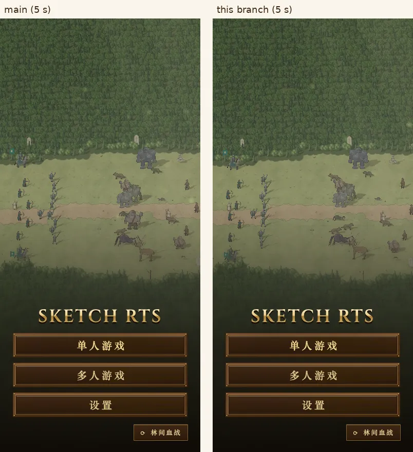
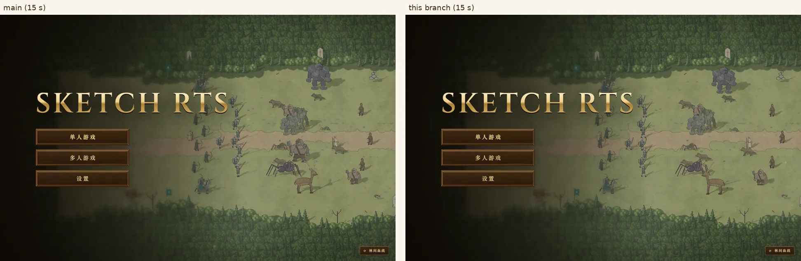
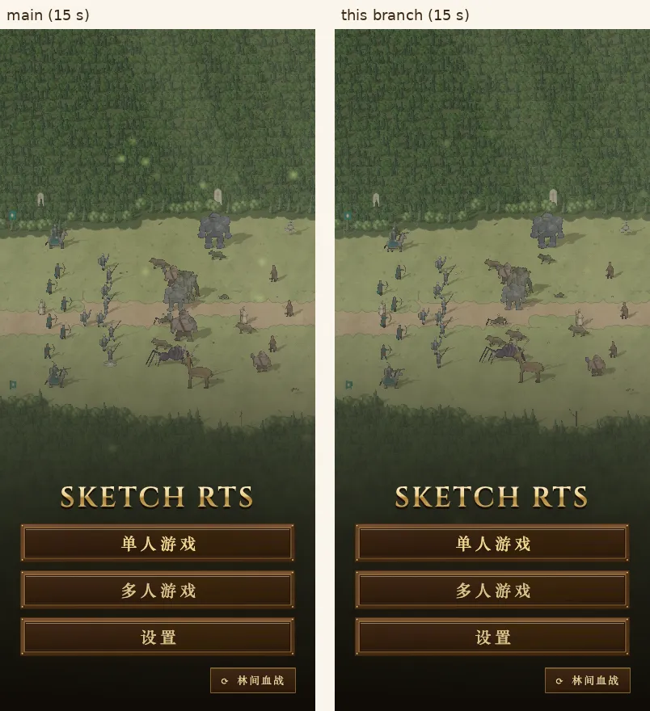
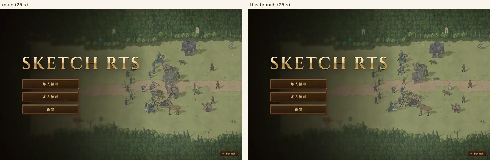
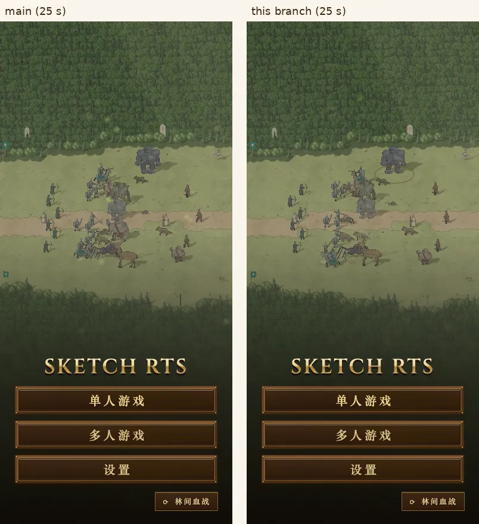
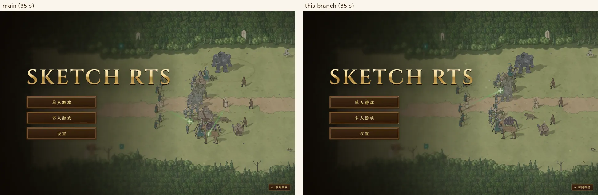
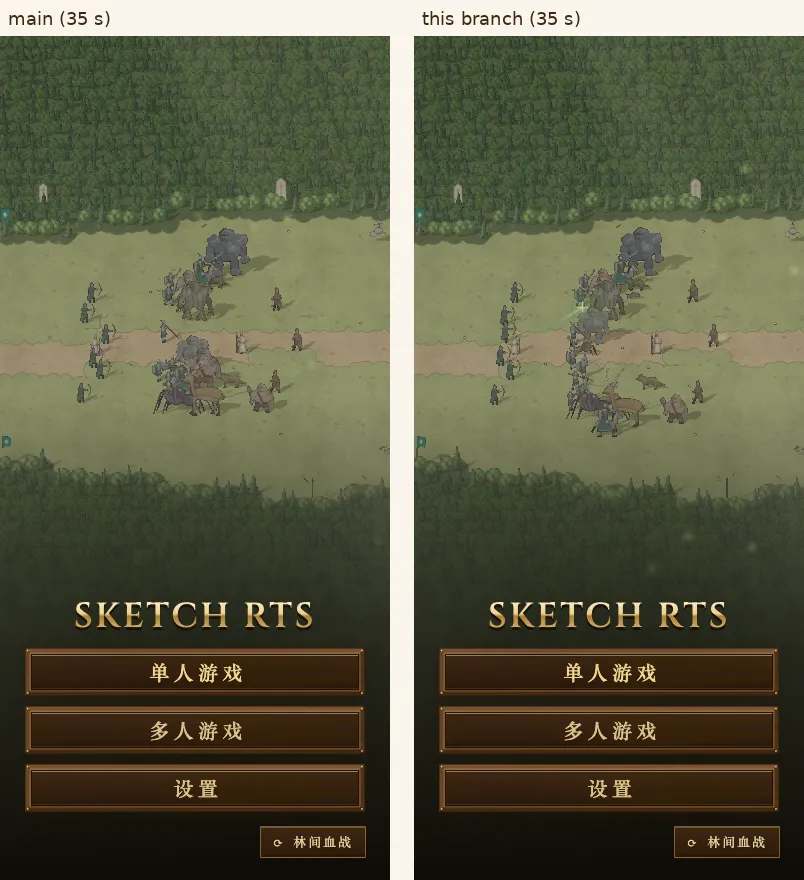

# 首页“林间血战”：结局不再总是同一方

owner 的反馈：这一幕双方实力不对等。

## 查到了什么

在 A100 上，用场景开局直接跑比赛模拟，固定种子 1–60：
- **改之前：** 兽群赢 53 局，王军只赢 7 局。
- 双方都是 18 个单位，打出的伤害也差不多（各 2,400–2,800），但兽群的总血量多三分之一（3,050 对 2,273）。差距主要在前排的食人魔领主（380 血）。兽群后排的投刺手和树医几乎从来没被打到；王军赢的那几局，都是靠弓箭手撑到了最后。

## 改了什么

只改开局，不改游戏规则：兽群前排原来站食人魔领主的位置，换成一个野人。

- **改之后：** 王军 33 局，兽群 27 局；每局在 26–61 秒之间分出胜负，平均 38 秒。
- 60 局里有 17 局，最后赢的一方中途血量落后过 5% 以上。种子 4 和 10 上，20 秒时王军领先，最后兽群赢了。
- 试过的其它改法和结果都写在提交说明里，各跑 40–60 局，都没有这个平衡。

## 截图

左边是 main，右边是这个分支。截图环境：mac1 无头 Chromium，生产构建，背景固定为“林间血战”，从场景出现开始计时，截第 5、15、25、35 秒。每次打开首页，种子由时钟挑选，所以左右两边打的不是同一个种子。

| 秒 | 桌面 1440×900 | 手机 390×844 |
|---|---|---|
| 5 |  |  |
| 15 |  |  |
| 25 |  |  |
| 35 |  |  |
