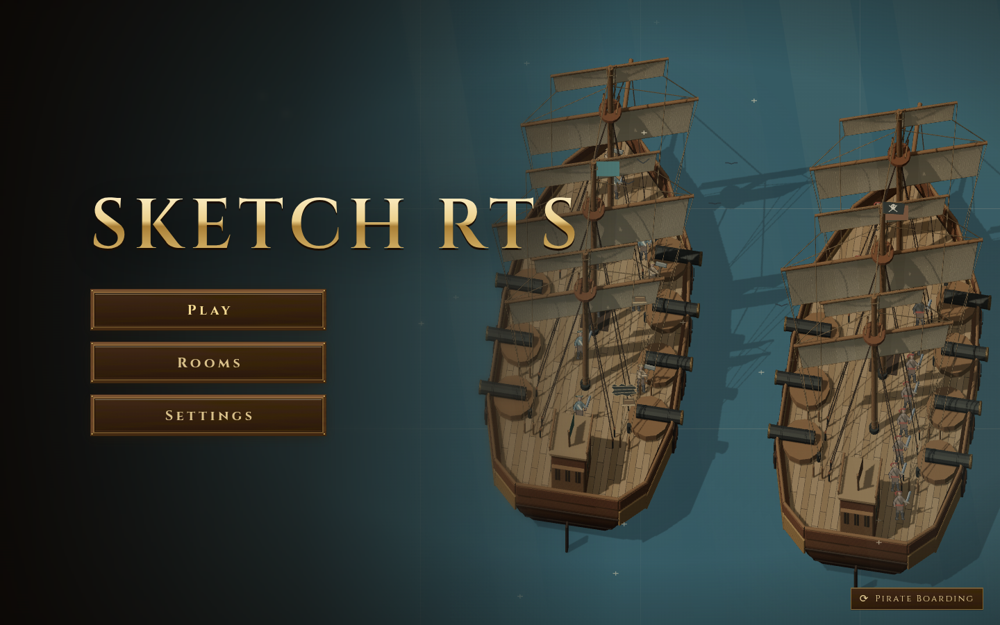
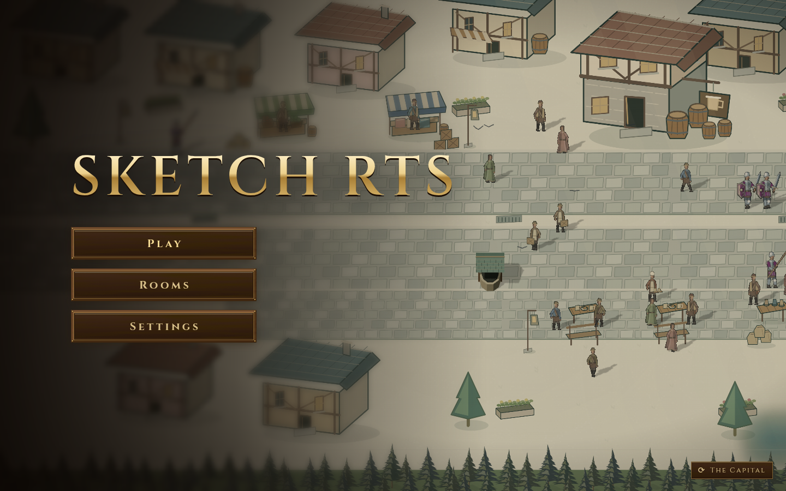
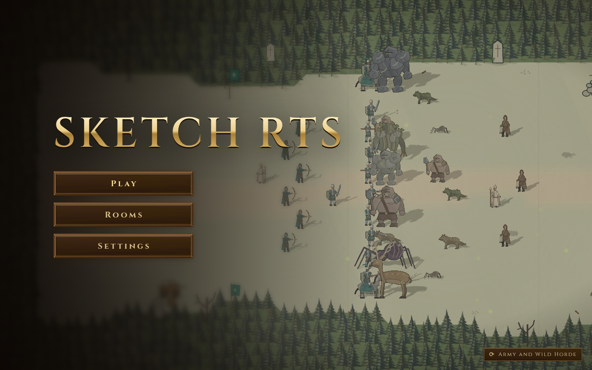

# PR380 生产发布与首屏核验证据

[PR #380](https://github.com/shuxueshuxue/sketch-rts/pull/380) 已合并为 `4804631c22f7be3f83dc6374e71ce03d86068dd8`，CD run [38662669848](https://github.com/shuxueshuxue/sketch-rts/actions/runs/38662669848) / job `116187340616` 成功，结束于2026-10-15 01:00:36 UTC。被计时head `0ea5beaee063c8443d66f7654333032b070d51ad` 与merge具有相同完整Git tree `4e2a28c42bea617bb69a5526a35f4a3523988bc7`；API、main/tag/release和官方包身份形成独立闭合。

本scope只追加发布时点与生产核验，不回写stage7发布前快照，也不改变stage7整局目标FAILED或stage8候选REJECTED。

## 官方包、API与部署回执

官方asset `642214724`，包2,467,699 B，SHA256 **`66189832ff0b3a6a9c30a26381b368a082c7514fe9b2180d071906059ccf7bc7`**；与官方digest一致。91个常规文件，解包11,328,103 B，每个完整文件和hash保留。归档离线复核tar成员路径与全文，拒绝路径逃逸、重复或链接/特殊文件。

部署log内部分SHA被GitHub `***` mask；`receiptAloneProvesFullSha=false`。原log、原后验失败及mask兼容核验保留，不能补猜被遮罩字节或将该log单独当完整SHA。完整身份依赖未遮罩API和官方包digest。

## 三个生产首屏与56/59

实际浏览器访问窗口01:08:37.512837–01:10:10.710945 UTC。fleet/capital/woods三个场景均desktop/normal、1440×900；三张原截图由root实际查看，`ROOT-VISUAL-REVIEW.json`记录。保存GPU completion fence、无context loss、无页面异常/网络失败的原结果。

**严格检查56/59；automatedPass=false，原执行exit1。** 三项失败均为各场景资源表示检查中同一 `audio-packs/served.json`：官方包stub **16 B**，SHA256 `4b7c27887eaf204ea1f0324f1b13a90eb1f8fb3b4940f807cca1f5233a033b5c`；线上配置 **41 B**，SHA256 `5b8fe19449089ceae78086a7cd6b5415e82dc364116922344af6845c9fe27ead`。线上JSON包含war3 pack/default；独立请求也读回相同41 B/hash。既有生产配置差异如实保留，原断言未改；不能称全部通过或证明可听音频。

本范围证明版本、资源与三个首屏的所列观察。SwiftShader、截图及fence不证明硬件FPS、所有动画/剧情或整局渲染。

## 冻结、恢复和核验

`FROZEN-REVIEW.json`于01:11:13.989797 UTC冻结252个原文件；归档另外保留该清单自身，共253原路径。252/252长度/SHA逐一保持；原失败、stdout/stderr、argv、cwd、UTC、exit及所有截图、官方包和已解包完整成员均保留。未删除原件。

```sh
python3 verify.py --out . --verify
python3 analyze-native.py
python3 verify.py --out . --extract /absolute/new-parent/restored
```

schema3采用lossless gzip与明确alias，去重前全文比较。`analyze-native.py`只读本scope压缩件，独立核对冻结252文件、官方tar91成员、API/CD/digest、三次实际查看记录和56/59边界，不运行游戏或访问网络。最终完整库存、哈希与支持文件pins见`manifest.json`和`verified-closure.json`。同次原SDK四文件执行的真实14项结果独立列入`preparation-notes.json`；不隐去旧文档失败或改原断言。

## 原始首屏图片

以下三张为已实际查看的冻结原PNG的全文副本，尺寸1440×900；直接下载文件与原件长度/SHA一致。图片不改变56/59的严格检查结论。

[fleet 原PNG](media/fleet.png)



[capital 原PNG](media/capital.png)



[woods 原PNG](media/woods.png)




## 最终归档闭合

**429个完整原路径、336个gzip、93个显式alias**；原件21,444,626 B，unique gzip 8,965,629 B。全部原件与解压canonical逐块全文比较、全部SHA和精确库存校验通过。

原四文件SDK实际 **13/14 pass、1个既有Stage5文档命名失败，exit1，32.132257秒**。唯一offender与旧9f3101闭合blob全文相同；新scope未被列为offender。旧文档及原断言未改，原stdout/stderr/UTC/argv/cwd/exit和精确归因全部保留。SDK执行期间四个追加scope全部SHA不变；随后仅追加归档receipts和明确闭合状态。
