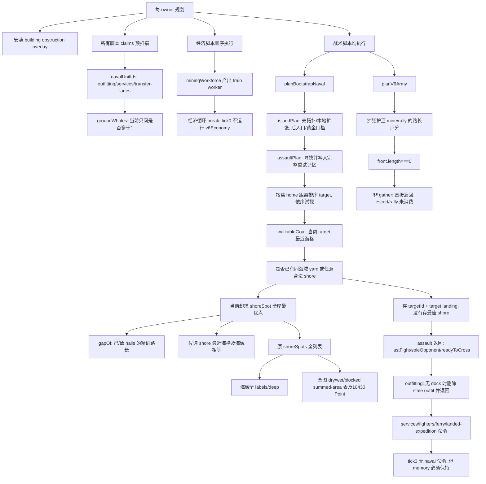

# tick 0：从最后需要的答案倒查计算

只读工作；未修改生产，未运行编译、模拟或计时实验。证据冻结于 clean causal-A（281a75d0）及 causal-P 的 source-inputs，而非当前工作树。rulesVersion=3，checksumVersion=18。源码副本、SHA 与原始首帧见 [CONSUMER-FACTS.json](CONSUMER-FACTS.json)，完整采样路径见 [A](A-tick0-tree.json) / [P](P-tick0-tree.json)。

## 当前最大值的决策依赖

A tick0 whole=95.33684ms、AI=80.50590ms、sim=10.72468ms；P tick0 whole=113.57917ms、AI=98.49617ms、sim=10.22573ms。这两次是诊断运行，不能替代未带钩子的正式重复。初始每个 AI 仅 3 worker、1 townHall、gold=500，没有船厂、舰船或陆军；首帧每家仅 mine+train worker。

此图描述发生顺序和消费者；共享缓存使树上多个边可能只在第一处真正构建，不能把 inclusive 时间或样本相加。A 的 assault 战术支路为64/134个采样，P为62/137；shoreSpot子支路57/53。setBuildingBodies各13，claims17/21，general的expansionEscortPoint各6。它们是归因计数，不是毫秒/调用次数。**“shore oracle 后仍63ms”只是一次局部删法的剩余时间，不是必要工作下界。**

## 谁需要什么，哪些结果可以不求

| 最终消费者 | 必要的答案 | 多求/不可直接删除的部分 |
|---|---|---|
| assaultPlan:1008、raidPlan:1076 | 任意合法 shore 是否存在 | 不需要最近岸、最短 gap 或全体候选排名。原第一次 best 赋值就是完整真值证据；后面的所有改进都不被这两处读取。assault memory 只存 target 的 landing，故首岸可不同。 |
| navalStep:219 | readiness 的存在性 | :238 延迟 issue 需要原最近岸。prepared 立即执行路径也可能持有 readiness Point，不能把首岸冒充执行岸。父车道正在按该边界处理。 |
| islandPlan:967–974 | 精确 shore→departure→海路评分 | 任意首岸不能替换：chooseNavalMine 用 departure 的海路长作 threat 后的排序键，能改变矿选择。 |
| navalStep:225、:238 | 真正的塔/船厂坐标与 builder | 必须保留最优点以及 Point/回调/延迟执行契约。 |
| planV6Army:202–209 | 有 front 时的 escort/rally；或无 front 但 gather 退出时的新 target | 无 front 且非 gather 的 escort/rally 没有任何返回值或记忆消费者。可先判这个确定条件；v6Doctrine 的首次随机抽取、doctrine/play 记忆必须仍发生。plan.chooseMine 是可传入回调，公开回调次数不能未经审计改变；bootstrap 内部 known callbacks 可另走私有确定路径。 |
| 未买下的经济 goals | id/cost/closeout、age、reserve、save/hold 对其他购买的影响 | 不是“没有 command 就能删”。rankBootstrapGoals/ageV6Goals 会写 goalAges，island/assault/raid 会写重试 tick/plan；但本 tick0 根本未运行 v6Economy，先改经济排名不会处理真实最大支路。 |

原序 existence 是最小因果实验，附 [未应用示例 patch](SHORE-EXISTS.unapplied.patch)，只展示 assault/raid 两处；它不覆盖父线程正在处理的第三处 readiness。一个原算法增加私有需求参数，在原 best 赋值前返回，净增3行。未测试、未提交。

旧 run2 诊断中，五次 shoreSpot 各有10430候选；首个合法索引依次7056、9339、6076、692、18，总23181/52150=44.45%。所以保留原序只减少55.55%候选，不能包装成10×。它仍触发完整 shoreSpots 首建。Boolean 模式没有 nearest/tie 需求，可在**同一原 readonly 列表**上改变访问顺序并完整 wrap；仍逐个调用相同完整谓词。此时排序本身不应造新索引/全局缓存，也必须核验早停改变 terrain 缓存 first-read 历史的后果。

## 每个试探到底触发什么冷成本

- 最先的 setBuildingBodies(planner-context:43) 为 building-aware 移动安装 land base + overlay；simulation 本 tick 的矿工真实运动也需要 overlay。它不属于“岸位候选排名”。后续 COW/source ownership 由 terrain 主车道管理。
- naval claims 的 groundWholes(:485) 首次请求全 land connectivity；这个 caller 只把精确组件数用于 <=1 guard。tick0 plain workers 的 claiming loop 本身不需要落地陆军判定，但后面的 assault target 仍会问 home/target 同陆地；仅移动这个触发点不能宣称删除初始化。
- assault 的候选目标先做 nearest sea landing(:1005)，这是写入 memory 的实际 selected landing。不能用任意海格取代；被淘汰 target 的 landing 仅服务于是否可攻击的存在判定，若有更廉价充分失败证据才可先跳过。
- 第一个 shoreSpot 首次 shoreSpots(:1143→terrain:201) 请求海域 labels/deep、全图3张积分表、完整候选 Point 列表。后续目标/owner重复利用该列表；其全量生成成本属于**列表 API 的物化契约**，不是“每个 Boolean planner 真需要整张地图”。不能重复冷算五次归因。
- shoreSpot:1124 的 walkingDistance 从所有候选查到 hall；第一个相应 target hall 的查询会 grow 整个 goal field。无效跨岛候选本只需不可达，却也触发首次 field 构建。每 hall 一个 field 后，重复候选查询主要是查表；因此“少9成query”不等于“少9成grow”。需要逐个 field 的首次消费者标签。
- shoreSpot:1151 的 walkableGoal 在通过前面过滤的每个候选上请求最近海格并比较海域；Boolean 成功后的这类搜索全部无消费者。原诊断 R 最大21，但不以其两行遍历优化作为本轮架构方案。

**真正当前要求全图完整结果的是公开 shoreSpots 的整列表 API，以及公开 groundWholes 的精确 count API；同一时刻大多数实际消费者只要存在性、两点连通性或一个局部判定。** sameGround 并不在语义上要求提前标完整地图；只是当前实现复用完整 labels。shoreSpots 同对象 first-read 缓存、列表/Point身份已被差分证明可观察，不能再直接换成本地枚举。若未来设计 lazy immutable list 或 purpose-specific topology/shore 查询，必须先由主 terrain 所有者界定现存缓存历史，不能把原契约悄悄修复。当前实验可以先保持该完整列表不变。

## 更大的删除方向：存在证明，而非先算精确分值

一个 Boolean shore 候选若能由原图证明：与某己hall连通、与所有敌hall不连通、到所有同组件己hall的合法路长下界均>=HALL_BERTH，则 gapOf 的“己方有限且>=160、严格优于敌方Infinity”已经成立，不必求任何精确距离。所有 tower/gun/placement/sea 条件仍须执行。多hall不可只看home；下界需原runtime.width及padAt解释，不能用当前world坐标冒充（旧cols变化反例已知）；UNREACHED上界与正常正cell也要严格守卫。此接口可交terrain主车道，不能在AI复制第二套寻路。它比压缩既有Field更根本：很多位置根本不需要一张Field。

## 最小可逆消费者诊断

只向一次完整原扫描加入计数，不重跑 query，不在热循环做 JSON/stack/timer；保持 source A 冻结，仅临时bundle改写：

1. 给每次计划/候选一个小数字 scope id（owner、tick、consumer=assault/raid/island/readiness/issue），计数 shore候选、firstAccept、bestUpdate、walkingDistance调用、nearestSea请求；在原 best 第一次赋值时保存 candidate原index，不改原返回。
2. 在 grow/wholesOf/createRuntime 的**首次 build**入口写 scope id及goal/mover标识，区分共享初始化、具体score/existence需求；不以 query次数推断build次数。
3. 在每个 planner/脚本边界记录返回的 targetId/landing/goalId；runner记录raw命令、claim过滤后、conflict过滤后命令。边界记录前后AI memory的规范序列化差分（保留undefined/-0/nonfinite），标注仅memory消费者和真正最终命令消费者。每owner记录主general的front数与gather状态，验证无用rally分支。
4. 在同一诊断输出中，原始 Boolean 结果与“扫描中firstAccept存在”应逐调用相等；不另执行算法即可先验证消费者条件。之后独立候选只把Boolean查询改原序早停/新的枚举顺序，原逻辑仍计算完整memory，比较每调用Boolean、逐tick完整游戏/AI memory、commands、旧快照和冷恢复。

最小先跑0..31三个think点；它是正确性/工作量实验，不作性能结论。成功后才对整局14400tick做无诊断的交替正式对照，并核对最大事件、总CPU、GC及回收后内存。覆盖无解、首岸≠最优岸、严格/放枪两种模式、敌塔/footprint挡住早期候选、多水域、多hall、原缓存Point被改、same-object cell/cols/levels mutation、retry memory现存/过期/目标消失、无舰/真实ferry和public回调计数。

## 可交 terrain 所有者的 scanline CCL 数据

[MAP-RUNS.json](MAP-RUNS.json) 仅静态读取初始102400字符，无游戏/编译/模拟/计时。land:21448可走cell、777水平run、13组件、相邻行run重叠779；sea:85767可走cell、838run、1组件、重叠850。原BFS每cell检查8方向约171584/686136次。平均run长度27.60/102.35，但这不是实测加速比，也不免去O(A)读图和最终labels物化。

stepAllowed:1300 要求对角的两侧cardinal均可走，所以每条允许对角边均有2步cardinal替代，连通分量严格等于4邻接。故可以按行run重叠构建CCL，消掉全尺寸BFS queue和逐cell八向扩展；如要保留原labels数值，按每组件最小padded seed排序重编号，并保留deep统计。必须基于真实runtime.walk及实际width，不能重新读取已变terrain.cells或丢掉padded边界；旧快照/COW、异常维度与typedarray行为由主车道验收。这里只交结构性证据与接口方向，未实施也未测时。
