# 房间流程重做：现状走查与新方案

**一句话**：单人和联机现在挤在同一个“房间设置”页里，靠一个切换按钮区分，所以单人页上有一堆用不上的联机控件，联机页又缺了真正要用的东西：权限、邀请、离开。新方案把它们拆成两条路：**单人游戏**是一屏选图加座位，点“开始”就开打；**多人游戏**是房间列表加房间，每个人只能改自己的座位，房主能邀请、能离开，对局里能认输。

这份文档只定流程和布局。视觉风格归 Art Lane，线框里的方块不代表最终样子。

## 怎么走查的

- mac1 上的无头 Chromium，基于 `main@13d0a870` 的开发服务器。窗口 1440×900，另加一次 390×844 的手机宽度。
- 三个独立浏览器身份：**房主**完整走一遍开房、选图、改座位、切联机、开局、认输、看结果、再来一局；**客人**走房间列表、加入、准备；**朋友**直接打开房主地址栏里的链接。
- 截图在 `before/`，下文每条问题都带一张。

## 现状：流程

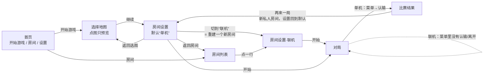

## 现状：问题清单

按严重程度排。“证据”一列是本次走查实际看到的。

| # | 问题 | 证据 |
|---|---|---|
| 1 | **客人能改别人的座位。** 客人把房主的种族从“余烬”改成“随机”，房主那边也跟着变了；客人还能勾房主的“准备”，能改电脑座位的队伍和 AI。服务器的 `POST /api/rooms/:id/slots/:slot` 不看是谁发来的。 | 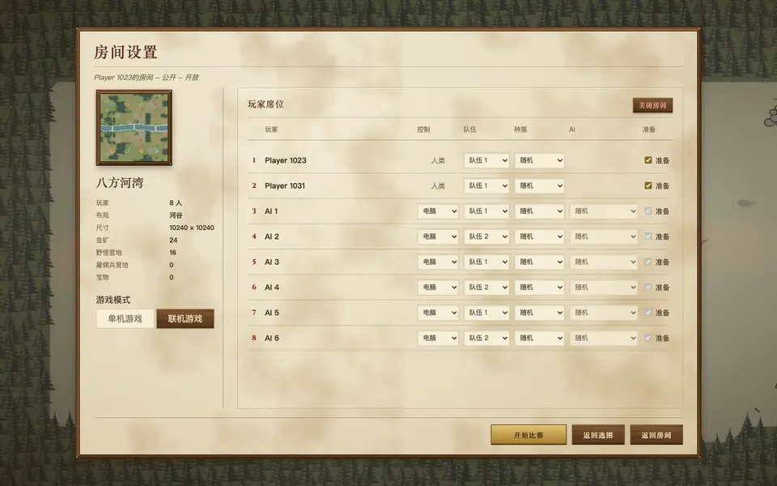 |
| 2 | **联机对局里没法认输或离开。** 菜单里只有“继续”和“设置”。`server-runtime.canForfeitMatch` 恒为 `false`，单机才有“认输”。 | 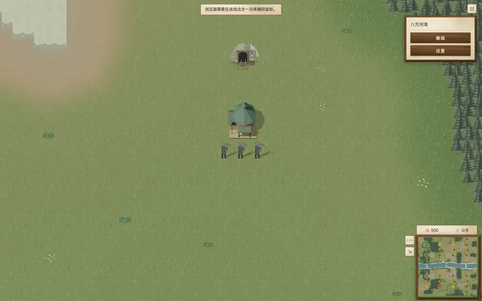 |
| 3 | **幽灵房间。** 房主关掉浏览器后，房间还会在列表里留到 5 分钟（`ROOM_IDLE_MS`）。客人能加进去，但房主已经不在，永远开不了局。房间满了也照样列出来，点进去才报错，提示原样是 `无法进入房间：{"error":"Room has no open slots"}`。 | 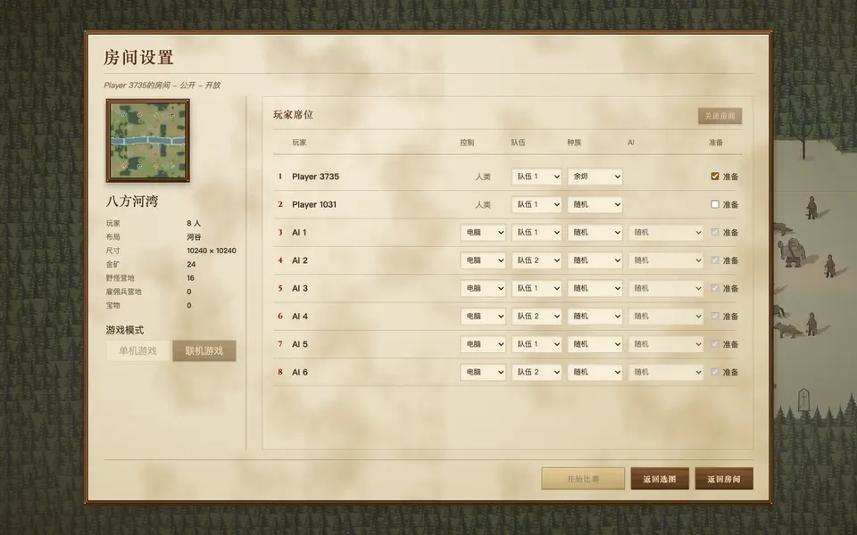 |
| 4 | **房间列表混进了自己的单人对局**（“你是 player”）。另外文案“8 活动”看不懂，“开放 · … · 开放”重复了一遍。 | 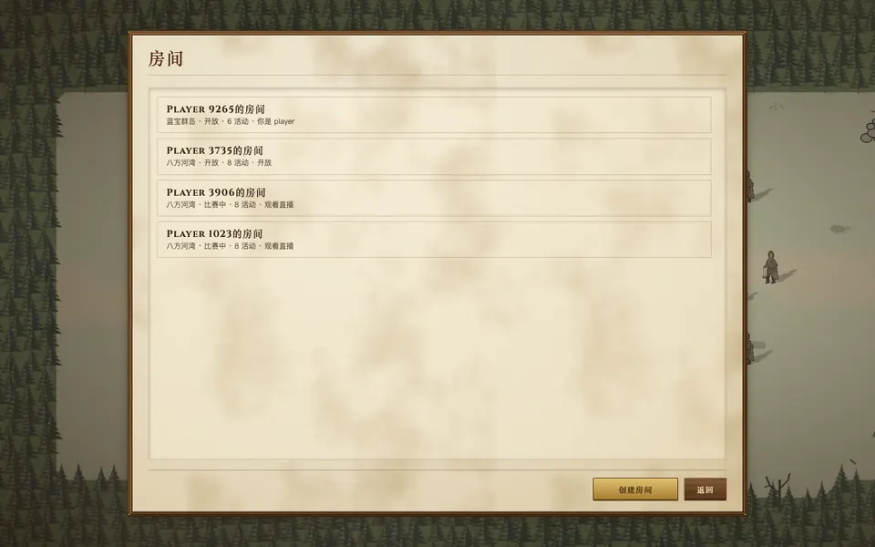 |
| 5 | **“联机”藏在单人设置页里。** 要先点“开始游戏”，选图，点“继续”，进了单机设置页，再点“联机游戏”。这一切换实际是关掉当前房间再新建一个（换了新 id），第一个电脑座位还会被悄悄改成“开放”。首页的“房间”和“开始游戏”到底是什么关系，也看不出来。 | 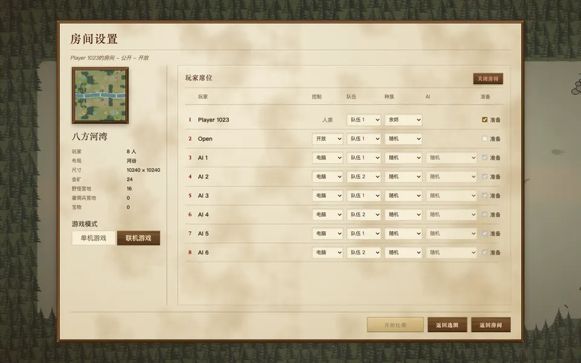 |
| 6 | **选图和座位分在两屏。** 选图页点图只是预览，必须再点“继续”。到了设置页想换图，又得“返回选图”。座位是按地图人数生成的，所以换一次图，刚调好的座位就重置。 | 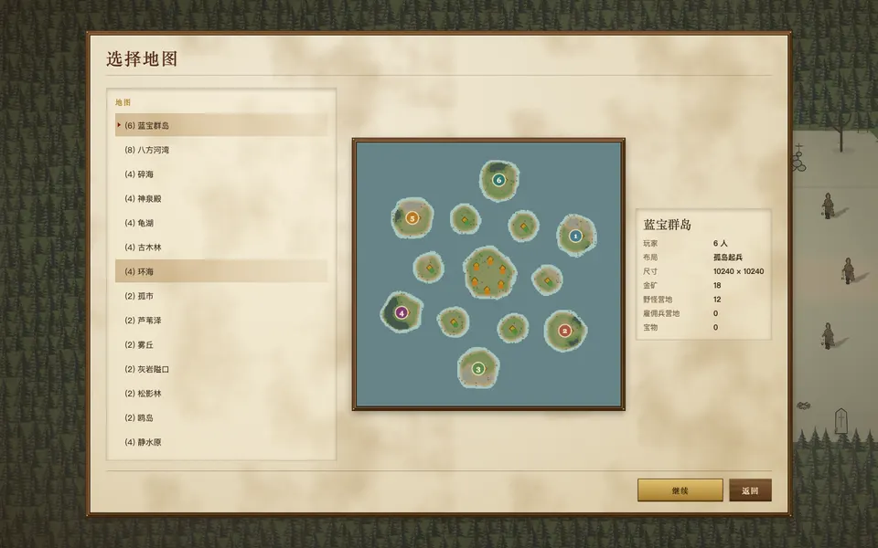 |
| 7 | **单人页上有用不上的控件**：灰掉的“准备”勾选、“关闭房间”，以及其实是去房间列表的“返回房间”。标题下面那行“私人 – 开放”是内部状态。 | 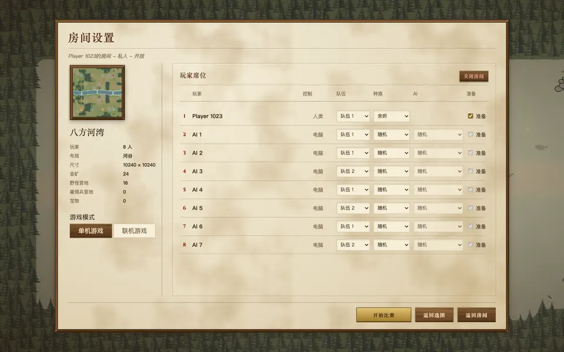 |
| 8 | **客人看到的是房主的界面**：“返回选图”能点，“关闭房间”是灰的。“开始比赛”变灰时，原因只写在悬停提示里（“每个座位都要有电脑或已准备的玩家…”）。 | 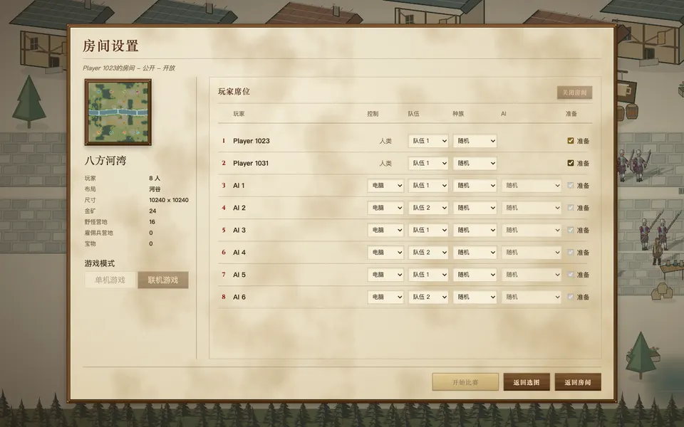 |
| 9 | **结果页说的是内部话**：“在第 58 tick 结束”，“电脑 · V9 ARCHER”。“再来一局”会新建一个私人房间，座位回到地图默认，刚才的设置全丢。联机打完点“再来一局”，客人被落下。 | 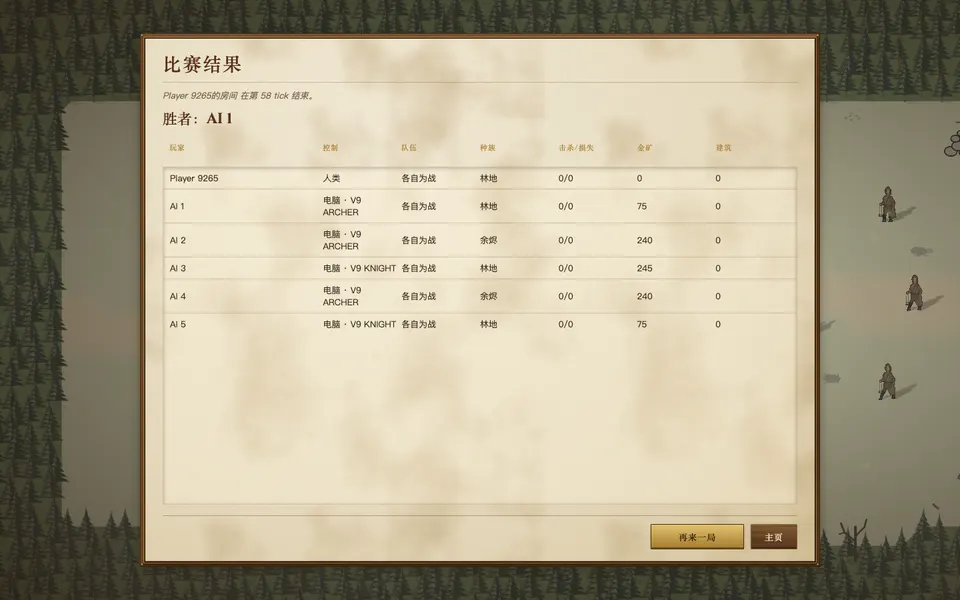 |
| 10 | **打开别人分享的链接**：比赛已经开始的话，会直接进加载，然后以观众身份进场，前面没有任何提示。加载框写的是“4.66 MiB · 32/32 项 · 复用 115.7 KiB”。 | 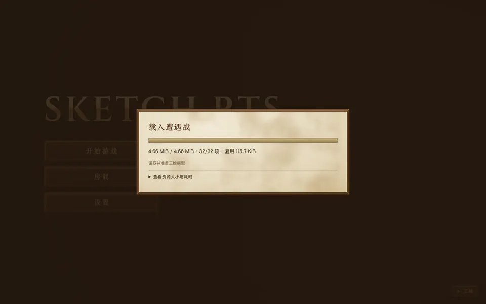 |
| 11 | **手机宽度**：座位行里三个下拉框挤成一排，“各自为战”被截断。 | 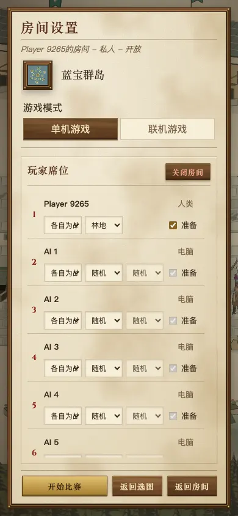 |

可以对照的成熟做法：War3 的自定义游戏和 AoE2 的遭遇战，选图和座位都在**同一屏**，改了就生效。SC2 和 War3 的大厅里，**每个人只能改自己的那一行**，房主额外能改电脑座位和空位。三者的对局菜单里都有“退出/认输”，打完都能“再来一局”，并且保留原来的设置。

## 新方案：流程

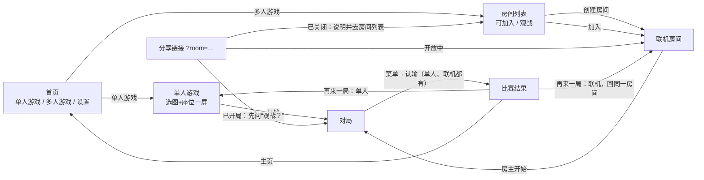

### 单人游戏：一屏

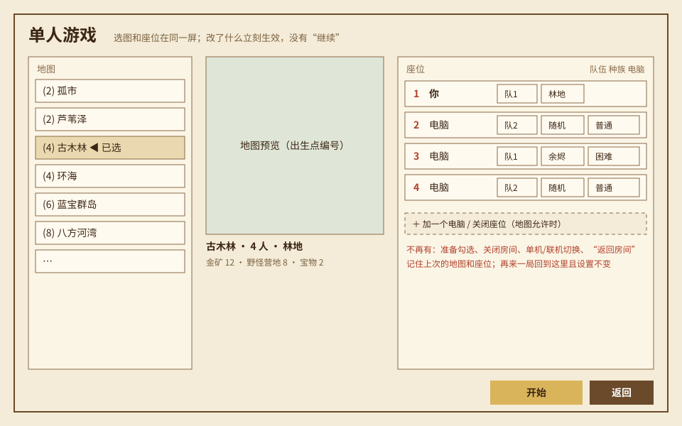

- 地图列表、预览和座位放在同一屏。点一张图，预览和座位立刻换掉，不再需要“继续”。
- 每行座位：队伍、种族、电脑强度。去掉“准备”、“关闭房间”和单机/联机切换。
- 记住上次用的地图和座位，“再来一局”回到这一屏，设置不变。
- 底部只有“开始”和“返回”。

### 多人游戏：房间列表

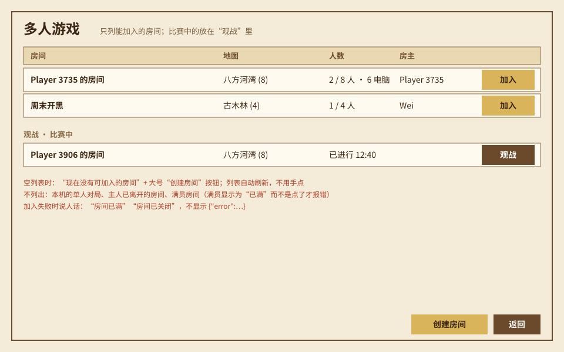

- 只列能加入的房间，有空位就带“加入”按钮。比赛中的单独放在“观战”分组。
- 不列：本机的单人对局、主人已经离开的房间。满员的房间显示“已满”，不能点。
- 列表自动刷新。为空时显示一句说明，再给一个大号的“创建房间”。
- 出错时说人话，比如“房间已满”“房间已关闭”。

### 联机房间

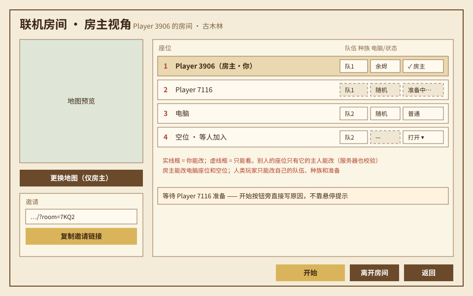

- **座位归属**：自己那一行能改队伍、种族和“准备”。房主还能改电脑座位和空位：打开、关闭、换成电脑。别人的行只读。服务器同样按这个规则校验，请求里不带对的用户就拒绝。
- **邀请**：一个“复制邀请链接”按钮，打开链接的人直接坐进空位。
- **开始**：按钮旁边直接写着在等什么，比如“等待 Player 7116 准备”。
- **离开**：客人离开就是让出座位。房主离开前先确认，确认后房间关闭，所有人回到房间列表，并看到一句“房主关闭了房间”。
- 房主能在房间里换图，用的就是单人那一屏的地图列表（弹出式），座位尽量保留。

### 对局与结果

- 对局菜单：单人和联机都有“认输”。联机里认输等于退出这局，留下的单位怎么处理见下面的待定问题 3。
- 结果页写“用时 12:40”，不写 tick。电脑写“电脑（困难）”这类玩家能懂的名字，内部版本号收进展开的详情里。
- 再来一局：单人回到单人那一屏，设置不变。联机回到**同一个房间**，座位保留，大家重新“准备”。

## 现状 → 新方案 对照

| | 现状 | 新方案 |
|---|---|---|
| 首页入口 | 开始游戏 / 房间 / 设置 | 单人游戏 / 多人游戏 / 设置 |
| 单人开一局 | 开始游戏 → （选图）→ 继续 → 开始（至少 3 次点击，2 屏） | 单人游戏 → 开始（2 次点击，1 屏） |
| 开联机房间 | 开始游戏 → 选图 → 继续 → 切“联机”（重建房间） | 多人游戏 → 创建房间 |
| 谁能改座位 | 任何进了房间的人改任何座位 | 自己改自己的，房主改电脑和空位，服务器校验 |
| 邀请朋友 | 自己从地址栏复制 | “复制邀请链接”按钮 |
| 开始变灰 | 原因写在悬停提示里 | 按钮旁直接写在等谁 |
| 联机中途退出 | 没有入口 | 菜单里“认输” |
| 房间列表 | 混有自己的单人局、幽灵房间、满员房间 | 只列能加入的；比赛中单独一组；满员标“已满” |
| 结果页 | tick、V9 ARCHER；再来一局丢设置 | 用时、能看懂的电脑名；再来一局保留设置，联机回同一房间 |

## 分批提交

每批一个 PR，带改动前后截图。动到房间的批次都要跑 `room-sync-yatu` 和 `e2e-room-flow`，必要时更新这两条验证本身。

1. **本文档**。
2. **座位归属**：服务器给座位修改加用户校验；客户端把别人的座位渲染成只读；客人看不到房主专属按钮；“开始”旁写原因。解决问题 1、8。
3. **单人游戏一屏**：选图和座位合成一屏，去掉单人用不上的控件，记住上次设置，再来一局保留设置。解决问题 6、7，以及问题 9 的单人部分。
4. **多人游戏入口与房间列表**：首页改成两个入口；房间列表过滤掉本机、幽灵和满员房间，错误说人话，比赛中的放进观战分组；加“复制邀请链接”；打开链接时按房间状态分情况处理。解决问题 3、4、5、10。
5. **对局与结果**：联机认输/离开，结果页文案，联机再来一局回同一房间。解决问题 2 和问题 9 的其余部分。

手机宽度（问题 11）在 3、4 两批里顺手处理：座位行在窄屏上改成两行。

## 需要 owner 拍板

1. **单人和多人拆成首页的两个入口**，取代现在房间页里的单机/联机切换。推荐拆。
2. **联机“再来一局”回到同一个房间**（所有人一起回去，座位保留），而不是现在这样各自新建房间。推荐回同一房间。这需要服务器允许一个已结束的房间重新开放，改动比其他几批大，放在第 5 批。
3. **联机里有人认输以后**，他的单位怎么处理：直接判负、单位全部消失（War3 的做法）；还是交给电脑接管，让队友不至于一下子少一个人。推荐直接判负、单位消失，规则最简单，也和单人一致。
4. **结果页的 AI 版本号**（V9 ARCHER）：收进展开的详情里，测试时还能看到。推荐收起，不删。
