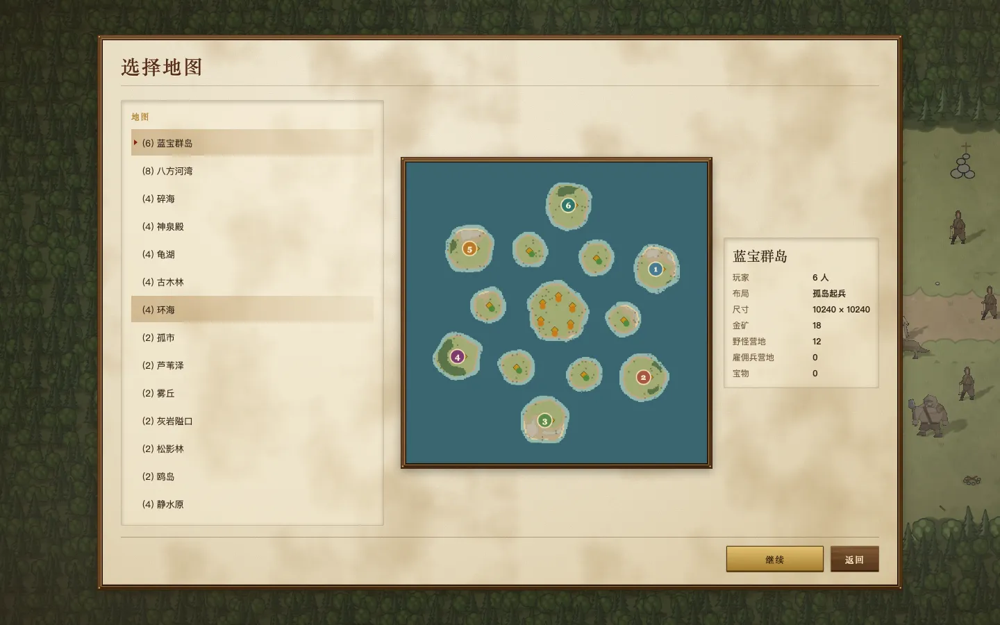
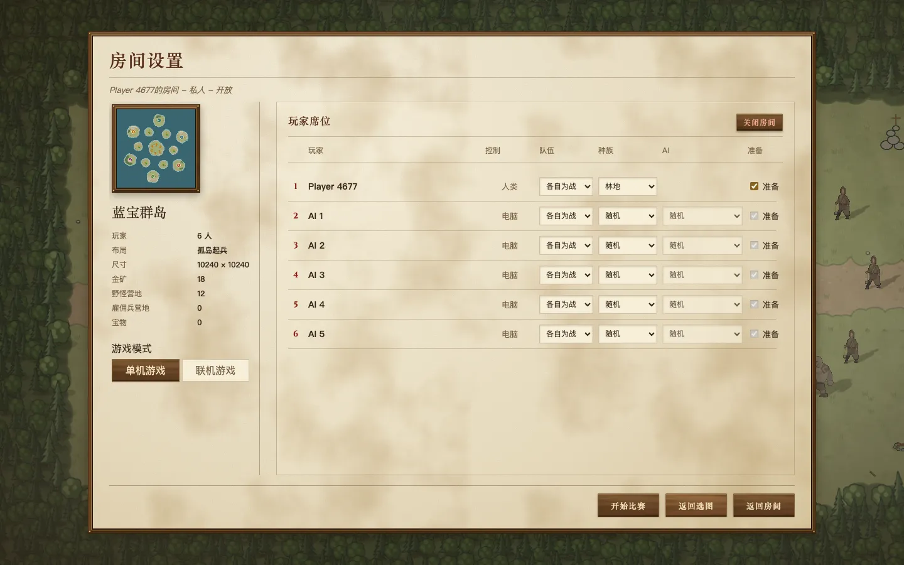
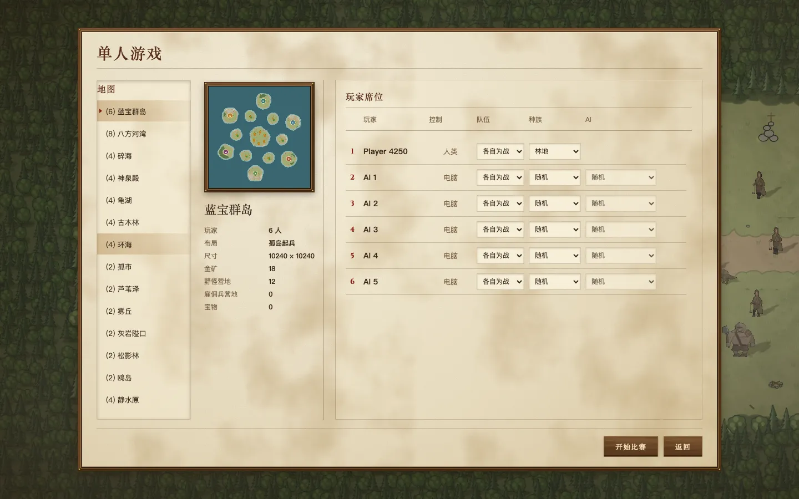
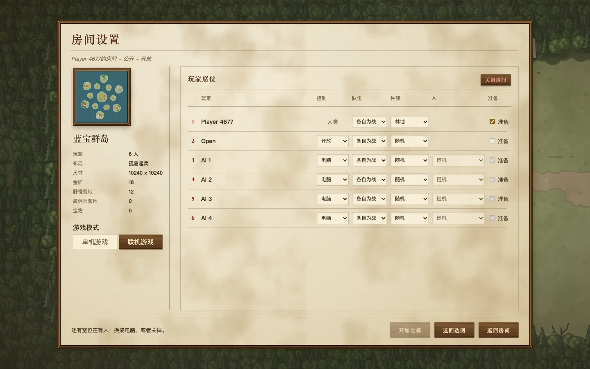
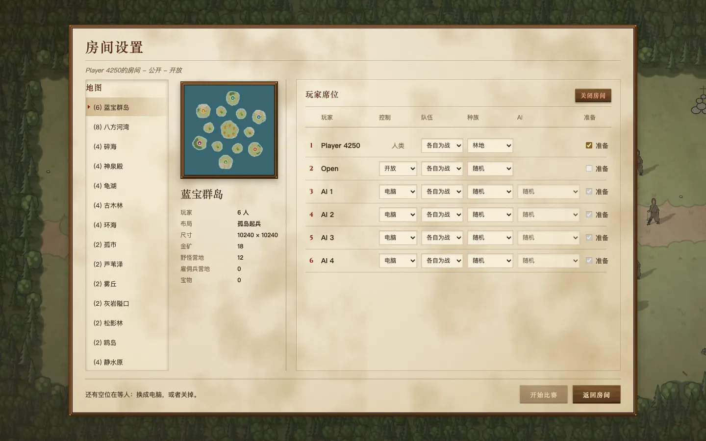
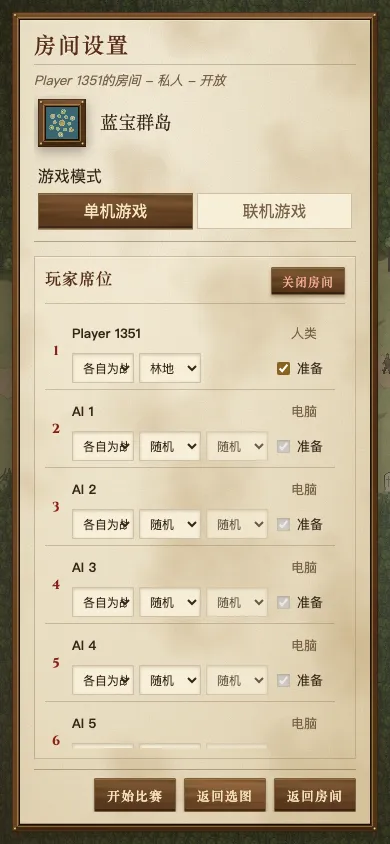
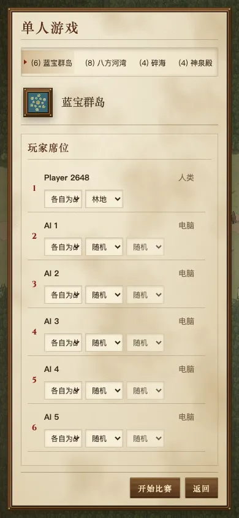

# 房间流程第 3 批：选图和座位合成一屏

对应 [房间流程方案](../README.zh.md) 的第 3 批，解决问题 6、7，以及问题 9 的单人部分。

## 两条路径

- **“开始游戏” → 单人游戏。** 一屏就能开打：左边地图列表，中间是选中地图的预览和数据，右边是座位。点一张图立刻换上，不再需要“继续”。这一屏没有“准备”、“关闭房间”和单机/联机切换；底部只有“开始比赛”和“返回”，“返回”回首页。
- **房间列表里的“创建房间” → 联机房间。** 用的是同一屏，房间对别人开放：有一个空位等人加入，每行有“准备”，房主有“关闭房间”，底部“返回房间”回房间列表。

联机房间以前只能从单人设置页里切过去。现在任何时候都能从首页的“房间”进入房间列表，再点“创建房间”。首页拆成“单人游戏 / 多人游戏”两个入口，留在第 4 批。

## 行为

- **换图保留座位。** 换一张图时，新图上有的座位保留原来的玩家、种族和电脑。队伍只在新旧两张图布局相同（都是两边对阵，或者都是环形各自为战）时保留，否则用新图自己的队伍。新图多出来的座位用默认设置。
- **记住上次的单人设置。** 上次单人游戏的地图和座位存在本浏览器里，下次点“开始游戏”直接回到上次那一屏。存的就是这一屏地址栏里的那串参数，读回来时和别人分享的链接走同一套校验。读不到或校验不过时，用第一张图的默认设置。
- **单人“再来一局”设置不变。** 单人打完点“再来一局”，回到这一屏，地图、座位、地形种子都和刚才一样。联机打完的“再来一局”还和以前一样，在第 5 批改成回到同一个房间。
- **联机房间换图仍是换一个房间。** 以前的“返回选图 → 继续”也是这样：新房间建好后关闭旧房间，已经进来的客人会回到房间列表。在原房间里直接换图，要服务器同时调整座位数和地形种子，留到后面再做。
- **手机宽度。** 座位行在窄屏上已经是两行（main 上就是这样，见下面的截图）。这一批把地图列表在窄屏上改成一行横向滚动。

## 改动前后

截图环境：mac1 无头 Chromium，生产构建。改动前是 `main@c8983954`。

### 单人：改动前要过两屏

| 改动前 1：选图（点图只预览，要点“继续”） | 改动前 2：房间设置（有准备、关闭房间、模式切换、返回选图） |
|---|---|
|  |  |

### 单人：改动后一屏

### 联机房间

| 改动前（单人页里切到“联机游戏”） | 改动后（房间列表 → 创建房间） |
|---|---|
|  |  |

### 手机 390×844，单人

| 改动前 | 改动后 |
|---|---|
|  |  |

## 验证

- `e2e-room-flow` 两条路径都走了一遍：
  - **单人**：“开始游戏”进入单人一屏，确认没有准备、关闭和模式切换。在这一屏换到 Pineshade，改种族和队伍后刷新，配置不丢。回首页再点“开始游戏”，回到同样的地图、座位和种子。换到四人的静水原，前两个座位的种族保留，再换回来也保留。开局、认输、看结果、点“再来一局”，回到同样的设置。
  - **联机**：房间列表 → “创建房间”，进入联机版同一屏，确认有准备和关闭房间。换到 Pineshade 后，客人从链接加入，只能改自己的座位。后面的对局、研究、结果页流程和以前一样。双海岸地图上的队伍检查也走这条路径。
- `room-sync-yatu`：通过，走的是“创建房间”这条路径。
- 单元测试：
  - `room-route.test.ts`：换图保留座位，以及只在布局相同时保留队伍；以前选图页的地址会直接打开设置页。
  - `room-setup-session.test.ts`：原来针对模式切换的“只保留最后一次请求、清理过期房间、失败回退”测试，改成用连续换图来验证。
