# 房间流程第 4 批：多人游戏入口与房间列表

对应 [房间流程方案](../README.zh.md) 的第 4 批，解决问题 3、4、5、10。

## 改了什么

- **首页两个入口：** “单人游戏”和“多人游戏”，替代原来的“开始游戏 / 房间”。单人游戏打开第 3 批的单人一屏；多人游戏打开房间列表，那里的“创建房间”打开同一屏的联机版。
- **房间列表只列能做的事：**
  - “可加入”一组：有空位的房间写“加入”；满员的房间写“已满”，变灰，点不了；自己坐着的房间写“回到你的座位”。
  - “比赛中（观战）”一组：正在比赛的公开房间写“观战”。
  - 不列：本浏览器里的单人对局（“单人游戏”会再打开它），以及主人已经离开的房间。
  - 每行写“地图 · 1/2 名玩家 · 加入”，不再是“开放 · 5 活动 · 开放”。
  - 列表每 3 秒自己刷新。为空时提示“创建一个，再把邀请链接发给朋友”。
- **主人离开的房间（幽灵房间）：** 服务器现在按用户记录谁在看着一个房间（房间设置页的事件流）。开放中的房间，只有主人还在看着时，才列给别人（@@@room-presence）。主人关掉页面，房间立刻从别人的列表里消失；主人刷新页面，几秒内就回来。5 分钟没人看的房间照旧由回收器关掉。
- **复制邀请链接：** 联机房间的座位栏上有“复制邀请链接”，房主和客人都能用。复制的是房间自己的地址，朋友打开后直接坐进空位。浏览器不让写剪贴板时，链接直接显示在状态行里，可以手动复制。
- **打开一个房间之前先看它的状态**（@@@room-entry），不再拿“加入失败”的报错原文给人看：
  - 房间不存在或已关闭：回到房间列表，写“这个房间已经关闭了。”
  - 房间满了：“这个房间已经满了。”
  - 别人的非公开比赛：“这局比赛不对外开放。”
  - 从链接打开一局已经开始的比赛：先问“这局比赛已经开始了。要以观众身份进去看吗？”，可以选“观战”或“返回房间列表”。从房间列表点“观战”是已经选过了，不再问。

## 改动前后

截图环境：mac1 无头 Chromium，1440×900，生产构建。改动前是 `main@653a1af1`（已经包含第 3 批）。

列表里的内容由另外几个浏览器身份造出来：
- Alice 开了一个有空位的房间；
- Bob 开了一个房间，把空位换成电脑，满员；
- Carol 开了一局并开始比赛；
- Dave 的房间是直接调接口建的，没有主人在看，就是主人已经离开的情况；
- 看列表的人自己还有一个单人对局。

### 首页

| 改动前 | 改动后 |
|---|---|
| 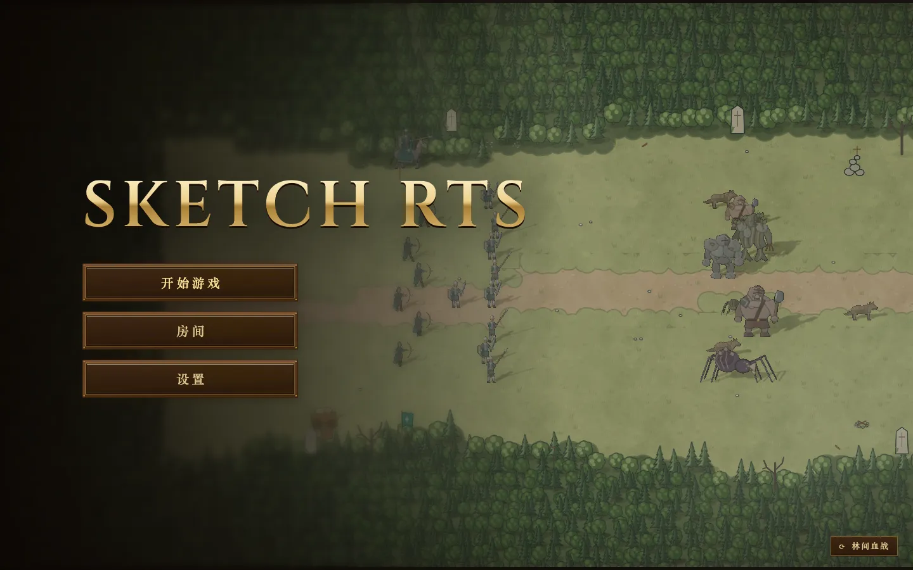 | 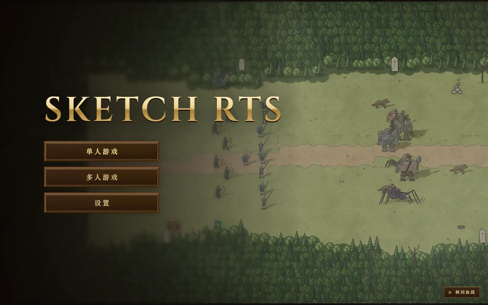 |

### 房间列表

| 改动前：一排平铺，主人已离开的 Dave 和满员的 Bob 都能点 | 改动后：分组，满员变灰，Dave 和自己的单人对局不列 |
|---|---|
| 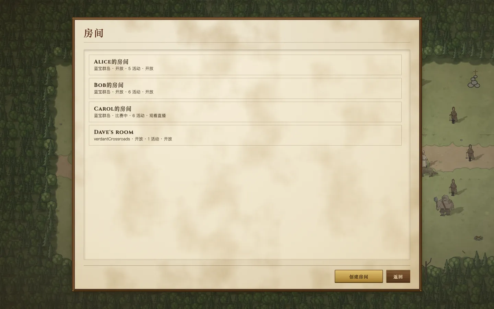 | 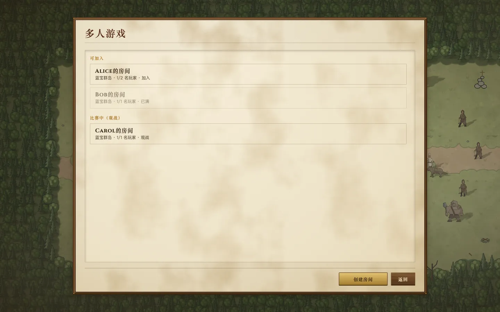 |

### 打开一个已经关闭的房间的链接

| 改动前：首页上一行报错原文 | 改动后：回到房间列表，写清原因 |
|---|---|
| 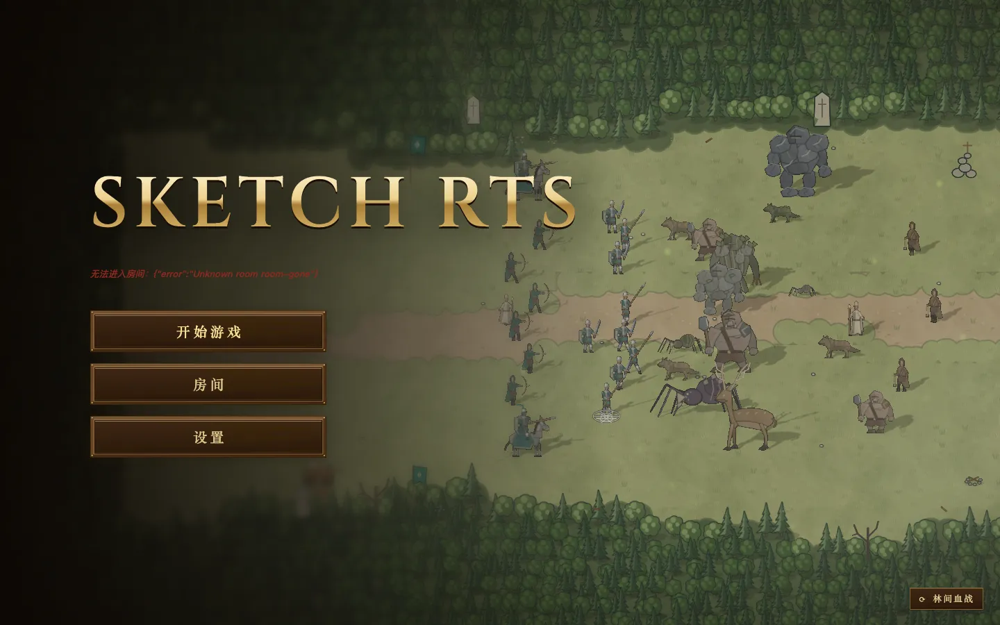 | 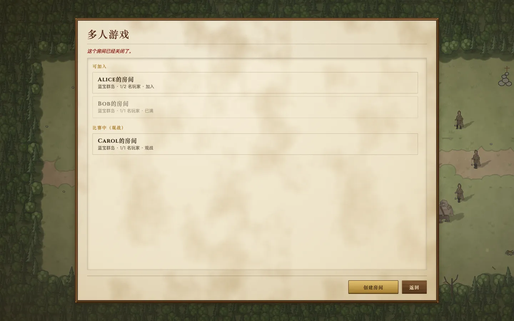 |

### 打开一局已经开始的比赛的链接

| 改动前：直接以观众身份进了比赛 | 改动后：先问要不要观战 |
|---|---|
| 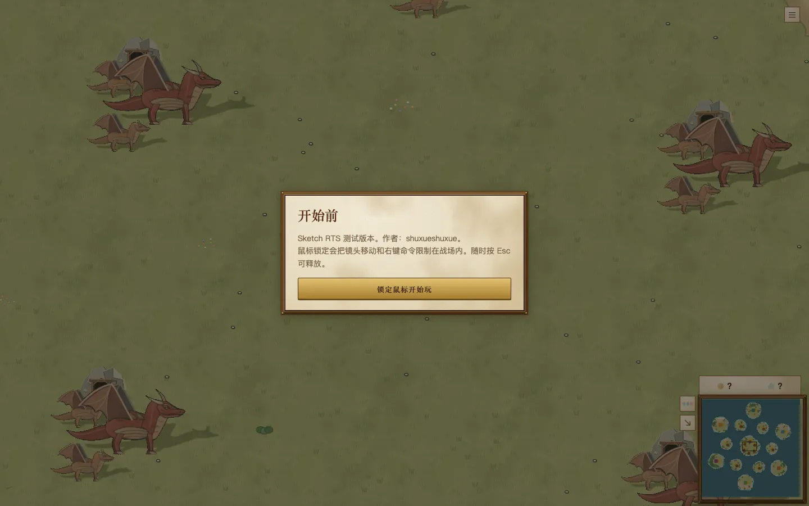 | 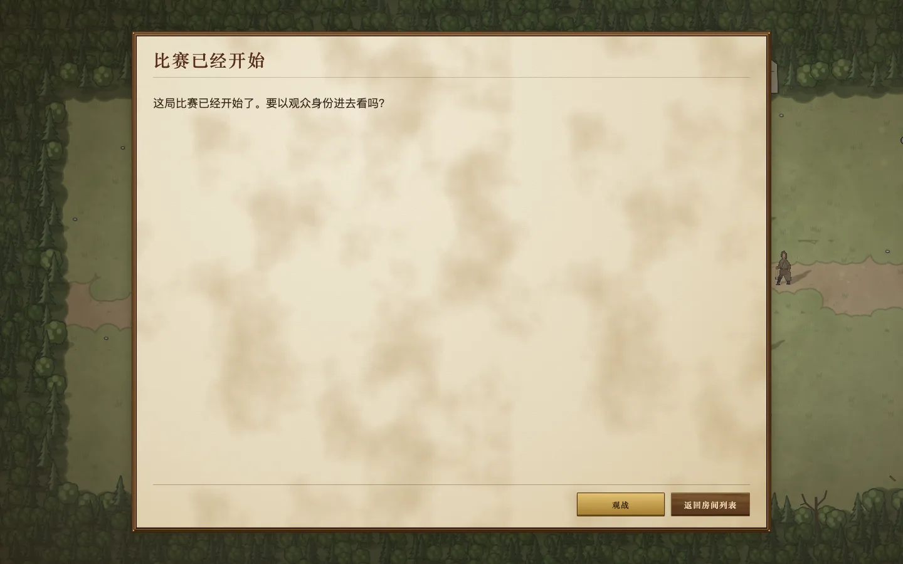 |

### 联机房间

| 改动前 | 改动后：座位栏多了“复制邀请链接” |
|---|---|
| 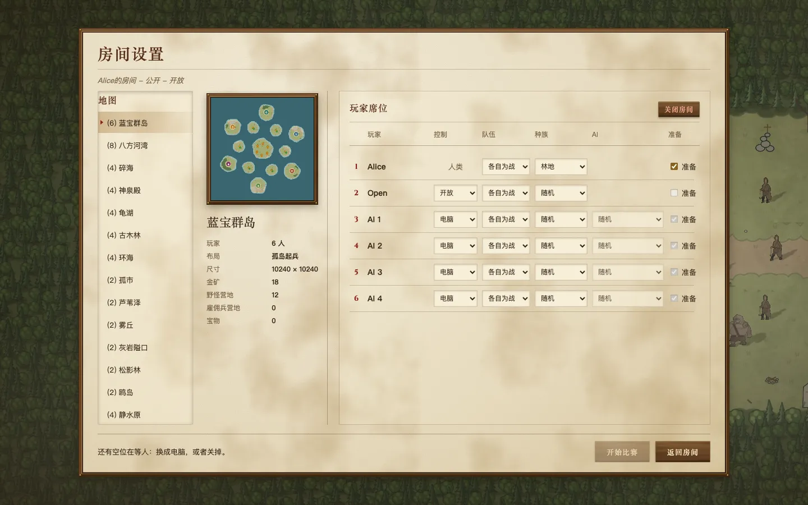 | 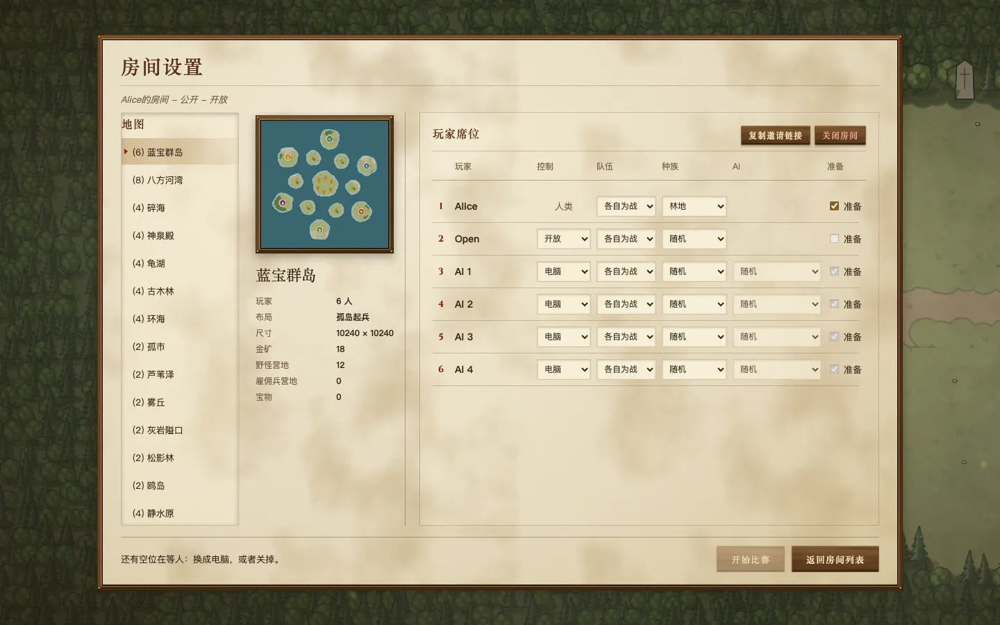 |

手机 390×844 首页：

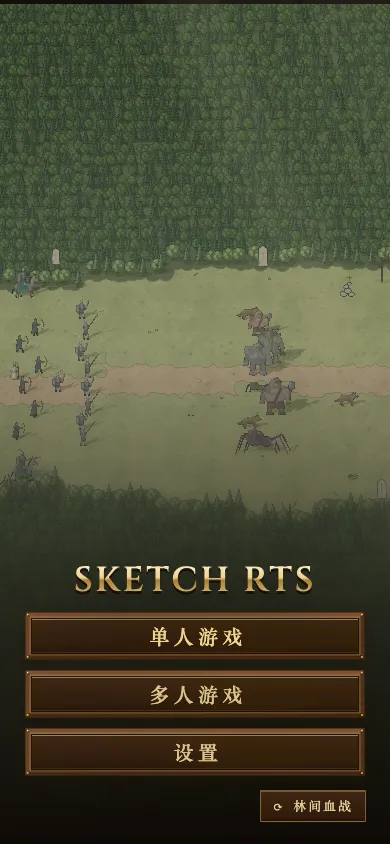

## 验证

- `e2e-room-flow` 加了这一批的检查：
  - 本浏览器的单人对局不在房间列表里；
  - 直接调接口建、没有主人在看的房间不列；
  - 打开一个不存在的房间的链接，回到房间列表并写“已经关闭”；
  - 客人先在房间列表里看到房主的房间（“加入”）；
  - 房主点“复制邀请链接”，得到的就是房间地址，客人用这个链接进来；
  - 比赛开始后，第三个人打开房间链接，先看到观战提问，点“观战”后进入比赛。
- 连续跑 3 次：2 次通过。另 1 次挂在客人勾“准备”那一步（第 2 批就有、这一批没改的步骤），后两次都过了。
- `room-sync-yatu` 通过。
- 单元测试：
  - `room-browser-model.test.ts`：列表分组、满员、单人对局不列；进房间的判断（关闭、满员、非公开比赛、从链接打开先问）。
  - `server-runtime.test.ts`：事件流带上看的人的用户。
