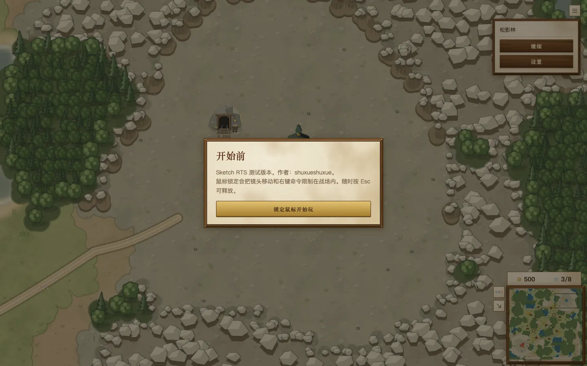
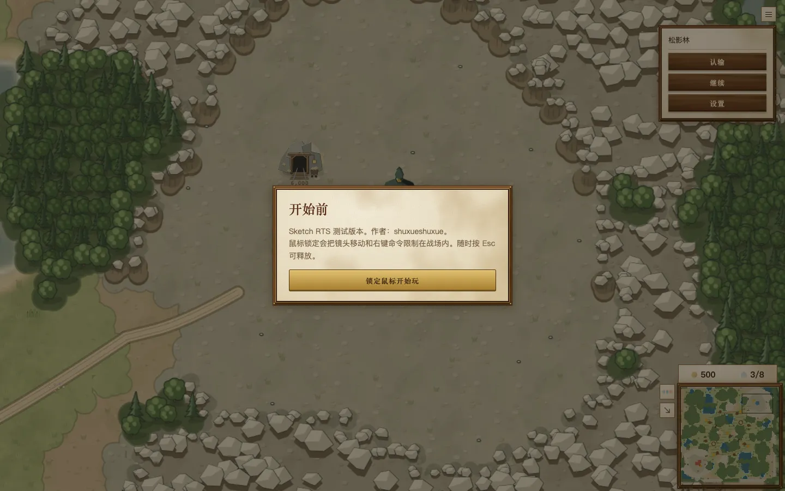
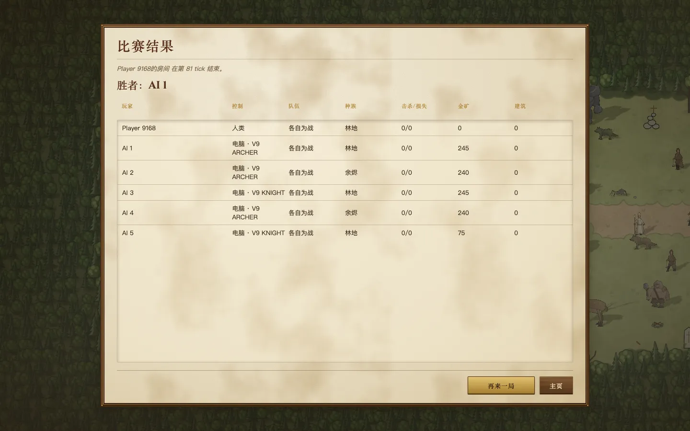
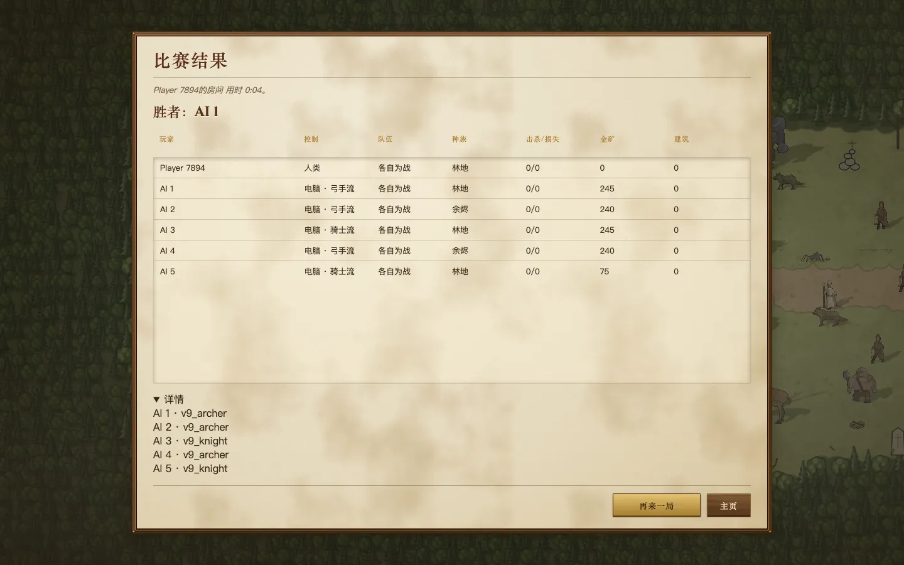
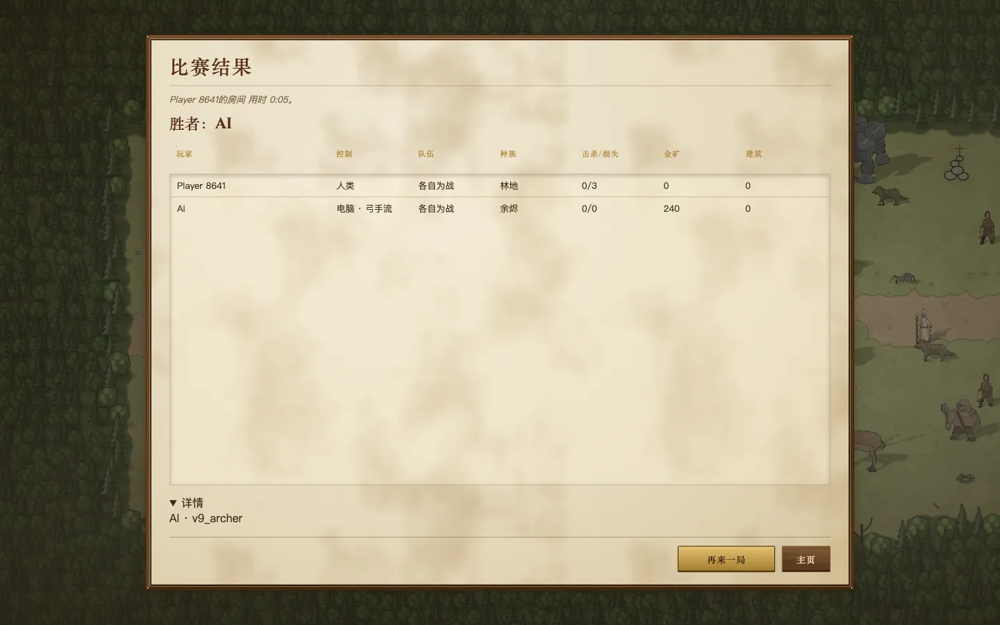
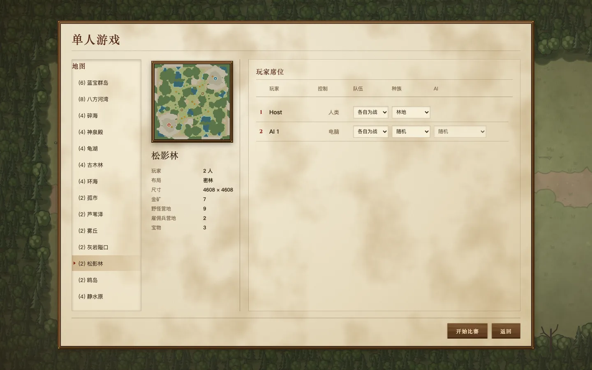
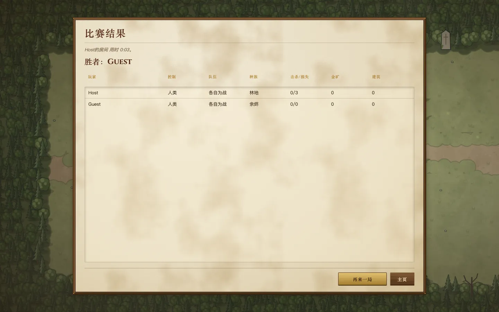
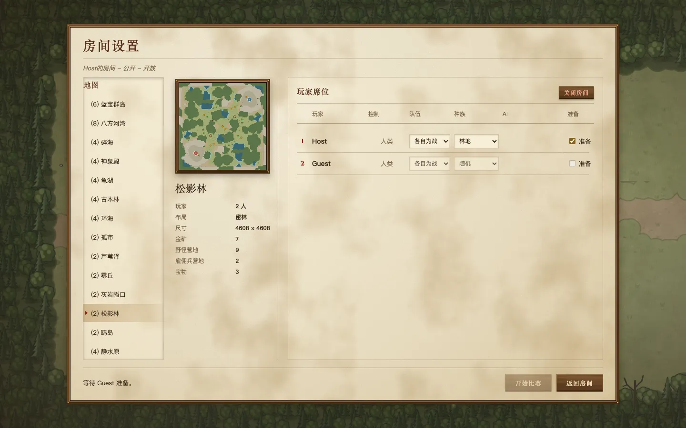
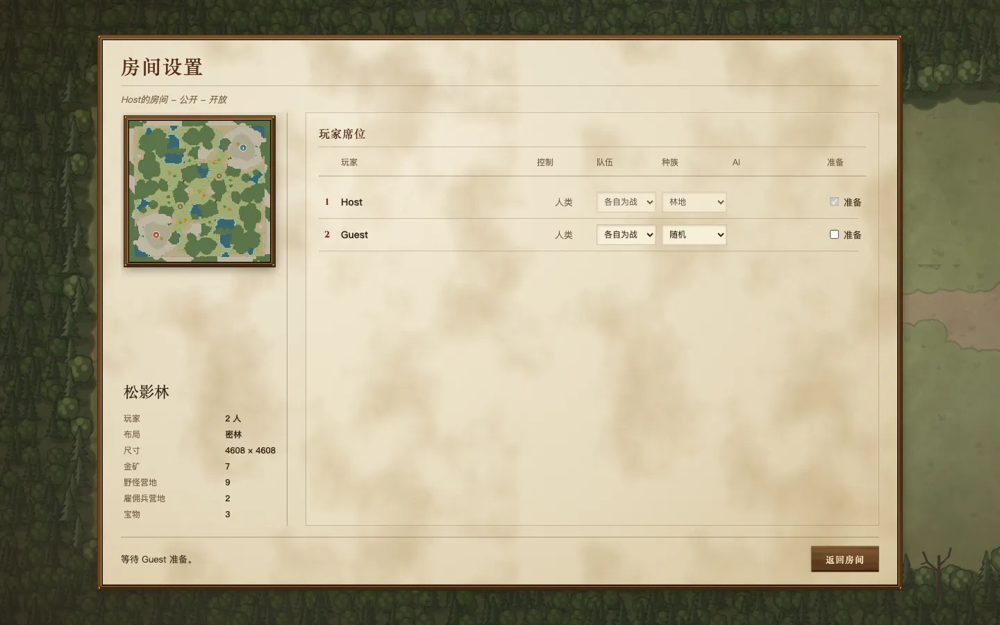

# 房间流程第 5 批（上）：联机认输与结果页

对应 [房间流程方案](../README.zh.md) 的第 5 批，解决问题 2 和问题 9 的结果页部分。联机“再来一局”回到同一个房间，放在下一个 PR。

## 改了什么

- **联机也能认输。** 对局菜单里，单人和联机都有“认输”；观众没有。
  - 认输是一条和其他命令一样的模拟命令（`forfeit`，@@@forfeit），所以联机时每个玩家在同一个 tick 认输，结果一致。
  - 认输的一方，所有单位和建筑一起倒下。胜负照游戏原来的规则判：哪一边最后还有建筑，哪一边赢。
  - 两边对打时，认输等于对方获胜，双方都会看到结果页。三方以上时，其余玩家接着打，认输的人留在场上看到结束。
- **结果页：**
  - 写“用时 0:05”，不再写“在第 81 tick 结束”。
  - 电脑按打法写成“电脑 · 弓手流 / 召唤流 / 骑士流”，不再是“电脑 · V9 ARCHER”。房间设置里选电脑的下拉框也一样改了。
  - 内部版本号收进结果表下面的“详情”，默认折起，测试时展开就能看到。

## 和方案的一处不同

方案里认输写的是“单位全部消失”。实际做成了“全部倒下”，走的是普通的死亡流程。游戏里只有死亡流程会把一个单位留下的引用都清干净，包括甲板上的位置、驻守的塔、身上带的物品和建筑占的地块。现成的“移除单位”只管单位，船上有人时会留下悬空的引用，建筑也没有对应的移除方式。为了“消失”的样子再写一套移除流程，复杂度不值得。看上去的区别是：认输的一方会留下尸体和废墟，而不是凭空不见。

## 改动前后

截图环境：mac1 无头 Chromium，1440×900，生产构建。改动前是 `main@8f7ea4df`。

### 联机对局菜单

| 改动前：只有“继续”和“设置” | 改动后：多了“认输” |
|---|---|
|  |  |

### 结果页（单人认输后）

| 改动前：tick、V9 ARCHER | 改动后：用时、打法名 |
|---|---|
|  |  |

### 联机认输后的结果页（展开了“详情”）

## 验证

- `forfeit.test.ts`：两方对局里认输，认输一方的单位和建筑全部倒下，对方获胜；三方对局里认输，其余两方继续打；命令格式只认 `{ type: "forfeit" }`。
- `e2e-room-flow` 新加一段：在房间列表里建一个两座位的联机房间，开局后从对局菜单认输。检查结果页：电脑获胜，状态行写的是用时而不是 tick，电脑名是打法，有“详情”。
- `room-sync-yatu` 通过。
- 静态部署的单人认输改成通过房间更新拿到结果（以前是函数直接返回），对应的测试一起改了。

# 房间流程第 5 批（下）：联机再来一局，回到同一个房间

## 改了什么

- 联机打完，任何一个参加了这局的玩家点“再来一局”，就把**同一个房间**重新打开（@@@rematch）：
  - 地图和座位保持原样，上一局的结果清掉；
  - 房主仍是“准备”，其他玩家要重新“准备”；
  - 房间重新打开后，第二个点“再来一局”的人直接回到房间，不会再新开一个。
- 还停在结果页的其他玩家，**不用点任何按钮**就会被带回这个房间。为此结果页会继续看着联机房间的状态。
- 单人对局的“再来一局”不变：用同样的设置开一局新的。

服务器只是把房间状态从“已结束”改回“开放”。真正的新一局在房主点“开始比赛”时照常创建，和第一局一样。

## 改动前后

截图环境：mac1 无头 Chromium，1440×900，生产构建。改动前是第 5 批（上）的分支（#449），它已经有联机认输。房主和客人在松影林打一局，房主认输，然后房主点“再来一局”，下面是之后两个人各自看到的画面。

| | 房主 | 客人 |
|---|---|---|
| 改动前：房主进了一个新的单人房间，客人留在结果页 |  |  |
| 改动后：两人都回到同一个房间，客人的“准备”已取消 |  |  |

## 验证

- `rooms.test.ts`：
  - 重新打开后，座位、地图不变，结果清空，只有房主是“准备”，因此还不能开始；
  - 房间已经重新打开时，再请求一次就原样返回；
  - 没参加这局的人不能重新打开。
- `e2e-room-flow`：
  - 联机认输那一段改成真人对真人：客人从链接加入并“准备”，房主开局后认输，双方都看到结果页。
  - 房主点“再来一局”回到同一个房间；客人没有点任何按钮，也被带回这个房间。
  - 检查座位与开局前一致，房主“准备”、客人未“准备”。
  - 原来在电脑局里检查的“打法名”和“详情”，移到前面那局有电脑的联机对局的结果页上。
- `room-sync-yatu` 通过。
