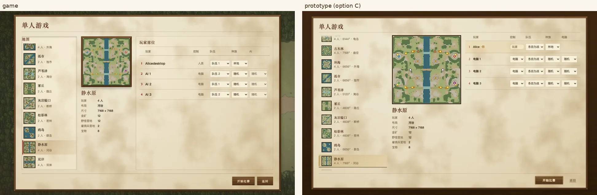
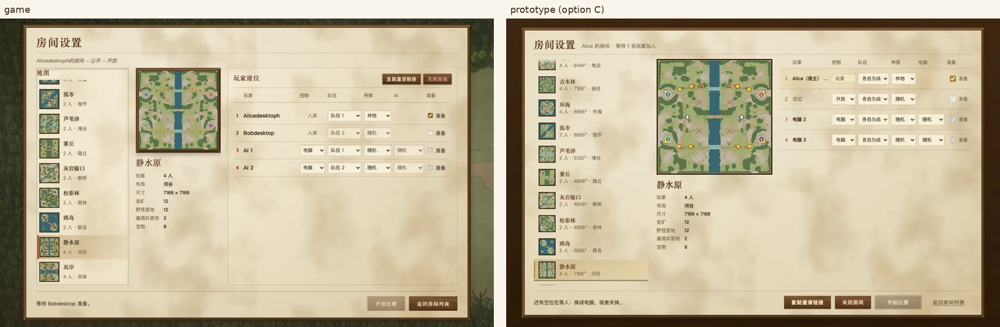
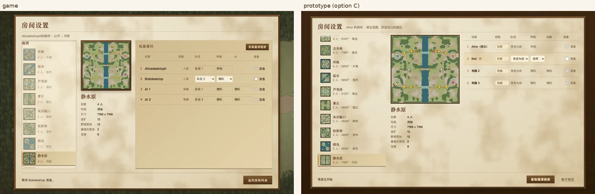
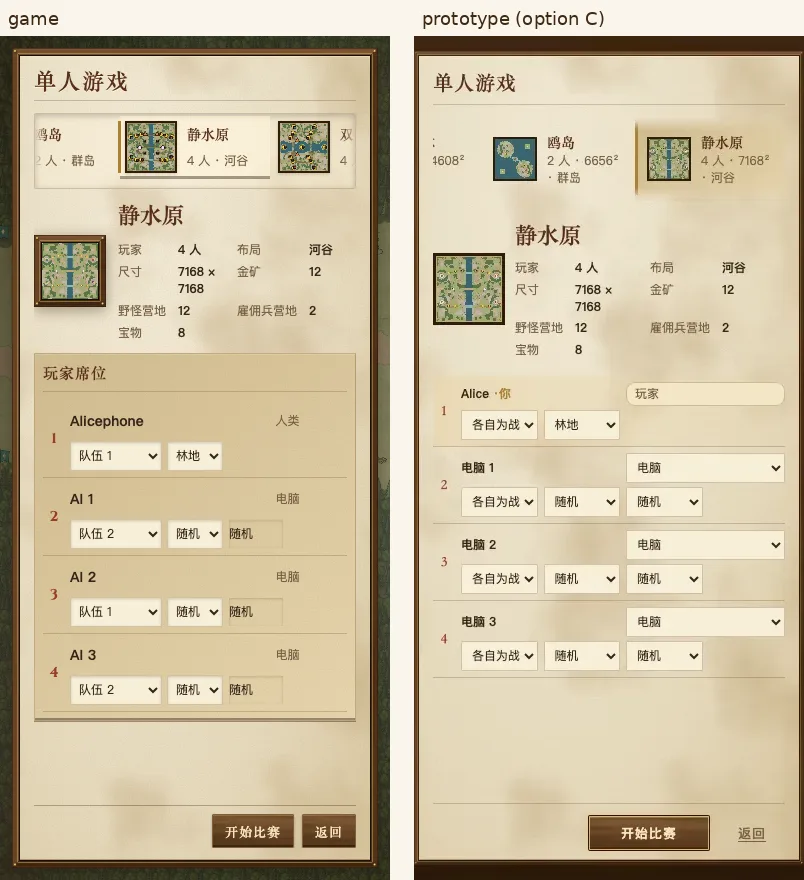
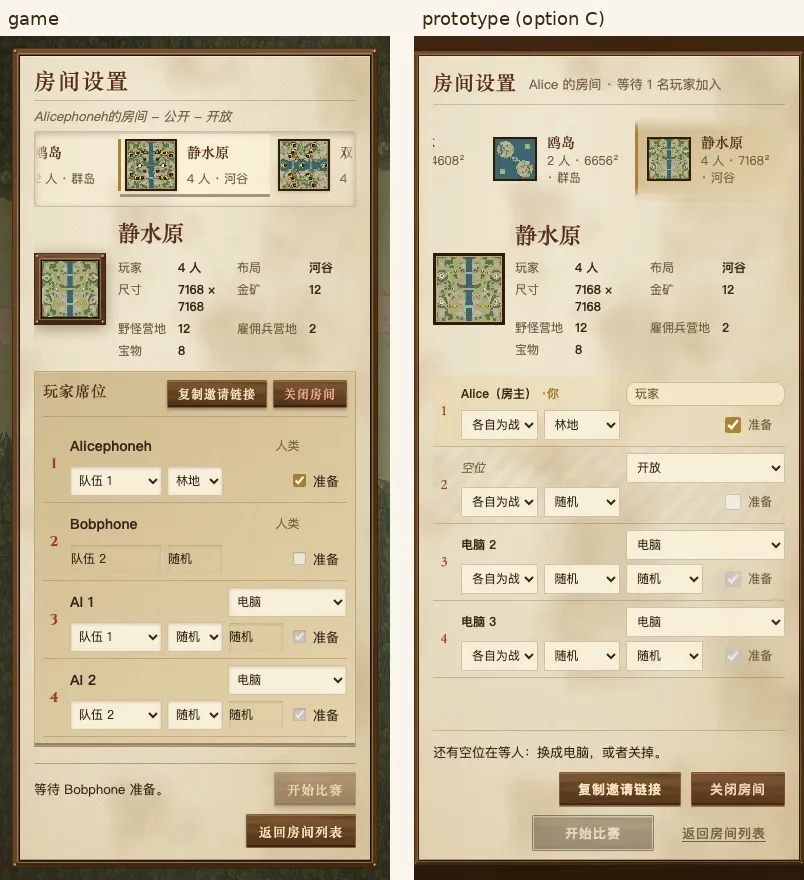
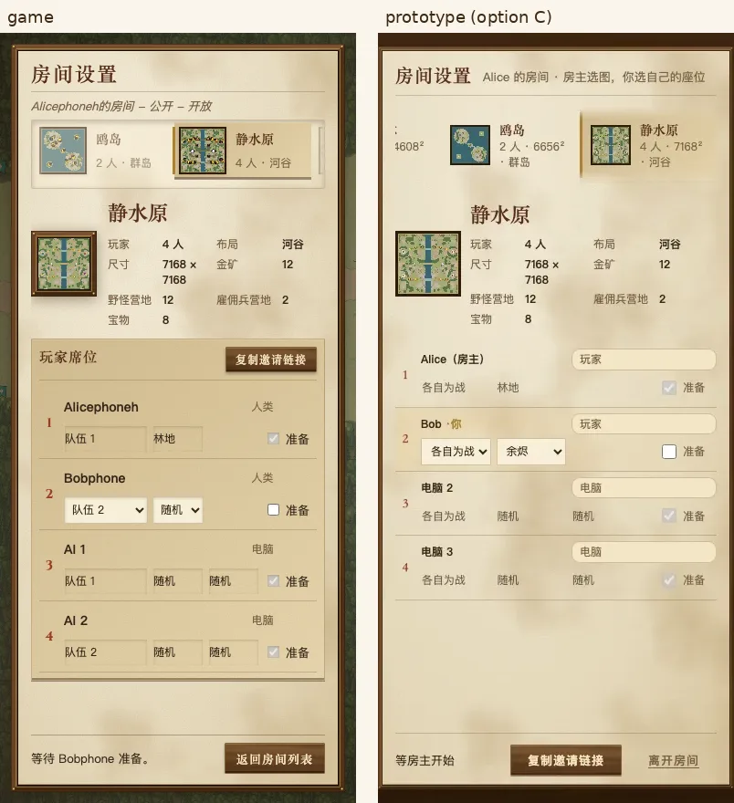
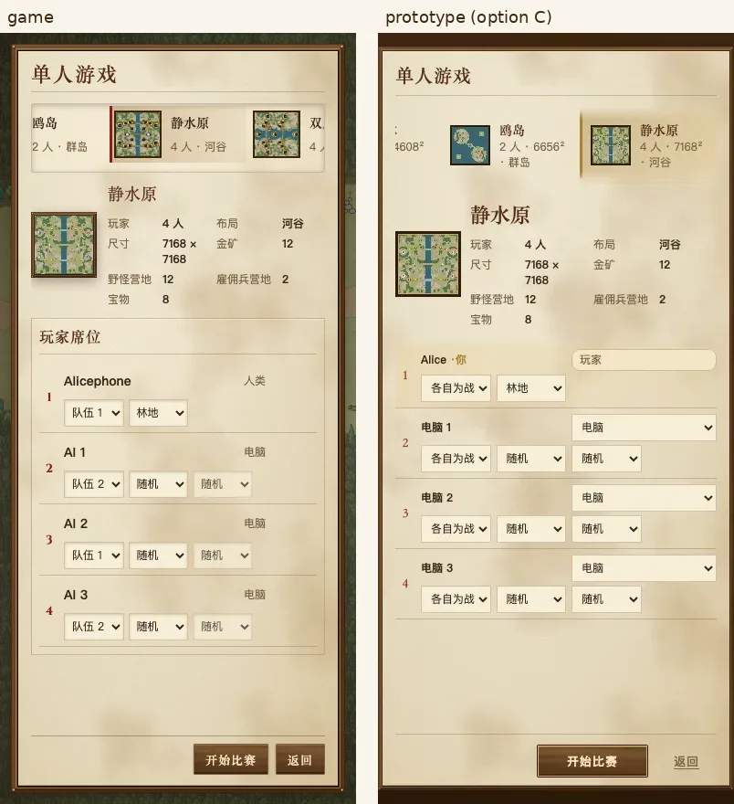
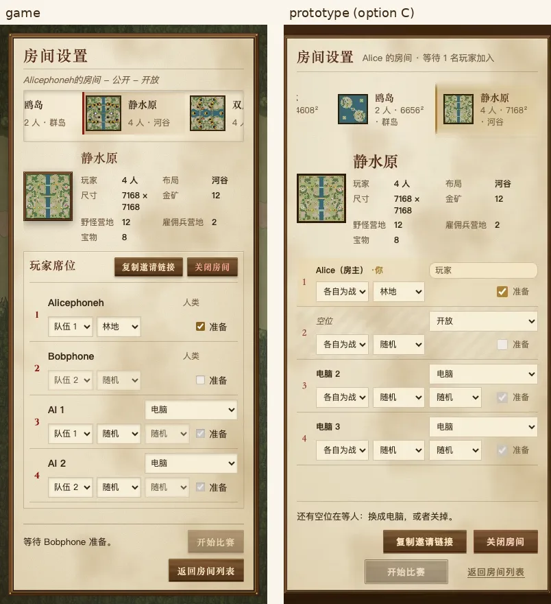

# 对局设置：方案 C 落进游戏

owner 选了[方案 C](../redesign/README.zh.md#方案-c保留左边列表但加宽地图详情并进预览卡片)。这里是游戏里的实现和原型的并排对比。每张图左边是游戏，右边是原型 `option-c.html`。

截图环境：mac1 无头 Chromium，生产构建。联机版由两个浏览器身份造出：Alice 当房主，Bob 当客人，另外两个座位是电脑。

## 桌面 1280×800

| 单人 | 房主 | 客人 |
|---|---|---|
|  |  |  |

## 手机 390×844

| 单人 | 房主 | 客人 |
|---|---|---|
|  |  |  |
|  |  |  |

## 怎么做的

- **三栏：** 地图列表 240 像素，地图卡片 220 像素，剩下的给座位。三栏都限在窗口高度以内，列表和座位各自在栏内滚动，整页不滚。
- **列表每行：** 缩略图、名字、“人数 · 布局”。
  - 缩略图 52 像素，由游戏自己的地图预览画出来，不提交图片（@@@map-thumbnails）。
  - 浏览器空闲时一张一张画：先画选中的那张，再画看得见的几行，其余按列表顺序。画好的按地图和布局缓存，同一个页面里不重画。
  - 没画好之前是同样大小的占位框，所以画好时行高不跳。
- **点图不重建列表：** 沿用 #456 的 @@@setup-in-place。点一张图只挪动选中标记，换掉卡片和座位，列表停在原来滚到的位置。`chooseSetupMap` 里的滚动检查照旧守着。
- **客人：** 能看到同一个列表，但点不了，只高亮房主选的那张。
- **座位：** 1280 宽时七列都放得下。名字太长就折行，不截断，也不把控件挤出去。
- **窄窗口（≤960）：** 改成一列、整页滚动，跟原型一样：
  - 地图变成顶上一行横向滚动的卡片；
  - 卡片缩成小图加两列资料；
  - 下面是座位。
- **≤720：** 每个座位排成两行，第一行是名字和控制，第二行是队伍、种族、AI、准备。

## 和原型不一样的地方

- 原型把“复制邀请链接 / 关闭房间”放在页面底部，游戏里还在座位栏的标题行，跟现在的游戏一样。这属于视觉层，由 Art Lane 决定要不要挪。
- 原型列表的每行写了地图尺寸（比如 7168²），游戏里只写人数和布局；尺寸在卡片里。

## 验证

- `e2e-room-flow` 加了布局检查：
  - 列表、卡片、座位三栏的顺序；
  - 客人的地图行都点不了，而且列表里不止一张图；
  - 1280 宽时，没有名字、下拉框、标记或“准备”超出自己那一行。
- `room-sync-yatu` 通过。
- 缩略图：在真实浏览器里测过。15 张都能画出来，选中的那张最先出来。
