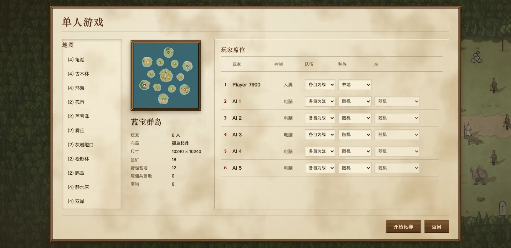
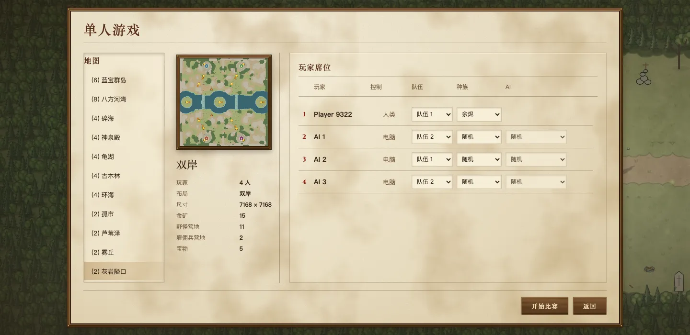
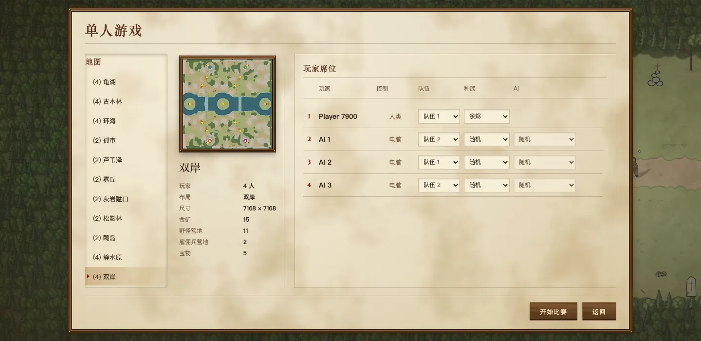
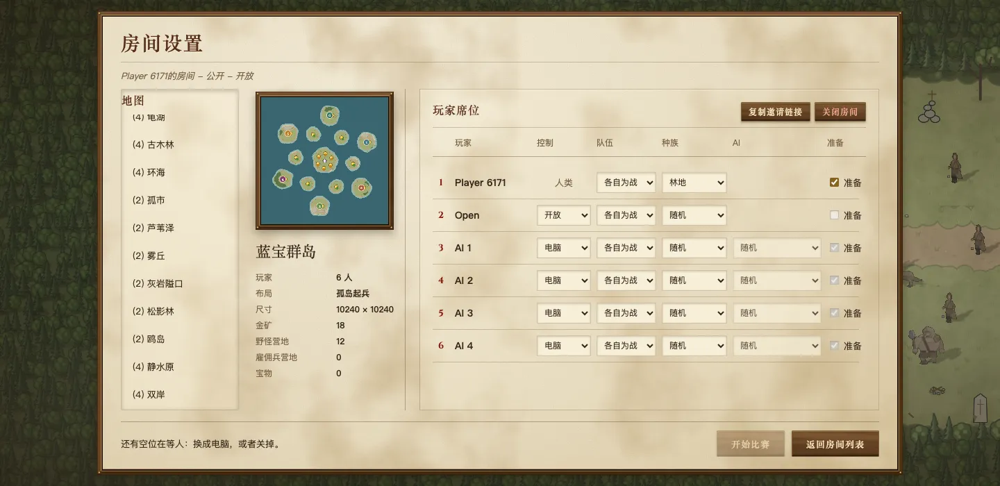
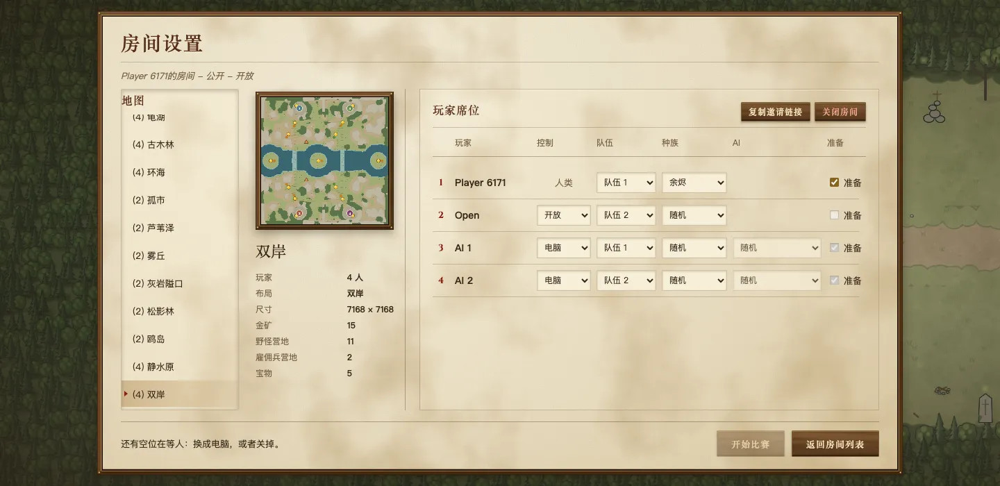
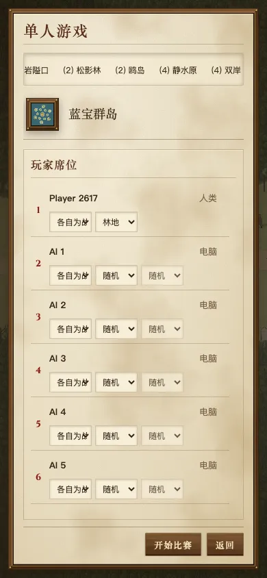
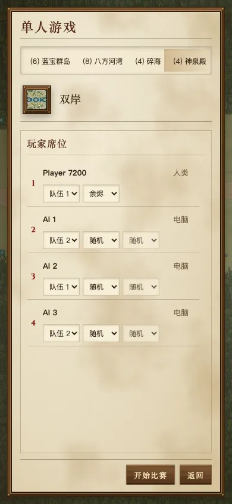
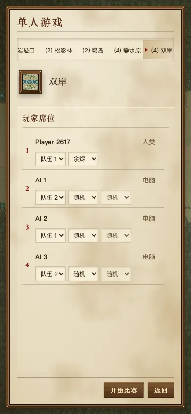

# 对局设置：点一张图，地图列表不再跳回顶部

owner 报告：在地图列表里点一张图，列表就滚回顶部（“一点击就上滑”）。

**原因：** 点图会在新地图上重建房间；房间一变，整个设置页重新生成一遍，再整个替换上去。地图列表因此成了一个新元素，滚动位置从头开始。改座位（种族、队伍）时也一样：房间状态一变，整页重建，列表跳回开头。

**修法（@@@setup-in-place）：** 设置页已经在屏幕上、而且是同一种（单人或联机，房主或客人）时，就地更新，不再整页替换。
- 地图列表和座位列表是会滚动的两部分，它们的元素保留，所以滚动位置不变；
- 地图条目只更新选中标记和是否可点；
- 座位行、地图预览、按钮栏换成新的内容。
- 地图条目的点击处理读取点击当时的房间，而不是生成按钮时的房间，因为条目现在比它所属的那个房间活得久。

这只是临时修复。这一屏的布局正在重新设计（见 [redesign](../redesign/README.zh.md)），“列表不重建”在新布局里同样要守住。

## 改动前后

真实浏览器，生产构建。先把地图列表滚到最底，点最后一张图（双岸），等房间在新图上重建完成。手机宽度下地图列表是横向的一行，所以看的是横向位置。

| | 点之前（列表已滚到底） | main：点之后 | 修复后：点之后 |
|---|---|---|---|
| 单人，1440×700 |  |  |  |
| 联机房主，1440×700 |  |  |  |
| 单人，手机 390×844 |  |  |  |

浏览器探针在点图后、以及之后再改一次座位后，都读取了列表的元素和滚动位置：

| | main | 修复后 |
|---|---|---|
| 单人桌面：纵向位置 159 | 变成 0，列表是新元素 | 仍是 159，同一个元素 |
| 联机桌面：纵向位置 177 | 变成 0，新元素 | 仍是 177，同一个元素 |
| 单人手机：横向位置 773 | 变成 0，新元素 | 仍是 773，同一个元素 |
| 之后改一次座位 | 三种情况都回到 0 | 三种情况都不变 |
