# CLI 场景和原 PR 证据对照

`tools/cli/scenes/` 里的十个场景，是从各条 lane 手写的截图脚本改写来的，都对应着某个 PR 当时提交的证据。这里在 main b7918750 上把每个场景各跑一次：九个在 A100 上用 `sketch yatu <场景> --on a100` 跑，setup 在 mac1 上用 `--locale zh-CN --sizes desktop,phone` 跑。然后把场景截到的图和原 PR 的证据图放在一起看。每张对照图上半部分是原 PR 的证据，下半部分是场景在 main 上截到的图。

结论分三种：
- **一致**：场景截到的画面就是原 PR 证明的那个改动；
- **部分一致**：改动能看到，但缺了证据里的某个状态，或者画面比例不够看清；
- **不一致**：场景截到的和证据对不上，原因写在后面。

| 场景 | 原 PR | 结论 | 说明 |
|---|---|---|---|
| hud | #418 / #420 | 一致 | 四种指令卡（可学技能的老兵、混编部队、兵营、工人建造菜单）和 #420 改动后的紧凑卡一样，另外还截了技能面板。 |
| equip | #418 / #422 / #446 | 部分一致 | 纸娃娃布局和 #422、#446 一样：左边是装备位，右边是主手和副手，下面一排四个物品格。但场景截的是整个屏幕，窗口只占一小块，#446 的主手、副手图标看不清，应该改成只截窗口这一块。 |
| spirit-battle | #423 | **不一致：回归** | 见下文。 |
| ships | #416 | 部分一致 | 证据是三艘船带着船员的近景，用来看桅杆和横桁有没有描边，这是 #416 改的东西。场景截的是整支舰队，地图比例，船上也没有船员，桅杆的细节看不出来。之后的美术（帆、旗）也改变了船的样子。应该补一张拉近镜头、船上有船员的图（`camera(x, y, zoom)`）。 |
| ghosts | #446 | 一致 | 两个种族的每种建筑都有：放置时的虚影就是建筑自己的模型，另外一座在建、一座建好，和 #446 改动后一样。 |
| sites | #451 | 一致 | 富矿、在采、将尽、塌了的矿洞，加上商店和营地，都和 #451 改动后一样。证据是在每个点悬停时截的，所以还能看到占地的圈；场景没有悬停，看不到这个圈。 |
| tower-top | #452 | **不一致：回归** | 加固的塔一致；驻守之后塔顶的两名弓箭手不见了，变成一块方块。见下文。 |
| minimap | #453 | 一致 | 小地图的边框包住整张地图，和 #453 改动后一样。 |
| tower-card | #471 | 部分一致 | 截到的是 #471 三个状态里的中间那个：加固按钮显示的是加固后塔的头像。证据里还有升级到 50% 时的进度状态，场景没有截。 |
| setup | #459 | 一致 | 桌面和手机两种尺寸，单人和房主的布局都和 #459 一样，文字是中文。默认地图现在是蓝宝群岛，当时是静水原。 |

## 回归：部分单位卡片画成纯色方块（#491 起）

tower-top 场景里，塔上驻守的两名弓箭手画成了一块方块；spirit-battle 场景的 lineup 里，单位画成灰色块，精灵看不见。81dbc770（#489）上这两个场景都正常，和 #452、#423 的证据一致。

用 tower-top 场景在 A100 上二分（下图从左到右）：
- 001f3bfa（#490）正常；
- 4a23f801（#491 perf/card-boxes）出现蓝色方块；
- 4d632581（#495）出现黑色方块，当前 main 也是黑色方块。

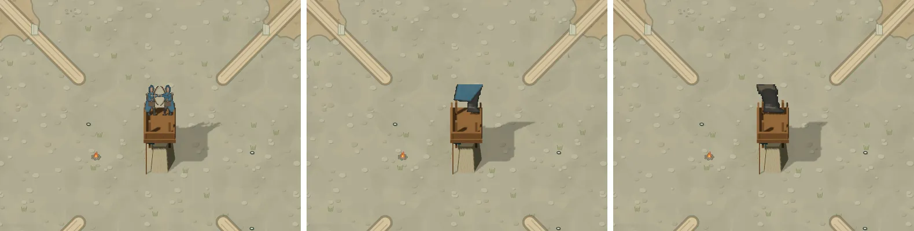

mac1 上同样能复现（001f3bfa 正常，b7918750 是黑色方块），所以不是 A100 软件渲染特有的问题。已经交给 UX Fix Lane（卡片性能这条线）去查。

## 对照图

| | |
|---|---|
| hud | 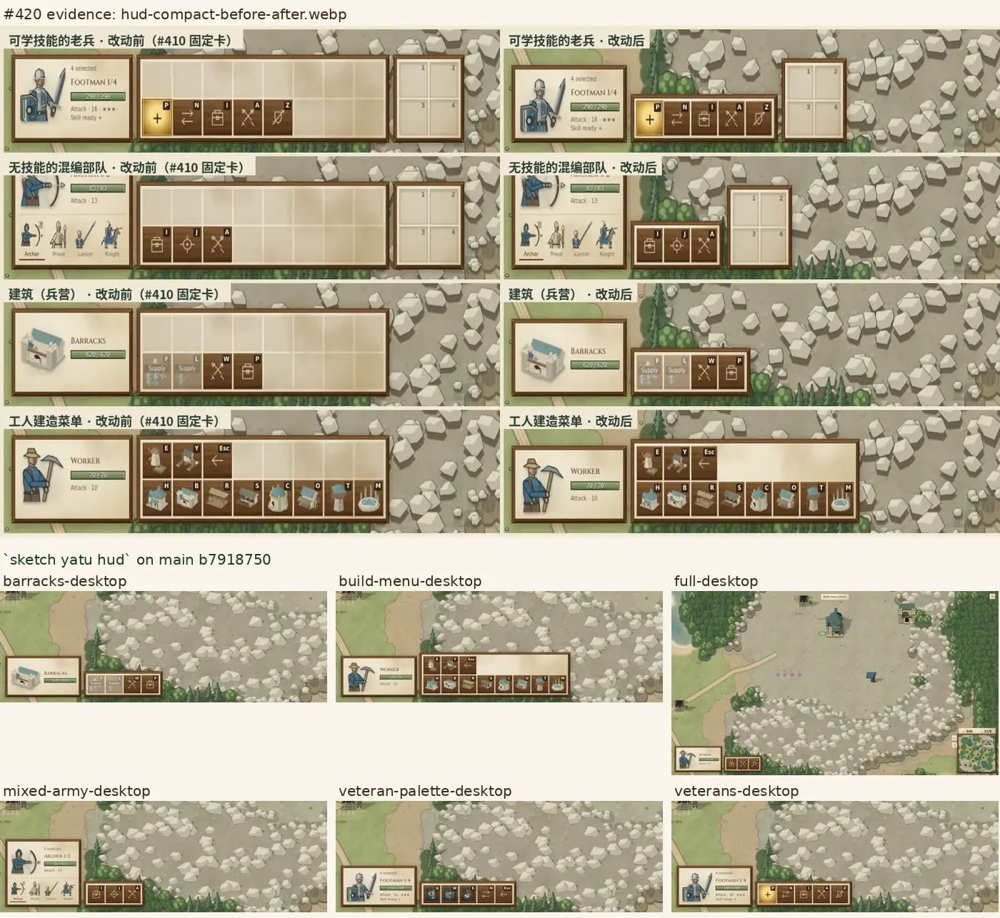 |
| equip | 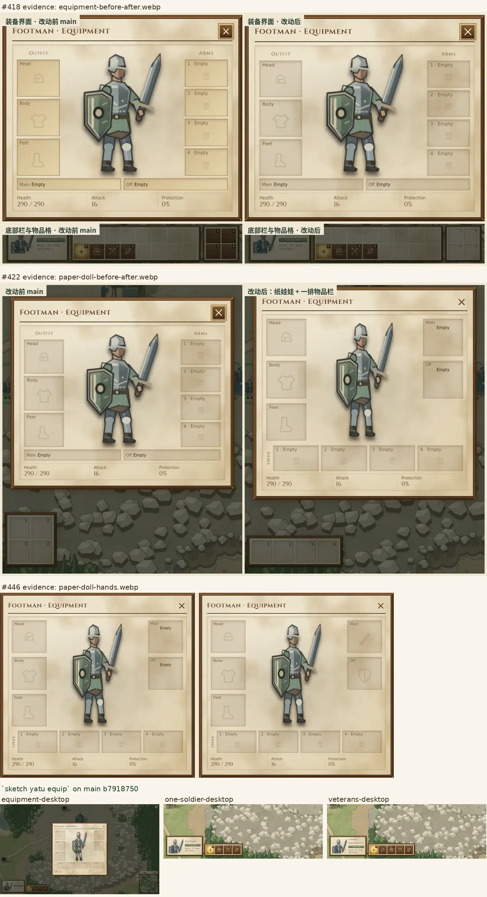 |
| spirit-battle | 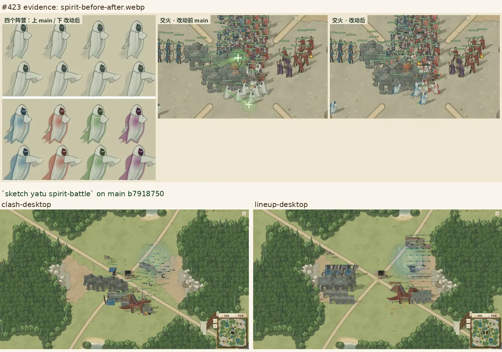 |
| ships | 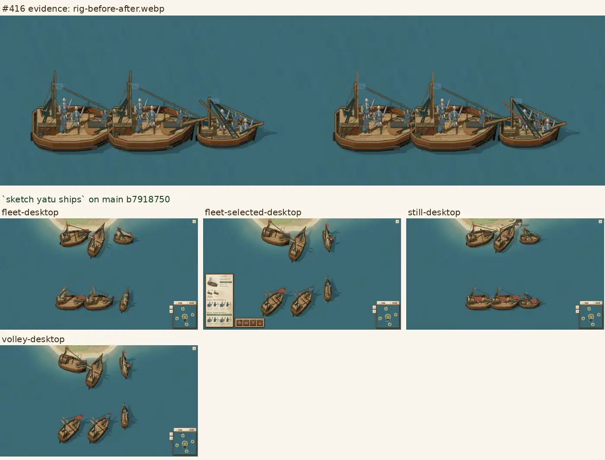 |
| ghosts | 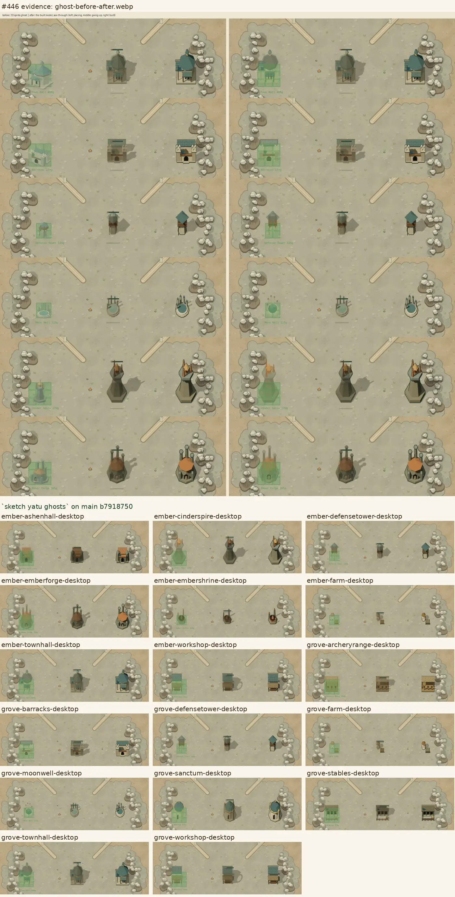 |
| sites | 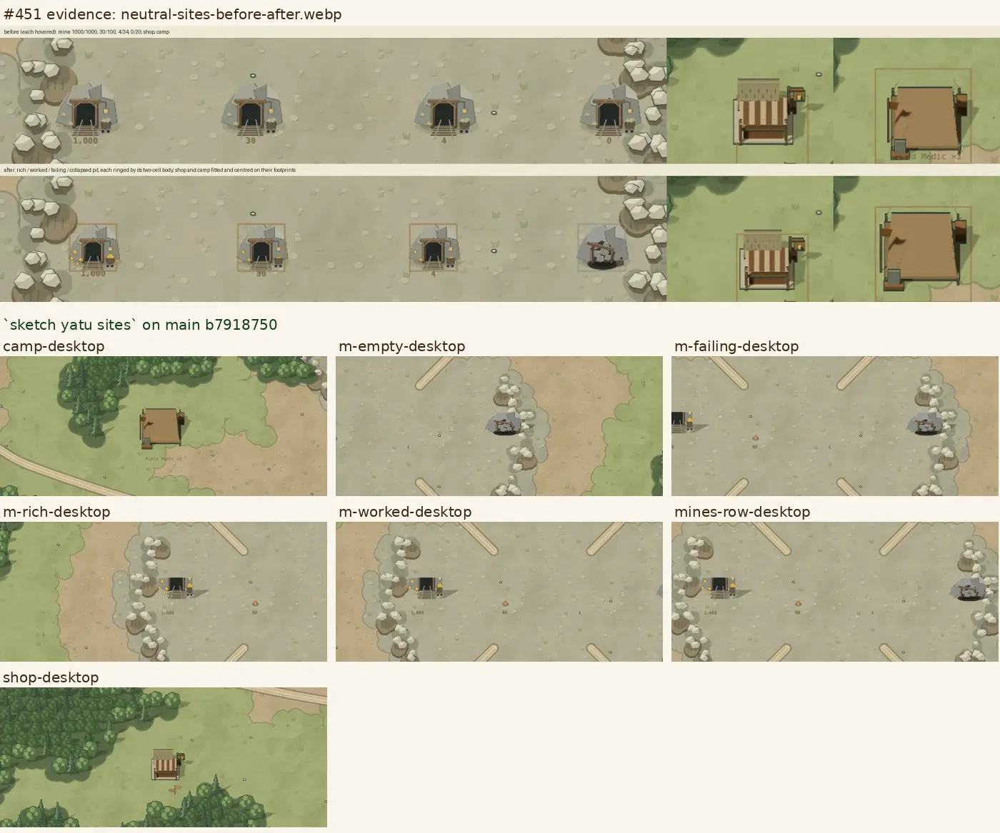 |
| tower-top | 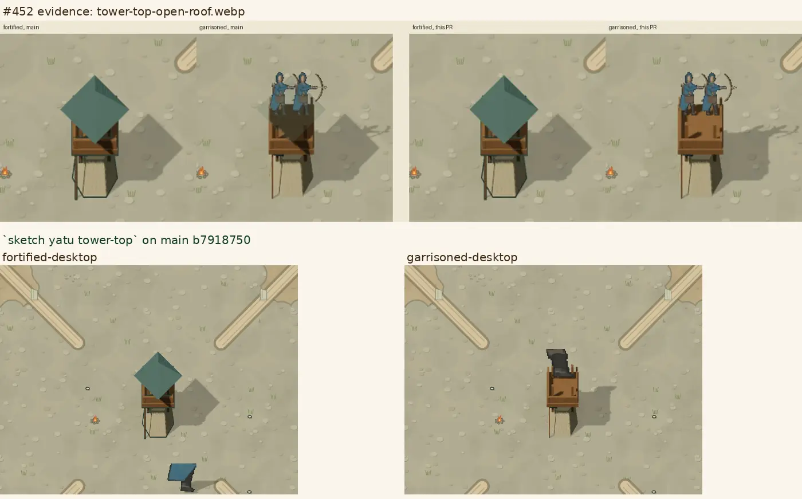 |
| minimap | 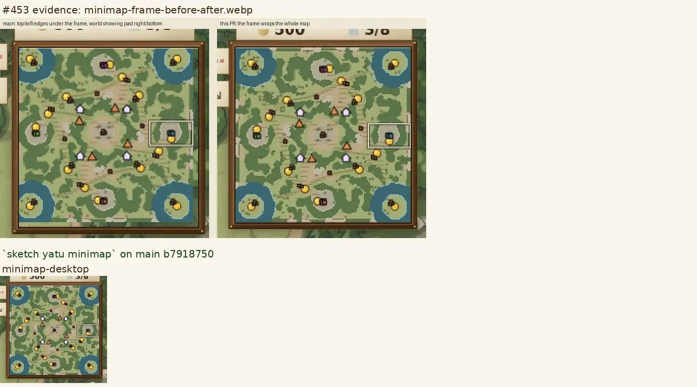 |
| tower-card | 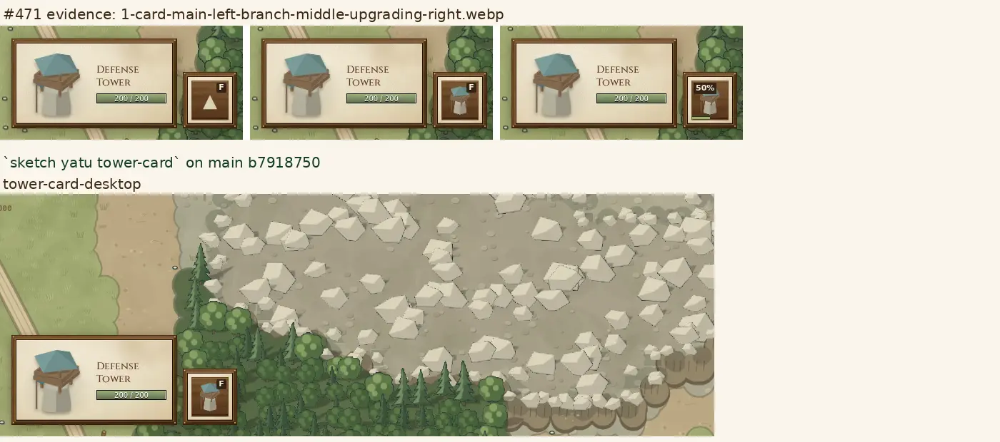 |
| setup | 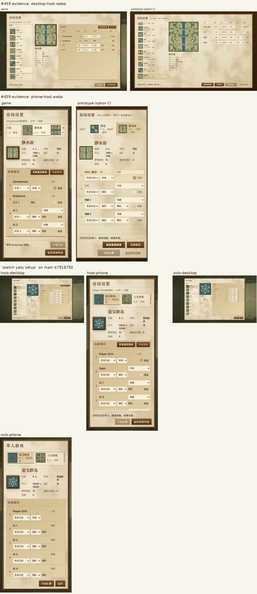 |

## 接下来

- equip 只截窗口；ships 拉近镜头并让船上有船员；tower-card 补上升级进度的状态；sites 补一张悬停的图。这些属于场景本身的改进，和上面的回归无关。
- Art Lane 剩下的脚本（capture、battle、pirate、sceneshot、pageshot、thumbs）和性能探针，改写成场景。
