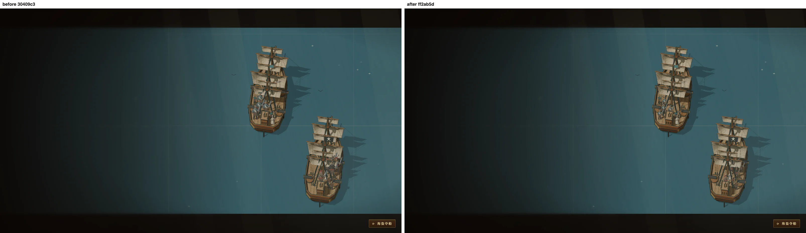
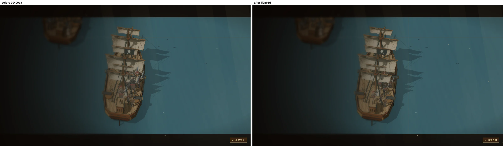
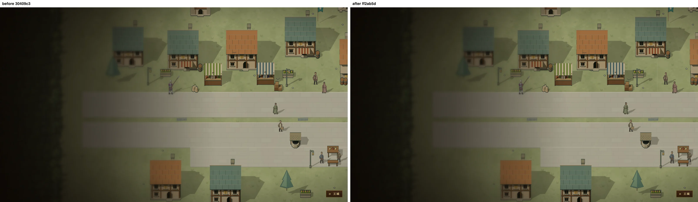
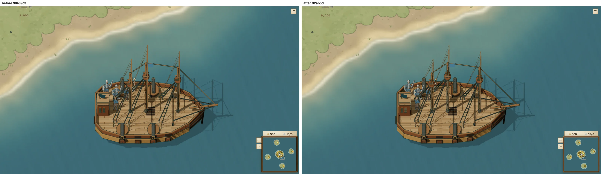

# 主页人物与游戏单位使用同一体型

主页造型沿用同种游戏单位的身体尺寸，以及单位半径决定的世界缩放。船长通过黑帽、金边、深色服饰和站位辨认。船体、碰撞半径、甲板位置和战斗规则没有改动。

| 造型 | 修改前额外体型倍率 | 修改后 |
| --- | ---: | ---: |
| 海盗船长（footman） | 1.65 | 1 |
| 海盗（footman） | 1.5 | 1 |
| 水兵（footman） | 1.45 | 1 |
| 首都市民：商人（worker） | 1.03 | 1 |
| 首都其余市民（worker） | 0.95 | 1 |
| 无定制造型的单位，Canvas 场景带有 `models` 时 | 0.8 | 1 |

最后一项是 Canvas 回退路径的隐含缩小；GPU 路径原本已使用正常游戏尺寸。同步移除了血迹与武器接触面对应的缩小选项，使画面、甲板脚点和战斗叠层一致。

删除 `figurePaintSize` 和 `@@@story-figure-size` 的大画布补丁。`storyFigure` 的 `size` 仍有实际用途：战役角色 Ashe 使用 0.85，保留她的身体、遗骸和武器挂点原有比例。主页所有调用均省略该参数。

## mac1 真 GPU 截图

基线 `30409c3d`，修改后 `ff2ab5da`。左侧 before，右侧 after。所有图片均在 mac1 的 Apple M3 Ultra 上，由 Chromium / ANGLE Metal 实际绘制，已逐张检查。

两侧均固定 `Date.now() = 1`，开启减少动态效果，保持同一开场种子、静止姿势和镜头。原生主页概览保留场景原镜头；近景只覆盖主页相机，仍由真实主页场景、人物画师和 GPU 世界渲染器绘制。







游戏参照来自真实暂停房间：普通 footman、worker、priest 通过登船命令站上 shipOfTheLine，未提供主页造型。此图两侧一致。



复现（使用 camps 的 mac1 5660–5669 端口；本次隔离缓存配置为 `/tmp/camps-machines.json`）：

```sh
SKETCH_MACHINES=/tmp/camps-machines.json bin/sketch shot home-figure-scale \
  --before 30409c3d --after ff2ab5da --on mac1 --sizes desktop --locale zh-CN --out /tmp/home-figure-scale
```

截图脚本会检查 GPU 渲染器为 Apple / Metal，并确认参照图的全部船员已经登上甲板。相机、GPU 信息和参照快照随 CLI 原始运行记录保存。

## 测试

`story-figure-size.test.ts` 比较 11 种主页造型与同种游戏单位在相同姿态下的身体坐标，并验证正常卡片足以容纳帽子和动作。`world-renderer.test.ts` 对照有无主页造型解析器时普通 footman、worker、priest 的实际甲板绘制尺寸及脚点。

在基线实现上运行新测试：12 项失败（11 种主页造型，以及普通甲板船员的 Canvas 尺寸）；修复后通过。
