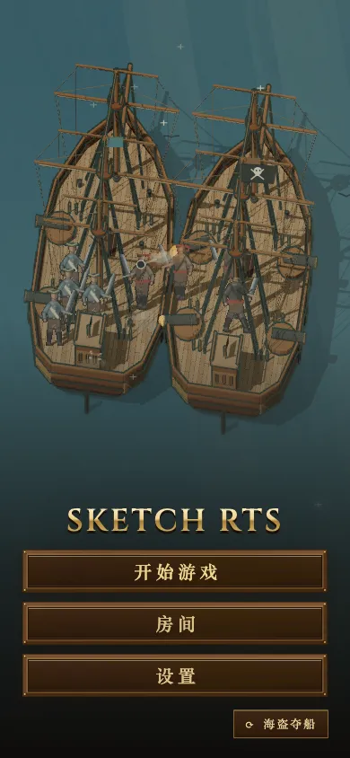

# 首页“海盗夺船”改成真实模拟：改动前后

改动前，这一幕是按脚本播的：跳板什么时候搭、谁什么时候倒下、什么时候换旗，全写死在固定的秒数上。比赛模拟从头到尾没有跑。

改动后，场景只定开局，其余全部交给比赛模拟，在 match thread（Web Worker）上跑。开局内容如下：

- 两艘战列舰并排靠着，海盗船已经停在模拟自己会选的接舷位置上。
- 每艘船上各站着一队水手。海盗 4 人，有些场次 5 人；水兵 4 人。
- 海盗船的舵手接到一条“接舷登船”命令；水兵接到一条冲向跳板落点（自己船上靠海盗一侧的船舷）的 attackMove。

跳板放下、两队在跳板口交手、伤亡、夺船和换旗，都是模拟真实算出来的。一方打光后，过 4 秒淡出，再用新的随机种子开下一场。

## 这一幕摆出来的开局（场景设定，不是改游戏规则）

下面两条只决定这一幕从什么局面开始。游戏规则一个字没改：舷炮、跳板、登船、移动和战斗的结算，和正式对局完全一样。

- **水兵船靠海盗一侧的两门舷炮（starboard0 / starboard2）没有架出来**，船上只剩背向海盗的两门。这一幕讲的是“水兵船被海盗贴上来时，那一侧的炮还没来得及架出”。两侧火炮都在的话，水兵船的舷炮会把跳板和刚上跳板的人一起扫掉，海盗根本冲不上去。
- **水兵开局冲向跳板落点**。不给这条命令，水兵会守在各自原位，被海盗逐个对上：种子 1–20 全是海盗无人阵亡就夺了船。给了以后，四个水兵一起在跳板口迎上去，海盗每场倒下一人，仍然夺船。胜负没变，过程有了起伏。

## 改动前（脚本）

| 4 秒 | 12 秒 | 24 秒 |
|---|---|---|
|  |  |  |

## 改动后（真实模拟）

| 3 秒 | 9 秒 | 16 秒 | 24 秒 |
|---|---|---|---|
|  |  |  |  |

手机 390×844，10 秒：

截图环境：mac1 无头 Chromium，1440×900，生产构建（`vite build` 后以 `NODE_ENV=production` 起服务）。改动前基于 `main@06c0d9e6`。截图时 mac1 负载很高，页面主线程大部分时间拿不到 CPU。每次推进最多补 4 个 tick，超出的时间直接丢掉，所以浏览器里这一场比模拟时间慢。负载正常时不会这样。

镜头按两艘船的真实尺寸取景：宽度取两船的横向跨度，高度取一个船身长。原来脚本里的船比真实战列舰大，沿用旧的取景系数会把船缩成右下角的一小团。

## 胜负与时长（种子 1–20，A100 上用 Node 直接跑 `stepGame`）

| | 海盗 5 人（12 场） | 海盗 4 人（8 场） |
|---|---|---|
| 跳板放好 | 3.0 秒 | 3.0 秒 |
| 水兵全部阵亡（分出胜负） | 13.1 秒 | 14.3 秒 |
| 海盗登上对面甲板、夺船 | 15.8 秒 | 16.4 秒 |
| 海盗阵亡 | 1 人 | 1 人 |

夺船发生在分出胜负后 2.1–2.7 秒，落在 4 秒的收尾时间里，淡出前能看到换旗。种子只决定海盗是 4 人还是 5 人，同样人数的场次过程相同。

## 模拟开销（A100 单核，用 `process.cpuUsage` 量 `stepGame` 本身）

| 场景 | 每 tick 均值 | p95 | 最坏一个 tick | 每秒 CPU（20 tick/秒） |
|---|---|---|---|---|
| 林间血战，种子 1 / 2 / 7 | 0.65 / 0.30 / 0.13 ms | 3.2 / 0.4 / 0.2 ms | 49 / 16 / 13 ms | 13 / 6 / 3 ms |
| 海盗夺船，种子 1 / 2 / 7 | 15.9 / 12.8 / 11.1 ms | 32 / 25 / 22 ms | 272 / 63 / 50 ms | 318 / 255 / 221 ms |

**已知问题：这一幕首页常驻的模拟开销偏高**，每秒 221–318 ms CPU，比林间血战高一到两个数量级，几乎全花在甲板走位上。真正的修法是 #421 那条甲板寻路，不是在这一幕里减人、减炮打折扣。

开销只在首页显示这一幕时才有：

- 模拟跑在 worker 里，不占页面主线程。
- worker 只按页面每一帧发来的推进请求走到当时的时钟，不会自己往前跑。标签页隐藏时页面不画帧，模拟也就停了。
- 首页换到别的场景时，这一场的 worker 被关掉（`terminate`）。
- 比赛开始时，`MenuBackdrop.stop()` 结束这一场并关掉 worker。回到首页或结果页时，这一幕从开局重新淡入。
- 房间设置页仍然显示首页场景作为背景，这时它照常在跑。

浏览器实测（mac1，生产构建）：在首页停 8 秒，进单人房间设置页，再开局并在对局里停 10 秒。这一场的 worker 在首页和设置页期间收到推进请求。开局时收到 `close` 并被 `terminate`，之后对局里的 10 秒没有再收到任何消息。

mac1 上的 Chrome trace 这次不能作数。负载在 84–106 之间时，渲染主线程每秒 650–920 ms 的墙钟时间里只拿到 10–20 ms CPU，worker 大部分时间在等页面发推进请求，测出来的是机器有多饿，不是场景有多贵。
