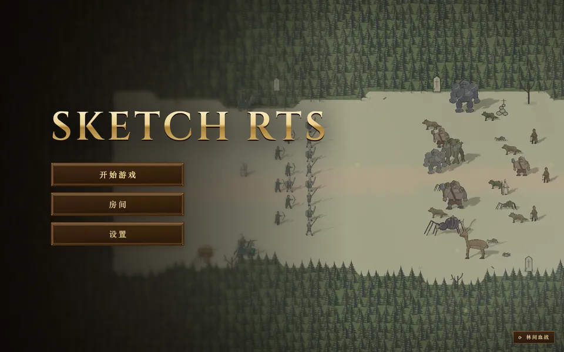
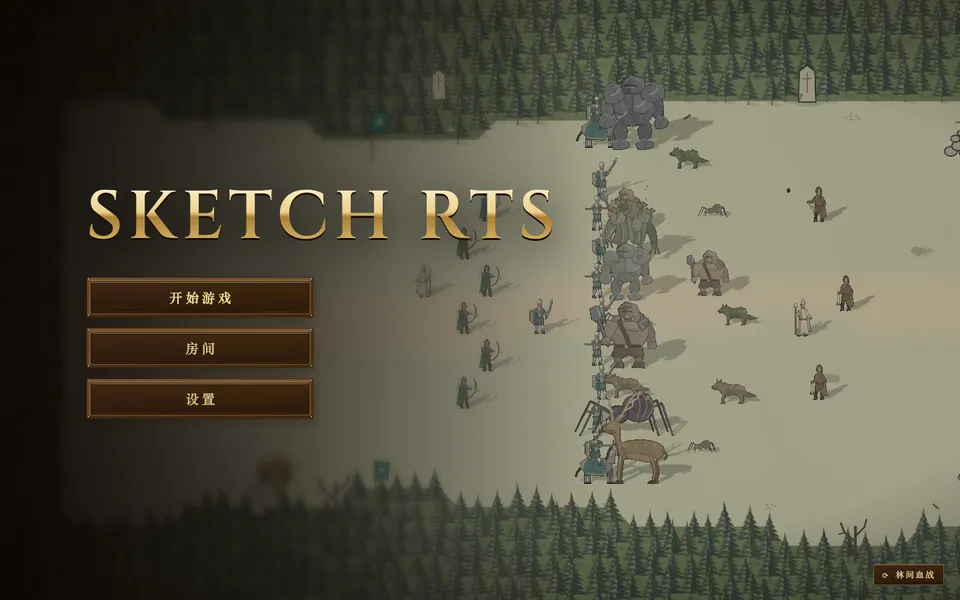
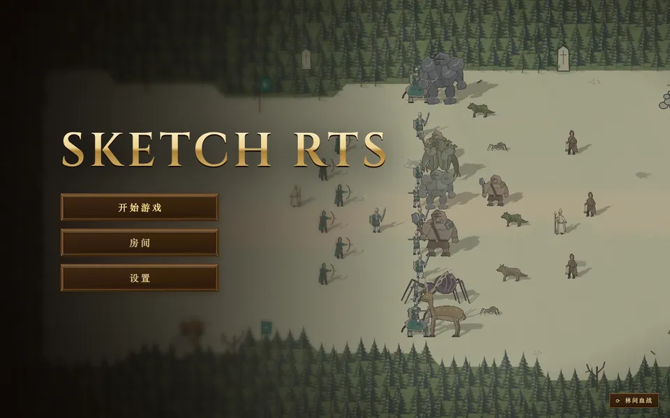
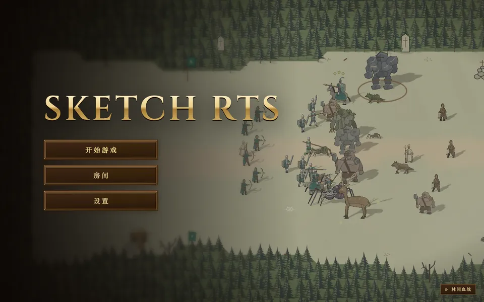
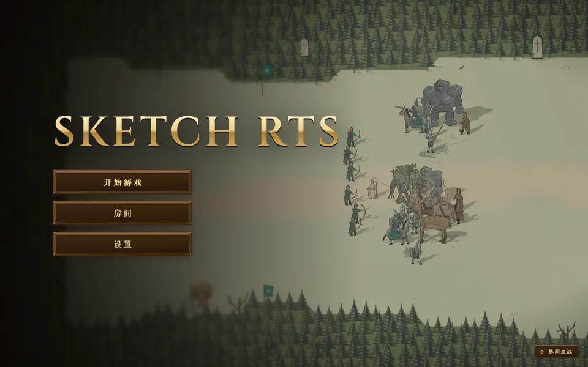
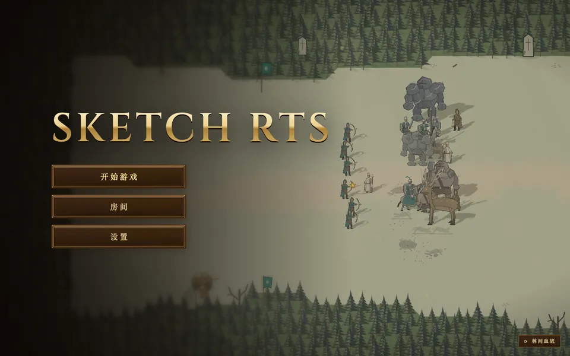
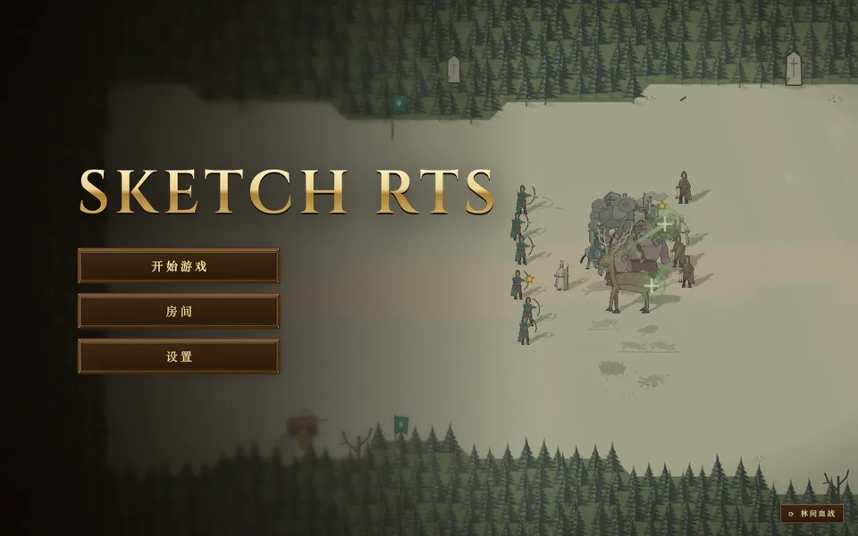
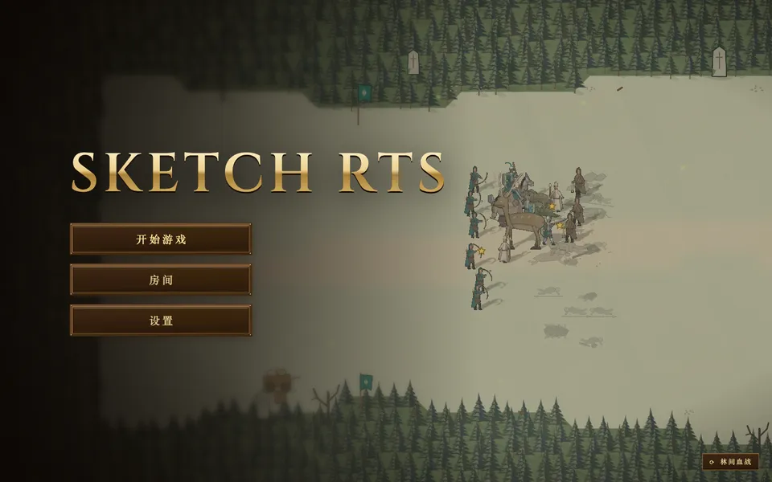
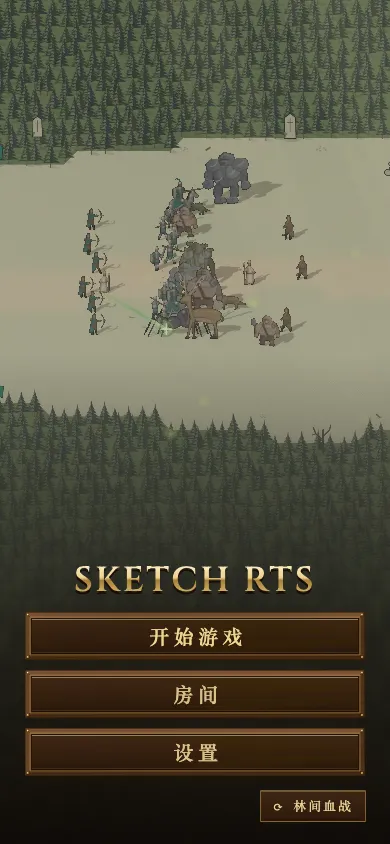

# 首页“林间血战”改成真实模拟：改动前后

改动前，这一幕是按脚本播的：单位沿预先写好的路线走，攻击、伤害、死亡都在固定的秒数上发生，用的是假的效果和尸体，比赛模拟从头到尾没有跑。

改动后，场景只定开局：谁站在哪、往哪进军，其余全部交给比赛模拟在 match thread（Web Worker）上跑。寻路、选目标、命中、伤害、死亡和尸体都是真实结算出来的。哪一方先打光，过 4 秒淡出，再用一个新的随机种子开下一场。

截图环境：mac1 无头 Chromium，1440×900（另有一张 390×844），开发服务器。改动前基于 `main@13d0a870`。改动前截的是完全渲染后的画面，改动后截的是战斗稳定后的画面。

## 改动前（脚本）

| 4 秒 | 18 秒 | 34 秒 |
|---|---|---|
|  |  |  |

两条阵线始终是笔直的，接触以后也不变形，这是按脚本摆位的结果。

## 改动后（真实模拟）

| 3 秒 | 10 秒 | 16 秒 |
|---|---|---|
|  |  |  |

| 22 秒 | 30 秒 | 手机 390×844，14 秒 |
|---|---|---|
|  |  |  |

阵线接触后会被冲散，地上的尸体都是真实阵亡留下的。弓手站在射程边缘放箭，治疗者跟在本方阵线后面。

## 胜负与时长（种子 1–20，Node 里直接跑 `stepGame`）

每场在 3.3–3.5 秒时接触，29–64 秒分出胜负。野怪群赢 18 场，军队赢 2 场。每一场都能分出胜负，因为双方的冲锋命令是来回扫一遍场地，没有人会站在打不到对方的地方发呆。即使哪场一直不分胜负，到 150 秒也会强制结束。

## 线程 CPU（Chrome trace，顶层 RunTask 的 tdur，每秒毫秒数，15 秒窗口，跑两次）

| | 主线程 CrRendererMain | 场景 worker |
|---|---|---|
| 改动前 | 405 / 385 | — |
| 改动后 | 367 / 391 | 7.8 / 7.6（单个任务最长 1.8 ms） |

主线程没有变重，模拟在 worker 上每秒用不到 8 ms。mac1 是共享 CI 机器，负载在 11–35 之间波动，所以这里比的是线程 CPU 时间，不看帧间隔。
