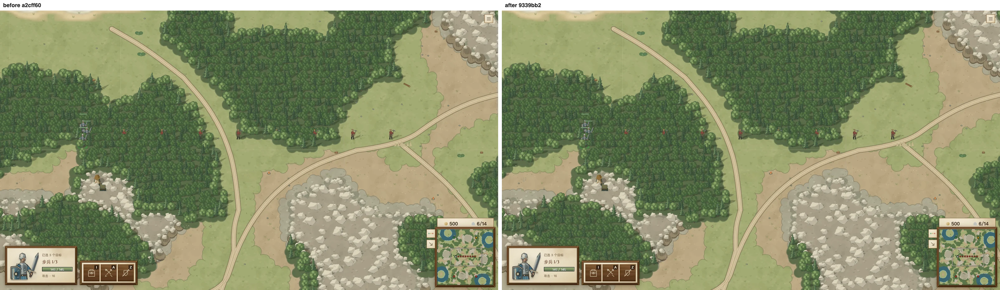
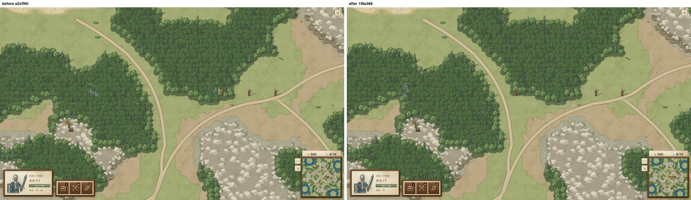
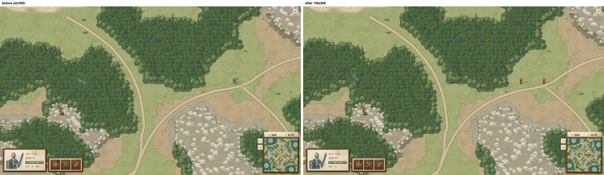

# 人类玩家的持久驻点

基准 `a2cff607`，实现和浏览器对照 `9339bb2a`。此次不跑胜率 benchmark。

人类单位保存独立的 `guardPosition`，出生、明确 move / attack-move 到达、stop、hold，以及集结、登船/卸载等指令完成时建立驻点。自动索敌、受击反击、换目标及自动返回都使用这个驻点。连续的小战斗可以继续，但不能逐次把追击原点向外推。

步兵沿用 600：这是已有自动追击距离，本次只修驻点漂移，不再扩大或缩小其作战区域。目标离开该区域、追击步进即将越界，或附近不再有可继续攻击的目标时，单位返回驻点。hold 不追；明确 attack 和 attack-move 继续不受此限制；野怪原有 home/leash 路径不变。舰队保留已有的 900 驻防距离和舰船运动规则，只让人类舰队的原点同样来自持久驻点。甲板驻点使用船体局部坐标，随船移动。

AI 名单由 sim 保留，并进入快照/恢复。SDK 的 internal-ai 和 external-agent 都是 AI 席位。AI 单位不生成新驻点，继续使用原来的每次交战原点；客户端没有绕过规则的分支。三组旧 AI 测试夹具补上了真实的 `ai: true` 身份，原断言保持不变。

`RULES_VERSION = 6`，接受规则 5 等旧存档、拒绝按新规则演算旧命令回放。旧存档没有驻点时，在第一次行动时以保存的位置初始化。新增持久驻点和人类席位身份进入校验和，因此 `CHECKSUM_VERSION = 21`；版本 20 的投影仍可读取，初始 golden 已有原因注释。全 AI 世界不增加这些字段，hash 数值保持不变。

## 回归和 AI 不变证明

`src/shared/sim/guard-position.test.ts` 的连续诱敌用例先在 main 上运行：单位最远离原位 **1410.5**，超过 600 而失败。实现后逐 tick 检查最大距离不超过 600，最终回到 8 以内；同文件覆盖新命令、连续换目标、受击、返回中再受击、队列、生产集结点、hold、明确攻击、驻塔、独立快照和旧存档。

`ai-guard-compatibility.test.ts` 重放以下基准记录。每份是实际房间 AI 的 2400 tick 对局，加入近距离接触部队以覆盖自动索敌/追击，保留普通采矿、生产和指令管线。三份均固定 main 产生的命令流，逐 tick 比较原校验和；不是比较当前两次运行，也没有重新跑当前 AI planner 来替换旧命令。

| 房间 AI | 对手 | main 命令数 | main 出现自动攻击的 tick | 校验和对比 |
| --- | --- | ---: | ---: | --- |
| v9_archer / grove | v8 / ember | 74 | 346 | 0–2400 全部相同 |
| v9_summoner / ember | v9 / ember | 68 | 235 | 0–2400 全部相同 |
| v9_knight / grove | v8 / ember | 74 | 35 | 0–2400 全部相同 |

共 7200 个演算 tick、含开局 7203 个 hash 比较。另有 external-agent 首 tick 的同值测试，防止外部 AI 被误认成人类。

房间 AI 的完整 `src/ai/bootstrap_1`：**181 个文件、2568 项全过**。相关 sim、存档、SDK、网络恢复、舰船和规范化校验和测试通过；三个双 AI 对局 / CPU 用例通过；`npm run build` 通过。

```sh
npx vitest run src/shared/sim/guard-position.test.ts src/shared/sim/ai-guard-compatibility.test.ts --maxWorkers 2 --minWorkers 1
npx vitest run --dir src/ai/bootstrap_1 --maxWorkers 2 --minWorkers 1
```

基准记录的生成脚本为 [capture-ai.mts](capture-ai.mts)。依次运行三个对局，不并行，不以胜负作门槛：

```sh
mkdir -p /tmp/guard-main
git archive a2cff607 src scripts package.json tsconfig.json | tar -x -C /tmp/guard-main
ln -s "$PWD/node_modules" /tmp/guard-main/node_modules
node --import tsx docs/validation/human-guard-position/capture-ai.mts /tmp/guard-main /tmp/guard-recordings
```

## mac1 的真实右键对照

`human-guard-position` 场景通过真实菜单建房；选择三名步兵后，由 Playwright 的真实右键鼠标事件发出 move，经 websocket 和房间输入延迟生效。八名敌方工人各向外移动 40，以连续的击杀和重新索敌诱走步兵。玩家单位的位置没有通过调试接口重写。

两边使用相同种子、命令、1600×900 视口、镜头 `(2125, 2050, zoom 0.7)`，观察 1200 tick。mac1 的浏览器以 `--use-angle=metal --enable-gpu` 启动。5 组前后图已逐张检查，开局和右键移动图像相同，后续战斗/驻点位置出现预期差异。

| 单位 | main 最远离驻点距离 | 修改后最远距离 | 修改后最终离驻点距离 |
| --- | ---: | ---: | ---: |
| guard-0 | 1401.65 | 538.13 | 4.41 |
| guard-1 | 822.46 | 546.62 | 5.73 |
| guard-2 | 805.16 | 534.59 | 3.96 |

浏览器距离每 24 tick 采样；独立诱敌单元测试逐 tick 验证 600 上限。数据见 [browser-summary.json](browser-summary.json)，完整轨迹和原图见 [browser.evidence.json](browser.evidence.json)。原始证据在 A100 的 `/codegeex/jeffry/sketch-rts-camps/human-guard-position/evidence`，取回时把机器配置的 `a100.evidence` 指向此目录。

右键命令到达后的原驻点，两边一致：



连续诱敌过程中，main 的部队向右追出，修改后仍围绕原驻点作战：



相同的最后镜头，main 的一名步兵已追到右侧，修改后的三人都回到原驻点附近：



```sh
SKETCH_MACHINES=~/.config/sketch/machines-camps.json bin/sketch shot human-guard-position --before a2cff607 --after 9339bb2a --on mac1 --locale zh-CN --out /tmp/guard-proof
```
