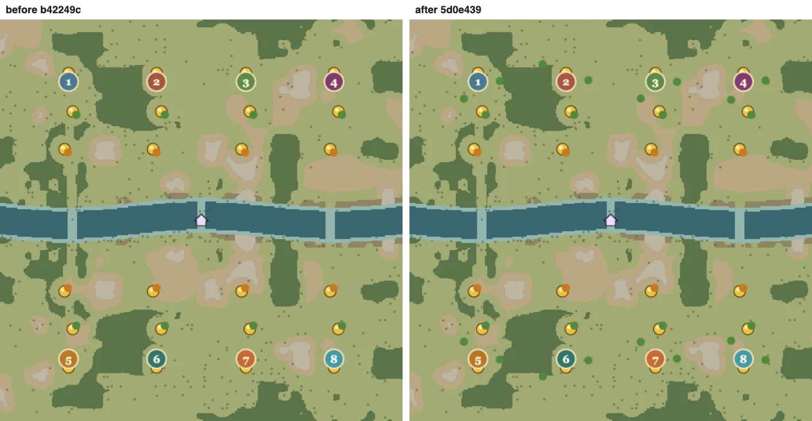
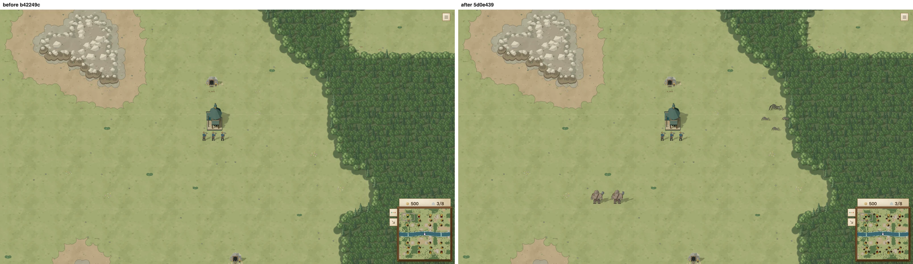
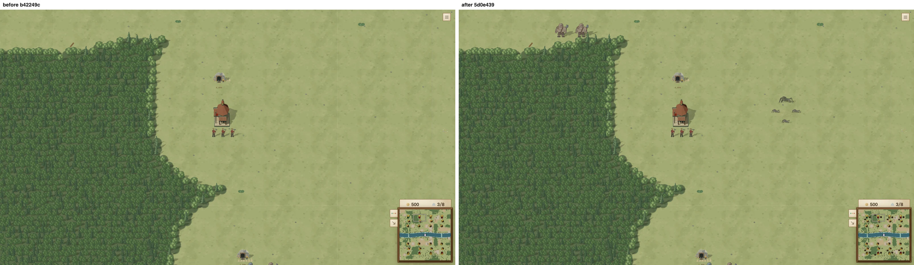

# 按玩家分配野怪营地

15 张地图实际生成后，八方河湾从 16 营地（每人 2）增至 32（每人 4），总强度 168 → 256。每个出生点现在都有至少两个步行 30 秒内的绿色营地；原来八方河湾、两张群岛图都没有开局绿营。

## 统计口径

`npx tsx scripts/map-camp-audit.ts` 走真实房间的席位和 `generateMap`。修改前来自 `origin/main`（b42249cb030664cd6af4b0f531d4fb5eafe123ae），修改后来自本分支。原始逐出生点结果见 [before.json](before.json)、[after.json](after.json)。

强度是实际生成的全部中立单位 `creepFoodPower` 之和，即营地等级总和；不把金矿储量当作野怪收益。每人营地/强度是全图总量除以玩家数。附近采用引擎 `walkingDistance` 的地形加权路程，按开局弓兵速度 60 换算：两分钟 7200 单位，30 秒 1800 单位。它不含战斗、建筑绕行和运兵船准备时间，隔海的营地不会被算成家门口的营地。

## 同表前后比较

所有箭头均为 main → 本分支；出生点列表依房间席位顺序排列。`密度` 表示修改前不足每玩家四营；`开局` 表示密度已够，但有出生点不足两个近处绿营。

| 地图 | 玩家 / 边长 | 原问题 | 营地 | 总强度 | 营地/人 | 强度/人 | 两分钟内各出生点营地 | 30 秒内各出生点绿营 |
|---|---:|---|---:|---:|---:|---:|---|---|
| 蓝宝群岛 `sapphireArchipelago` | 6 / 10240 | 密度 | 12 → 24 | 144 → 186 | 2 → 4 | 24 → 31 | 0/0/0/0/0/0 → 2/2/2/2/2/2 | 0/0/0/0/0/0 → 2/2/2/2/2/2 |
| 八方河湾 `grandEstuary` | 8 / 10240 | 密度 | 16 → 32 | 168 → 256 | 2 → 4 | 21 → 32 | 9/13/14/8/9/13/14/9 → 16/21/22/15/16/21/22/16 | 0/0/0/0/0/0/0/0 → 2/2/3/2/2/2/3/2 |
| 碎海 `brokenSea` | 4 / 7680 | 密度 | 8 → 16 | 56 → 84 | 2 → 4 | 14 → 21 | 0/0/0/0 → 2/2/2/2 | 0/0/0/0 → 2/2/2/2 |
| 神泉殿 `templeSpring` | 4 / 6656 | 开局 | 17 → 21 | 158 → 174 | 4.25 → 5.25 | 39.5 → 43.5 | 13/13/13/13 → 17/17/17/17 | 1/1/1/1 → 2/2/2/2 |
| 龟湖 `turtleLake` | 4 / 6144 | 密度 | 13 → 17 | 124 → 136 | 3.25 → 4.25 | 31 → 34 | 13/13/13/13 → 17/17/17/17 | 1/1/1/1 → 2/2/2/2 |
| 古木林 `elderwood` | 4 / 7168 | 达标 | 21 → 21 | 188 → 188 | 5.25 → 5.25 | 47 → 47 | 17/17/17/17 → 17/17/17/17 | 2/2/2/2 → 2/2/2/2 |
| 环海 `ringwater` | 4 / 6656 | 开局 | 17 → 21 | 184 → 196 | 4.25 → 5.25 | 46 → 49 | 13/13/13/13 → 17/17/17/17 | 1/1/1/1 → 2/2/2/2 |
| 孤市 `loneMarket` | 2 / 6656 | 密度 | 6 → 10 | 56 → 76 | 3 → 5 | 28 → 38 | 6/6 → 10/10 | 0/0 → 2/2 |
| 芦苇泽 `reedwater` | 2 / 5120 | 达标 | 9 → 9 | 66 → 66 | 4.5 → 4.5 | 33 → 33 | 9/9 → 9/9 | 2/2 → 2/2 |
| 雾丘 `veiledHill` | 2 / 4608 | 开局 | 8 → 10 | 78 → 84 | 4 → 5 | 39 → 42 | 8/8 → 10/10 | 1/1 → 2/2 |
| 灰岩隘口 `greystonePass` | 2 / 4608 | 密度 | 6 → 8 | 48 → 58 | 3 → 4 | 24 → 29 | 6/6 → 8/8 | 1/1 → 2/2 |
| 松影林 `pineshade` | 2 / 4608 | 开局 | 9 → 11 | 70 → 78 | 4.5 → 5.5 | 35 → 39 | 9/9 → 11/11 | 1/1 → 2/2 |
| 鸥岛 `gullIsland` | 2 / 6656 | 开局 | 9 → 11 | 94 → 106 | 4.5 → 5.5 | 47 → 53 | 7/7 → 9/9 | 1/1 → 2/2 |
| 静水原 `stillwater` | 4 / 7168 | 密度 | 12 → 20 | 136 → 160 | 3 → 5 | 34 → 40 | 12/12/11/11 → 19/19/17/17 | 0/0/0/0 → 2/2/2/2 |
| 双岸 `twoShores` | 4 / 7168 | 密度 | 11 → 19 | 124 → 160 | 2.75 → 4.75 | 31 → 40 | 8/8/8/8 → 16/16/15/15 | 0/0/0/0 → 2/2/2/2 |

## 各玩家实际就近分配

把每个陆路可达营地分配给步行路程最近的出生点；差距不超过一个地形格（32 单位）的并列者均分，因此可出现小数。不可从任何出生点步行到达的海岛营地另列，仍计入上一张表的全图均值。这里衡量地理机会，不代表实际对局所有权。

| 地图 | 各出生点分配营地 main → 修改后 | 各出生点分配强度 main → 修改后 | 需运兵营地 main → 修改后 |
|---|---|---|---:|
| 蓝宝群岛 | 0/0/0/0/0/0 → 2/2/2/2/2/2 | 0/0/0/0/0/0 → 7/7/7/7/7/7 | 12 → 12 |
| 八方河湾 | 2/2/2/2/2/2/2/2 → 4/4/4/4/4/4/4/4 | 21/21/21/21/21/21/21/21 → 32/32/32/32/32/32/32/32 | 0 → 0 |
| 碎海 | 0/0/0/0 → 2/2/2/2 | 0/0/0/0 → 7/7/7/7 | 8 → 8 |
| 神泉殿 | 3.33/3.33/3/3.33 → 4.33/4.33/4/4.33 | 24.67/24.67/20/24.67 → 28.67/28.67/24/28.67 | 4 → 4 |
| 龟湖 | 4/3/3/3 → 5/4/4/4 | 43/27/27/27 → 46/30/30/30 | 0 → 0 |
| 古木林 | 4.33/4.33/4/4.33 → 4.33/4.33/4/4.33 | 32.33/32.33/27/32.33 → 32.33/32.33/27/32.33 | 4 → 4 |
| 环海 | 3.33/3.33/3/3.33 → 4.33/4.33/4/4.33 | 31.33/31.33/26/31.33 → 34.33/34.33/29/34.33 | 4 → 4 |
| 孤市 | 3/3 → 5/5 | 28/28 → 38/38 | 0 → 0 |
| 芦苇泽 | 4.5/4.5 → 4.5/4.5 | 33/33 → 33/33 | 0 → 0 |
| 雾丘 | 4/4 → 5/5 | 39/39 → 42/42 | 0 → 0 |
| 灰岩隘口 | 3/3 → 4/4 | 24/24 → 29/29 | 0 → 0 |
| 松影林 | 4/5 → 5/6 | 27/43 → 31/47 | 0 → 0 |
| 鸥岛 | 3/4 → 4/5 | 23/39 → 29/45 | 2 → 2 |
| 静水原 | 3/3/3/3 → 5/5/5/5 | 32/33/35/36 → 38/39/41/42 | 0 → 0 |
| 双岸 | 2/2/2/2 → 4/4/4/4 | 21/21/17/17 → 30/30/26/26 | 3 → 3 |

## 原因与统一修法

- 八人 `riverValley` 走独立的 `estuaryMap`，每个出生点只创建一个橙色自然矿守卫和一个红色前线矿守卫。10240 的大地图没有补充开局营地。它绕过了普通 `sidesLayout` 的绿营逻辑，因此只改普通 sides 参数无法修复。
- 群岛生成器同样只创建中央/卫星矿守卫，出生岛上没有野怪；普通布局按路径尝试安放绿营，放不下就跳过，也没有数量或局部下限。地图更大本身不会增营。
- 现在三种生成路径都经过 `ensureCampBudget`：先给每个出生点补齐 1800 步行单位内至少两个绿营（营地还须离本家最近，不能借邻居的营地满足本家配额），再补足全图至少每玩家四营。保留矿守卫和争夺营地；连通环图整体旋转、对岸布局逐条战线镜像，隔海出生岛各自在可达土地上放置，共享开局轮次的兵种组合。
- 所有新增营地使用现有模板、完整兵组、确定性种子、480 营地间距，以及出生点/矿区安全距离。生成器验证营地中心和成员都能步行到本家，且不占主堡高台；普通布局不满足时重试整张图。较小出生岛半径下限从 480 增至 640，为同一开局规则留地。
- 随机选择出的八人河谷现在也走独立河湾生成器，与显式 `riverValley` 一致，避免尝试塞入仅能容纳四人的高台布局。没有地图 ID 特判，也未修改 AI。

## 验证

新增 `generated-camp-budget.test.ts` 在 main 的初始 15 张地图检查中 13 失败、2 通过；失败包括八方河湾的 16 < 32。它验证全图数量、逐出生点近处绿营、所有单位落点；另外覆盖 2–8 席的新种子、随机选出的八人河谷和重复生成一致性；该测试与地图哈希测试已加入 PR 的 Simulation CPU Check。最终八个相关测试文件共 74 项通过，`npm run build`（含 `tsc --noEmit`）通过。另对 44 张新种子地图做过生成压力检查。已有整图哈希已明确更新，守矿测试继续验证每个扩张矿有完整且等强的守卫。

AI 的 240 局配对结果：总胜场 164 → 157（对 v8 持平，对 v9 少七场），49 局赢输直接互换、38 局涉及超时/无胜者变化；逐局翻转与 clear、bases@8 见 [bench.md](bench.md)。地图统计是主要证据，因为 room bench 的随机 ladder 图不包含命名的八方河湾。

截图场景为 `tools/cli/scenes/camp-budget.ts`：地图选择页概览，以及前两个出生点相同中心、相同 0.65 缩放的暂停开局画面。

## mac1 画面对照

源版本 main `b42249cb`，修改后 `5d0e4398`，语言 zh-CN，桌面 1600×900；左右均为同一静止开局。概览直接复制游戏实际绘制的 512px 地图预览到 700px 检查窗口；两个特写均以出生点朝地图中心偏移 100 单位、缩放 0.65，摄像机算法和出生点坐标在前后保持一致。已逐张检查，矿区与林线对齐，两个出生点都能看到新增的两个营地。

