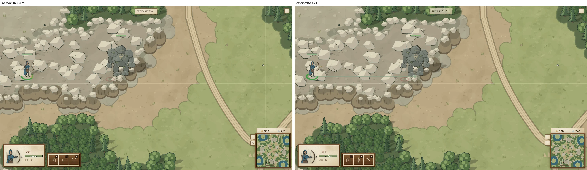
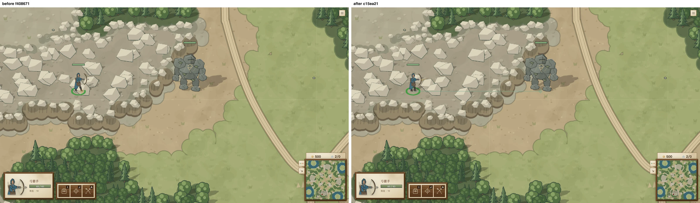
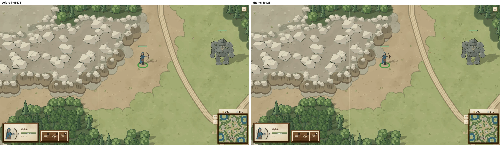

# 远程瞄准射程缓冲

远程单位开始追踪目标后，可以在普通射程的 125% 内站定完成当前一发。起手、索敌和下一发仍用普通射程；换目标、点地预瞄都不能借用上一目标的缓冲。目标越出缓冲后照常追击，自己的移动仍会按原来的容差清除瞄准。所有玩家和 AI 共用这一规则。

`weaponRules(...).aimRangeBuffer` / `SHIP_WEAPONS[kind].aimRangeBuffer` 默认 `0.25`，`0` 可关闭。25% 给弓手 80 码的瞄准余量，足以避免刚越过射程就迈步、超过 6 码后重置准心的循环；起手和每次射出后的再次瞄准保持原射程，因此它不是永久加射程。

舰炮使用各自炮位、老兵修正射程和独立目标锁。普通射程内保留既有的边航行边瞄准，只在当前瞄准目标越出普通射程、仍在缓冲内时暂停额外追击。炮位死区、射界、友船遮挡、舰体瞄准点和未来射击站位的准入射程保持原条件。投石车和迫击炮保留原最小射程、弹道、伤害及溅射半径。技能施法距离不扩张。

## 回归

`src/shared/aiming-range-buffer.test.ts` 用明确攻击命令追击后退近战单位。控制后退速度为 24，专门隔离瞄准取消和双方本身速度差异；200 tick 共 10 秒。

| 控制者 | main bb757c59 箭数 / 中断 | 修改后箭数 / 中断 | 修改后射击 tick |
|---|---:|---:|---|
| 人类 | 0 / 25 | 4 / 0 | 21、73、125、176 |
| AI | 0 / 25 | 4 / 0 | 21、73、125、176 |

同一测试文件复制到实际 main 源码上，按测试名筛选，两条追击测试都失败，见 [main 原始日志](regression-main.log)。额外覆盖 attack、attackMove、hold、换目标、预瞄点、越出缓冲、武器参数关闭，以及投石车和舰炮的射程边界、死区、射界、友军遮挡、存档恢复。

`RULES_VERSION = 7` 接受规则 6 等旧存档，跨规则命令回放仍拒绝。单位及炮位的 `aim.targetId` 持久保存，因此独立将 `CHECKSUM_VERSION` 升为 22；版本 21 的投影只删除这个新字段，保留其原有驻守点与人类席位身份。旧剧情存档的校验仍使用旧格式。新开局没有 aim，初始 golden 不变。

先前的人类驻守规则留下的全 AI 固定命令流回归，显式关闭这个后续战斗缓冲、使用版本 21 校验和投影，继续独立验证驻守规则不影响 AI；本次新测试另行验证缓冲确实对 AI 生效。

## mac1 真浏览器对照

```sh
SKETCH_MACHINES=~/.config/sketch/machines-camps.json \
  bin/sketch shot ranged-aim-buffer --before f408671c --after HEAD \
  --on mac1 --locale zh-CN --out /tmp/ranged-aim-shot-open --json
```

真实房间和 GPU 浏览器，选择弓手后用 Playwright 的右键事件点敌人，断言服务器收到对应攻击命令；敌方石像沿固定方向撤退。两种单位都用原始游戏属性（弓手速度 60，石像速度 42）。两侧都在相同 tick 截取同一镜头。GPU 为 `ANGLE Metal Renderer: Apple M3 Ultra`，没有软件渲染。五组图全部逐张看过。

左侧 main，右侧修改后；起始图完全一致。第 12、74 tick 的右侧可看见完成的射击，后续图显示同一条追击路线。实际浏览器的 240 tick 记录、显卡信息见 [visual/browser-proof.json](visual/browser-proof.json)。







另附 [起始](visual/selected-before-attack-desktop.webp) 和 [第 180 tick](visual/pursuit-180-desktop.webp)。

## 旧平衡场景

默认 v2 ladder 对局重新出现历史僵持。沿 AI Lane 在 `e2600b46` 中的口径，测量后半程 tick 30000–60000：同一单位被另一脚本在 60 tick / 3 秒内改写实际命令，且 600 内没有任何敌方单位或建筑。观测到 attackWave → skirmishPreservation 75 次，反向 270 次，见 [原始数据](v2-thrash.json)。依总指挥要求改回 `it.fails`，保留原有胜利、交战和 CPU 断言。

骑射测试原意是花费真实资源的两名骑射能解决六名追兵；本次缓冲改变站定和接触时机，镜像 Ravager 场景受到一次 20 血伤害。依总指挥要求允许这一很小的总损失上限，保留全歼、两骑存活、零阵亡、实际花费和其他近战样例无伤保证。

主页森林会战仍保持 seed 1 军队胜、seed 4 野怪从落后翻盘。缓冲改变精确第 20 秒的领先方，因此改为检查此前确实一度落后；两种最终胜负要求完整保留。

回防旧失败已定位：#546 前的重放结束时，当前回防名单有 18 人，其中两个火花射手不在原 19 人名单内，距驻点 807.28 / 969.46、`arrived:false`。测试只移动原 19 人，仍有这两个增援未到场，故保持 gather 符合原规则。#546 后当前任务已自然释放，原测试原样通过；本 PR 撤回了那段测试收尾修改。原始测量见 [rally-cohort.json](rally-cohort.json)。

三矿时限在 rebase 到 `f408671c`（#546）后重新量过；本 PR 完整保留其断言，等待叠加的 AI 适配 PR。实际 main 与同源码零缓冲控制组的数据一致，见 [实际 main](expansion-main.jsonl) 和 [缓冲控制组](expansion-buffer-controls.jsonl)。

| 时点或阶段 | main f408671c / 零缓冲 | 默认 25% |
|---|---:|---:|
| 二矿落基 | 237.30 秒 | 262.35 秒 |
| 三矿落基 | 386.25 秒 | 415.90 秒 |
| 三矿完成 | 414.50 秒 | 443.90 秒 |
| 二矿集结 | 81.75 秒 | 104.25 秒 |
| 二矿清营 | 16.50 秒 | 17.25 秒 |
| 二矿护送至落基 | 15.25 秒 | 17.05 秒 |
| 开局死亡 | 0 人 | 0 人 |

二矿慢 25.05 秒，主要在集结多了 22.5 秒，超过 4:00 线 22.35 秒；三矿落基慢 29.65 秒，超过 6:30 线 25.9 秒；7:30 完成线仍满足。#546 之前的额外两人死亡已经不适用于当前对局，未将旧原因沿用。

普通 verdant 镜像更早结束，清营地有部队控制时，双方现金最多只有 112.98 / 113，低于 160 招募费，所以没有雇佣机会；佣兵脚本仍实际发出前往营地命令。参战回归现在将一个仅售一名佣兵的营地放到初始驻军旁，并仅补足这一笔招募费用。AI 必须自己雇佣、库存必须售罄、佣兵必须击杀；胜利、双方消费、互有伤亡、野怪击杀、CPU 预算等原断言保留。原始查询见 [mercenary-probe.jsonl](mercenary-probe.jsonl)。

撤退的 4 名火花射手仍全员到家，因敌弓手完成已有瞄准，受伤总计 65，上限按审阅要求设为 80；骑射击杀追击女巫时受一击 8，上限设为 10。保留全员存活、零阵亡、原野怪营地未被惊动、实际击杀和费用要求，未改 AI 生产逻辑。
