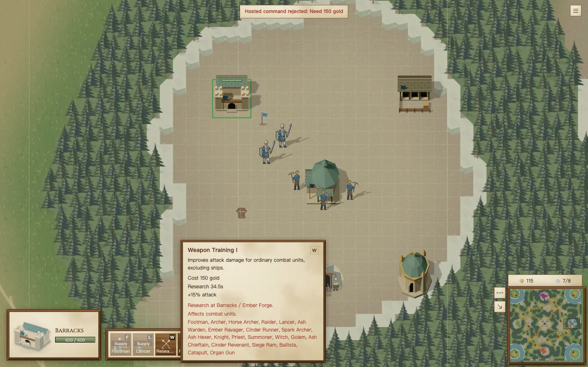
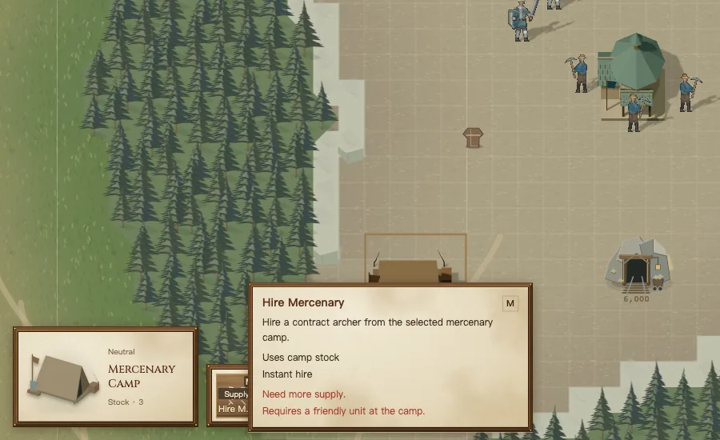
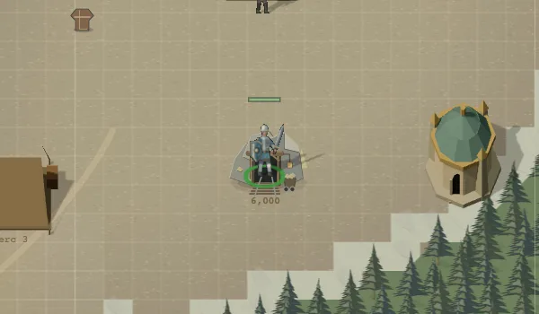
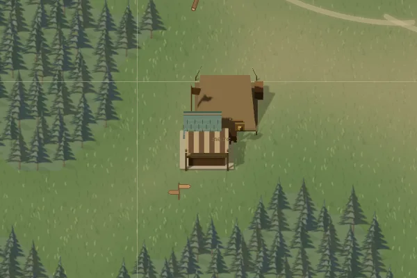
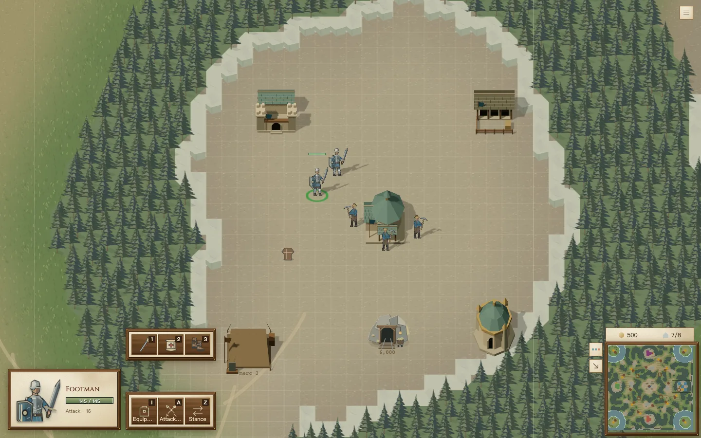

# 玩法交互复现报告（2026-10-17，main 13d0a870）

复现环境是 mac1 上的真实浏览器（无头 Chrome，1440×900）。对局是服务器房间，地图 templeSpring。场景通过房间 reset 的 scenario 摆出来：两个步兵，其中一个带着物品，另外有兵营、马厩、圣所和一个雇佣兵营地。脚本放在 `rig/` 下：
- `start.js` 走真实菜单开房；
- `scene.js` 用来摆场景；
- `act.js` 负责点击和截图；
- `probe-collide.ts` 和 `probe-attack.ts` 是无头 sim 的探针，每张池图和每个兵种都跑一遍。

按根因的清楚程度和改动大小排，建议的处理顺序是：5 攻速 → 2 科技钱不够 → 3 雇佣兵营地 → 4 碰撞 → 1 物品栏。

---

## 5. 骑士换目标时连续出手（攻速）

**现象（已复现）。** 用 `rig/probe-attack.ts`：骑士贴着敌人 A，敌人 B 在 240 外，逐 tick 记录每一次出手。

| 兵种 | 攻击冷却 (tick) | 两次出手的最小间隔 | 结果 |
|---|---|---|---|
| knight | 26 | **9** | 先打 A（tick 2），9 tick 后冲到 B 再打一下（tick 11，伤害 ×2） |
| raider | 20 | **9** | 同上 |
| footman / archer / horseArcher | 22 / 30 / 30 | 等于冷却 | 正常 |

**根因。** 冲锋的撞击是一次绕开武器冷却的出手。`updateChargeOrder`（`src/shared/sim.ts:2586`）在够得着的那个 tick 直接结算伤害，没有看 `unit.cooldown`，打完才把冷却重置。另外它重置时用的是 `unit.attackCooldown`，其他出手路径都用 `attackCooldownOf()`，这里没有算嗜血和老兵加速。普攻、攻击移动、驻守、换目标这几条路径都正确地查了同一个 `unit.cooldown`，所以问题不在"换目标"，而在冲锋。只要 A 死掉或 B 打到骑士，B 就会落进 180–300 的冲锋窗口，自动施放的冲锋随即开始。

**修法。** 冲锋撞击也走单位自己那一个武器冷却：冷却没走完就停在原地，等冷却好了再撞。冷却的重置统一用 `attackCooldownOf`。测试的写法是：两个目标之间，任意两次出手的间隔都不小于攻击冷却，并覆盖骑士、突袭骑兵、步兵、弓箭手、骑射手。
**会影响平衡**，修好后请父会话在 A100 上跑房间 AI 评测，对比修复前后的结果。

## 2. 钱不够时点科技升级

**现象（已复现）。** 金 115，点兵营的武器训练（150 金）：
- 按钮一直亮着，提示框里没有"金子不足"；
- 状态栏先显示"Weapon Training started."，随后被服务器回包盖掉，变成未翻译的 `Hosted command rejected: Need 150 gold`；
- 单机（本地 worker）模式下顺序正好反过来："Need 150 gold"先写进状态栏，随即被下一行的 "started." 覆盖，玩家只会看到"已开始"。研究队列里什么也没有，金子也没扣；
- 同一个界面上，训练兵种的按钮在钱不够时会变灰，显示"金"。

**根因。** 按钮能不能点，客户端是按命令类型各写一份判断：
- 训练用 `trainCommandState`；
- 雇佣用 `mercenaryHireCommandState`；
- 研究只看"能不能研究"（`main.ts:370`），没有任何费用判断。

sim 那边是一个权威校验 `checkCommandLegality`，客户端的这几份只是它的手抄副本，漏了的就出错。另外 `research()`（`main.ts:2661`）不看 `sendCommand` 的返回值，直接写"已开始"。

**修法。** 让 `checkCommandLegality` 的错误带上原因代码，比如 gold、supply、tier、stock、cooldown、position。客户端所有经济类按钮（训练、研究、雇佣、购买）的可用状态都从它推出来，删掉客户端的手抄判断。命令被拒时一律显示本地化的原因，不再报告成功。这一处改动同时修好了第 3 项里"雇佣距离对不上"的问题。参考 War3：按钮变灰，提示框写明缺多少钱；硬点的话，给出"金子不足"提示和音效。

## 3. 雇佣兵营地的说明和实际规则不一致

**现象（已复现）。** 图中这个营地卖的是"雇佣兵"（160 金，2 人口），提示框却写"雇佣一名契约弓手"。templeSpring 上 4 个营地卖的都是战地医师，提示框写的也是契约弓手。全部不一致的地方：
1. 雇佣说明写死成"契约弓手"（`i18n.ts:143/441`），不读营地的 `hireKind`；
2. 按钮和面板上都不显示单价、兵种、库存规则；面板只有"库存 · 3"；
3. 说明写的是"补货中"，实际库存**永远不会补**，计时器只是两次雇佣之间的间隔（`sim.ts:1257`）；
4. 客户端判断"身边有友军"用的是写死的 100（`main.ts:2882`），规则是 `MERCENARY_HIRE_RANGE` = 220。所以距离在 100 到 220 之间时，按钮是灰的，但服务器其实会接受；
5. 冷却显示成"N ticks"；
6. 雇来的兵和召唤物共用一条说明，读起来像是会过期。

**根因。** 规则数据是按营地存的（`hireKind`、`cost`、`stock`、`cooldown`），说明文字却是手写的一份，描述的是一个想象中会补货的契约弓手营地。商店按钮已经是从数据生成说明的（`SHOP_GOODS`），营地没有这样做。

**修法。** 营地的按钮、提示框和面板全部从选中营地的数据生成（兵种名、价格、人口、剩余库存、下次可雇时间、雇佣距离），距离判断直接调用共享的 `unitControlsMercenaryCamp`。
**需要你定：** 库存应该补吗？War3 的雇佣兵营地是按时间补货的，这里的规则是卖完就没了。我默认的做法是让说明照实写"不补货"。如果要补货，那是规则改动，会影响 AI，我另开 PR。

## 4. 商店、营地、金矿的碰撞

 

**现象（已复现，全部 15 张池图）。** 用 `rig/probe-collide.ts` 跑出来的结果（`rig/probe-collide.json`）：
- **单位能穿过金矿、商店和营地**：每张图上、每一个这类建筑，都能让一个农民径直从中心穿过去（最近距离 1，半径是 40–50）。第一张图是步兵站在金矿上。
- **能把建筑造在商店和营地上**：所有有商店或营地的图都能在上面放农场。金矿是挡着的，不能造。
- **地图生成时会重叠**：templeSpring 的 4 组商店和营地都叠在一起（中心距 69，两个半径加起来是 90），第二张图就是。

**根因。** 统一的实体模型（`@@@building-body`、`@@@building-pathing`）只把 `game.buildings` 和 `game.obstacles` 写进占地层（`syncBuildingBodies`，`sim.ts:882`）。金矿、商店和营地各自放在单独的集合里，没有占地，也不参与身体碰撞。其中：
- 金矿的"占地"只是两处特判的圆：一处在造建筑时检查，一处在出兵点检查；
- 商店和营地在放置检查里完全不存在；
- 地图生成时，商店不参加任何"放得下"检查（`generated-map.ts:469`）。

**修法。** 把这三种建筑也纳入同一套"占地 + 身体"模型，作为占地格写进 `setBuildingBodies`，放置检查也统一按占地格做。这样可以删掉 `resourceBlocksPlacement` 这个特判。地图生成时把商店加进放置检查。
**需要你定：** 三种都做成实心吗（War3 就是这样，农民在金矿边上采）？代码注释写着商店是"故意不挡路"的。我推荐三种都做成实心。金矿变成实心后，采矿的站位会变，所以要用 mining 测试和 A100 的 AI 评测确认经济和 AI 强度没有退步。

## 1. 物品栏位置和物品操作

**现象（已复现）。**
- **物品栏浮在空中**：选中带物品的步兵，物品条和命令条之间隔了一整行空白。原因是命令区按两行预留了布局高度（`--hud-command-height`），但只画了一行，物品条贴的是预留区的顶端，而不是看得见的命令框（`battle-hud.css:27-29,91-97`）。所以命令有几行，物品条就在哪里，选中的单位不同，它的位置就不同。
- **物品条按"物品"列出，而不是按"格子"**：已经穿在身上的被动装备（速度之靴）也占一个格子和数字键，按下去只提示"是被动的"。物品一变，后面物品的编号就跟着变。最多显示 6 个，但单位一共有 7 个格子。
- **不能把物品交给其他单位**：sim 允许 72 范围内的单位互相转交，但装备面板一次只显示一个单位，"转移 ⇄"按钮只对船有效，对步兵点了只会报错。
- **不能交换**：拖到有东西的格子上会被拒绝，换一次位置要三步。
- **丢弃**：要么在物品条上右键（很难发现），要么在面板里选中后点按钮；落点固定在单位身旁，不能拖到地上；sim 也不检查丢弃距离（`sim.ts:2356`）。
- **使用**：会先把物品切到右手；目标不在射程时什么都不发生，也没有提示（`sim.ts:2837`）。

**根因。** 物品条没有自己的布局位置，挂在命令区的预留高度上；物品条的内容是"物品列表"，不是"格子"。几种操作各自实现在面板、物品条、快捷键三处，规则不一致。

**修法（建议）。**
- 物品条做成固定的格子：位置固定、只列手持格、格子号就是快捷键、空格子也显示。参考 War3 头像旁边的 2×3 物品栏。
- 支持拖到格子上交换，拖到友军单位上转交，拖到地上丢弃（服务器检查距离）。
- 使用时目标超出射程，就先走过去再用，和技能一样。

视觉样式归 Art Lane（它的界面批次会改 HUD 按钮）。我只动位置和交互，开工前会先和它对齐。
**需要你定：** 范围是全做，还是先做"固定格子 + 位置"这一批？
